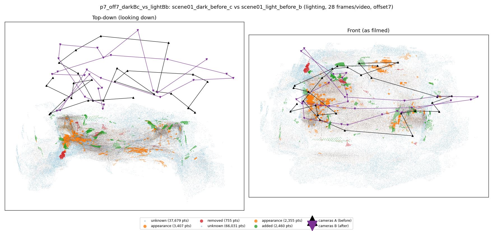
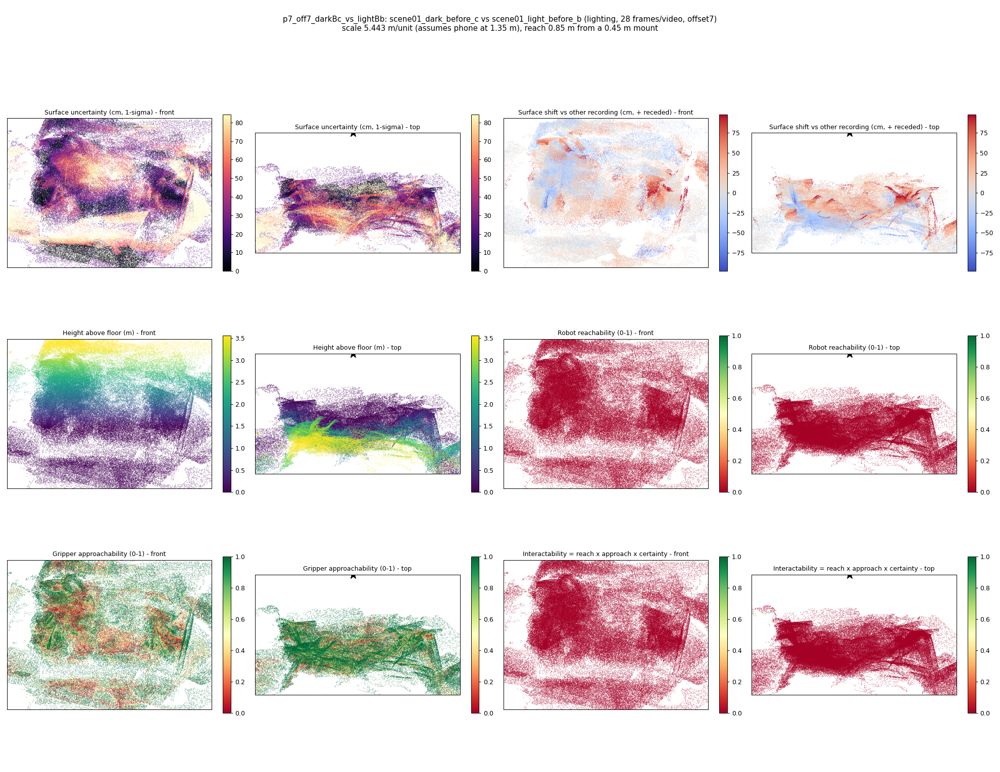

# p7_off7_darkBc_vs_lightBb

**scene01_dark_before_c** (A, before) vs **scene01_light_before_b** (B, after) - pair type **lighting**, 28 frames per video, variant `offset7`.

Distances are in cm, from a floor fit and an assumed phone height (scale 5.4425 m/unit, range [4.4347, 6.4504]).

| Measure | Value |
|---|---|
| Observed share (A / B) | 87.3% / 77.8% |
| Changed share of observed points (A / B) | 1.60% / 2.08% |
| Alignment residual across / within recordings | 0.0526 / 0.0509 |
| Thresholds (depth tau, see-through fraction, appearance) | 0.15226 / 0.75 / 0.91567 |
| Changes (moved / removed / added / appearance) | 0 / 0 / 0 / 1 |
| Reconstruction time | 27.5 s (GPU peak 9.57 GB) |

Nothing was moved between these recordings, so every flagged point is a false change: **false-change rate 1.84%**.

Heat maps (recording B): reachable 0%, approachable 52%, interactable 0%; surface uncertainty median 24.16 cm (90th pct 71.434); surface shift 99th pct 98.044 cm.

## Changes

- **0 appearance** glass vase (p=0.284, 1821 pts, centroid +/- 0.053): The glass vase looks different (turned over, deformed or swapped) but occupies the same place.
