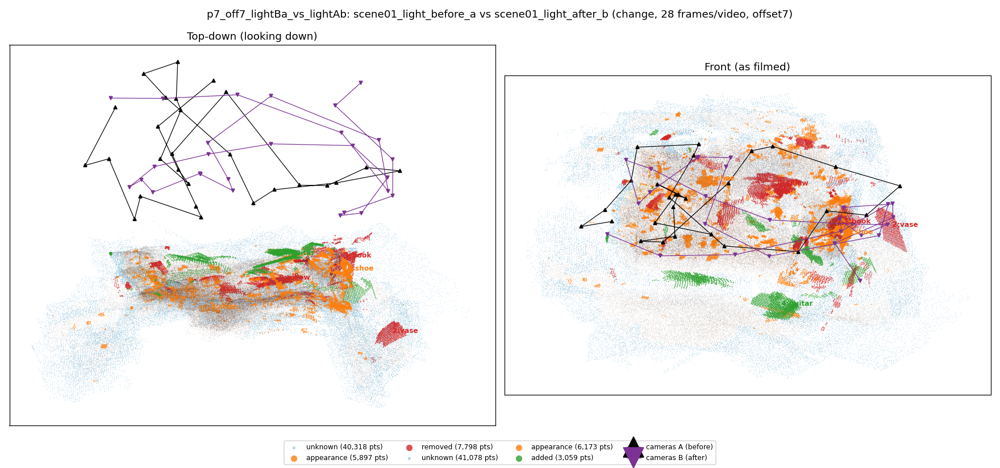
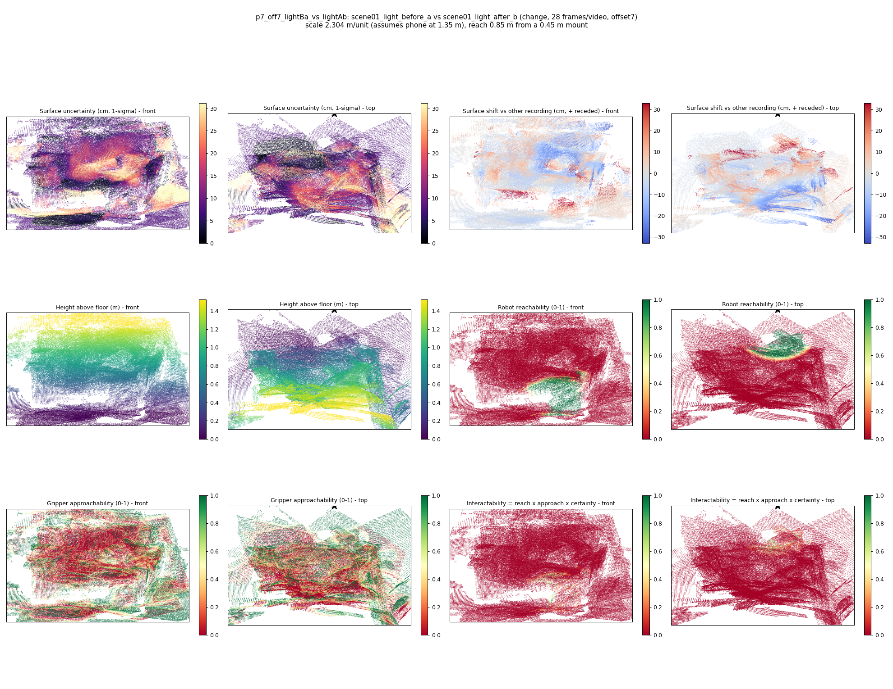

# p7_off7_lightBa_vs_lightAb

**scene01_light_before_a** (A, before) vs **scene01_light_after_b** (B, after) - pair type **change**, 28 frames per video, variant `offset7`.

Distances are in cm, from a floor fit and an assumed phone height (scale 2.3038 m/unit, range [1.8772, 2.7305]).

| Measure | Value |
|---|---|
| Observed share (A / B) | 86.4% / 86.2% |
| Changed share of observed points (A / B) | 5.33% / 3.60% |
| Alignment residual across / within recordings | 0.0428 / 0.0364 |
| Thresholds (depth tau, see-through fraction, appearance) | 0.10881 / 0.83333 / 0.8811 |
| Changes (moved / removed / added / appearance) | 0 / 3 / 1 / 2 |
| Reconstruction time | 25.8 s (GPU peak 9.57 GB) |

Heat maps (recording B): reachable 4%, approachable 31%, interactable 0%; surface uncertainty median 7.694 cm (90th pct 25.566); surface shift 99th pct 32.82 cm.

## Changes

- **0 removed** pillow (p=0.426, 2801 pts, centroid +/- 0.032): A pillow that was there in the first recording is no longer there.
- **5 appearance** shoe (p=0.608, 1963 pts, centroid +/- 0.032): The shoe looks different (turned over, deformed or swapped) but occupies the same place.
- **1 removed** book (p=0.188, 1398 pts, centroid +/- 0.032): A book that was there in the first recording is no longer there.
- **4 added** guitar (p=0.986, 1287 pts, centroid +/- 0.032): A guitar appears in the second recording that was not there before.
- **2 removed** vase (p=0.093, 765 pts, centroid +/- 0.032): A vase that was there in the first recording is no longer there.
- **3 appearance** shoe (p=0.252, 596 pts, centroid +/- 0.032): The shoe looks different (turned over, deformed or swapped) but occupies the same place.
