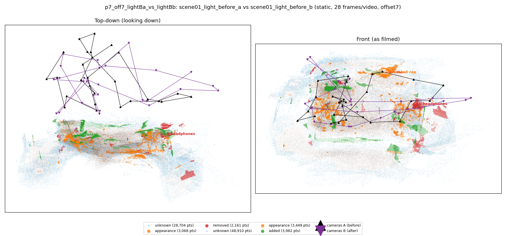
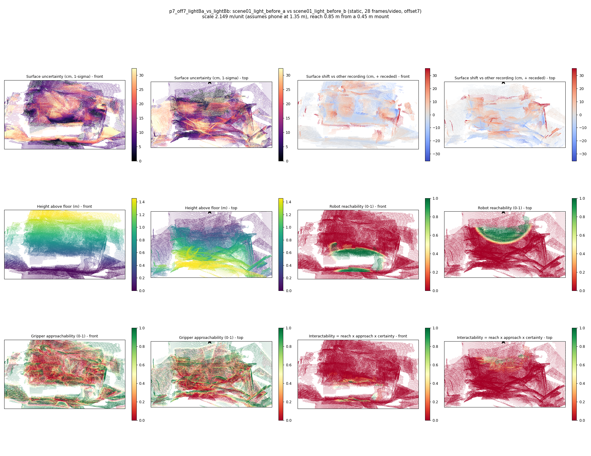

# p7_off7_lightBa_vs_lightBb

**scene01_light_before_a** (A, before) vs **scene01_light_before_b** (B, after) - pair type **static**, 28 frames per video, variant `offset7`.

Distances are in cm, from a floor fit and an assumed phone height (scale 2.1486 m/unit, range [1.7507, 2.5465]).

| Measure | Value |
|---|---|
| Observed share (A / B) | 90.3% / 83.5% |
| Changed share of observed points (A / B) | 1.95% / 2.99% |
| Alignment residual across / within recordings | 0.0393 / 0.0361 |
| Thresholds (depth tau, see-through fraction, appearance) | 0.10845 / 0.83333 / 0.89383 |
| Changes (moved / removed / added / appearance) | 0 / 1 / 1 / 2 |
| Reconstruction time | 25.7 s (GPU peak 9.57 GB) |

Nothing was moved between these recordings, so every flagged point is a false change: **false-change rate 2.47%**.

Heat maps (recording B): reachable 9%, approachable 33%, interactable 1%; surface uncertainty median 9.789 cm (90th pct 27.918); surface shift 99th pct 35.316 cm.

## Changes

- **2 added** blanket (p=0.113, 835 pts, centroid +/- 0.033): A blanket appears in the second recording that was not there before.
- **1 appearance** baseball cap (p=0.521, 717 pts, centroid +/- 0.033): The baseball cap looks different (turned over, deformed or swapped) but occupies the same place.
- **3 appearance** shoe (p=0.115, 702 pts, centroid +/- 0.033): The shoe looks different (turned over, deformed or swapped) but occupies the same place.
- **0 removed** headphones (p=0.074, 679 pts, centroid +/- 0.033): A headphones that was there in the first recording is no longer there.
