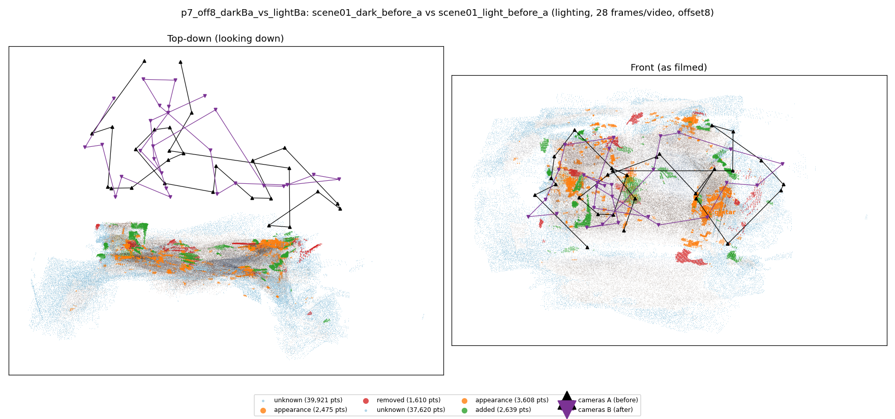
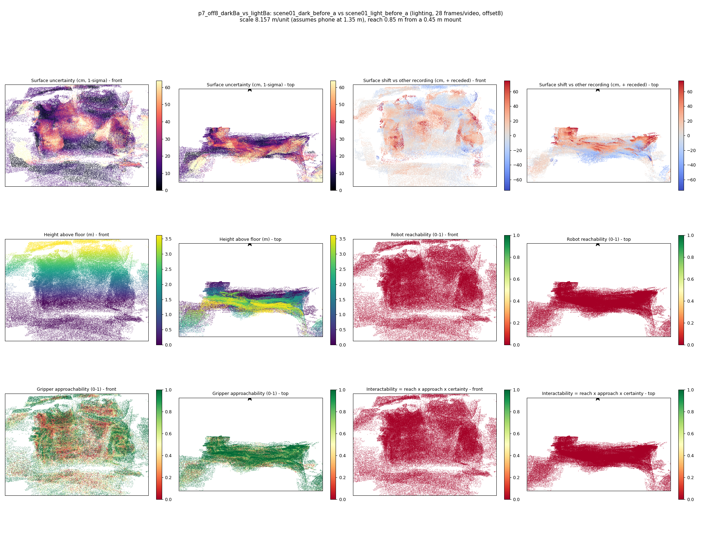

# p7_off8_darkBa_vs_lightBa

**scene01_dark_before_a** (A, before) vs **scene01_light_before_a** (B, after) - pair type **lighting**, 28 frames per video, variant `offset8`.

Distances are in cm, from a floor fit and an assumed phone height (scale 8.1571 m/unit, range [6.6465, 9.6677]).

| Measure | Value |
|---|---|
| Observed share (A / B) | 86.6% / 87.4% |
| Changed share of observed points (A / B) | 1.58% / 2.40% |
| Alignment residual across / within recordings | 0.0403 / 0.0394 |
| Thresholds (depth tau, see-through fraction, appearance) | 0.11799 / 0.75 / 0.90088 |
| Changes (moved / removed / added / appearance) | 0 / 0 / 0 / 1 |
| Reconstruction time | 27.6 s (GPU peak 9.57 GB) |

Nothing was moved between these recordings, so every flagged point is a false change: **false-change rate 1.99%**.

Heat maps (recording B): reachable 0%, approachable 51%, interactable 0%; surface uncertainty median 15.63 cm (90th pct 47.622); surface shift 99th pct 74.725 cm.

## Changes

- **0 appearance** guitar (p=0.993, 715 pts, centroid +/- 0.028): The guitar looks different (turned over, deformed or swapped) but occupies the same place.
