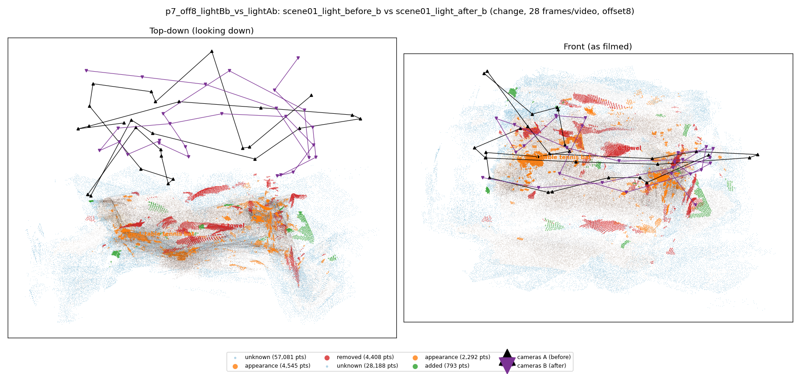
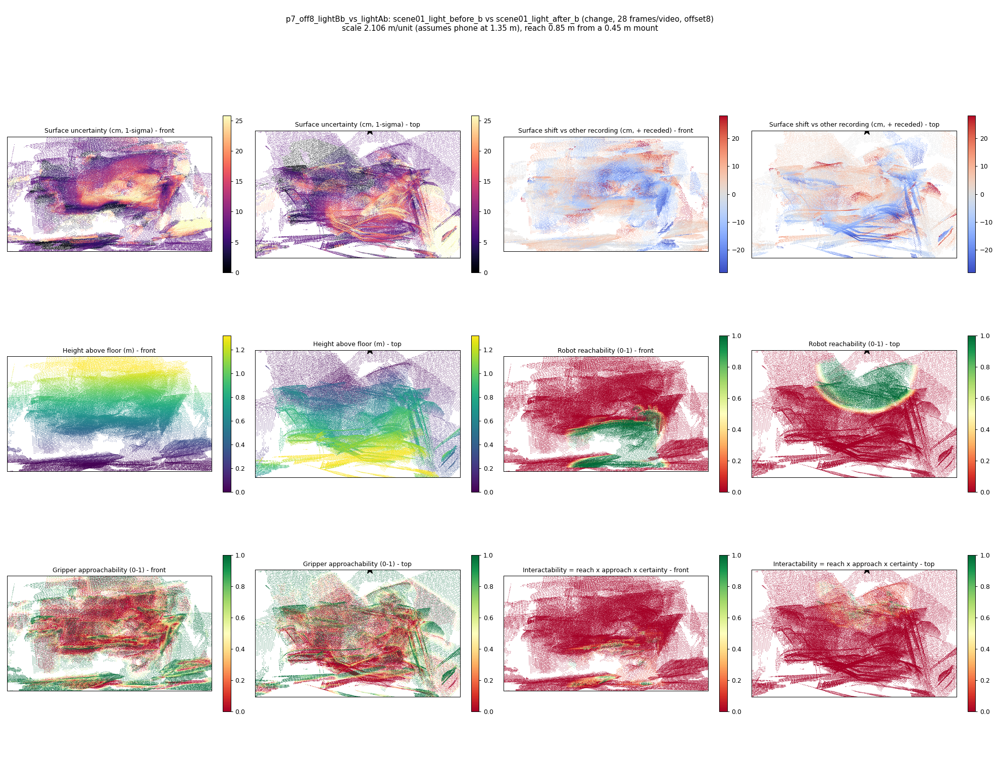

# p7_off8_lightBb_vs_lightAb

**scene01_light_before_b** (A, before) vs **scene01_light_after_b** (B, after) - pair type **change**, 28 frames per video, variant `offset8`.

Distances are in cm, from a floor fit and an assumed phone height (scale 2.1062 m/unit, range [1.7162, 2.4963]).

| Measure | Value |
|---|---|
| Observed share (A / B) | 80.8% / 90.5% |
| Changed share of observed points (A / B) | 3.73% / 1.15% |
| Alignment residual across / within recordings | 0.0525 / 0.0524 |
| Thresholds (depth tau, see-through fraction, appearance) | 0.15799 / 0.75 / 0.91536 |
| Changes (moved / removed / added / appearance) | 0 / 1 / 0 / 1 |
| Reconstruction time | 27.3 s (GPU peak 9.57 GB) |

Heat maps (recording B): reachable 15%, approachable 33%, interactable 1%; surface uncertainty median 7.425 cm (90th pct 21.057); surface shift 99th pct 28.163 cm.

## Changes

- **1 appearance** table tennis bat (p=0.986, 2193 pts, centroid +/- 0.049): The table tennis bat looks different (turned over, deformed or swapped) but occupies the same place.
- **0 removed** towel (p=0.078, 680 pts, centroid +/- 0.049): A towel that was there in the first recording is no longer there.
