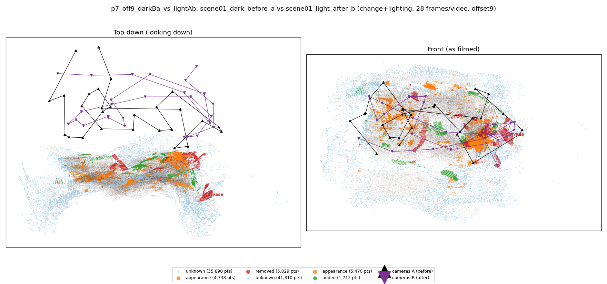
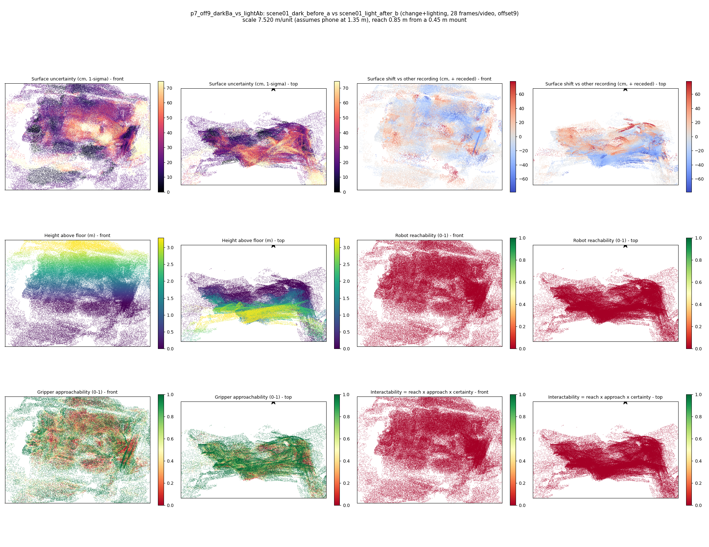

# p7_off9_darkBa_vs_lightAb

**scene01_dark_before_a** (A, before) vs **scene01_light_after_b** (B, after) - pair type **change+lighting**, 28 frames per video, variant `offset9`.

Distances are in cm, from a floor fit and an assumed phone height (scale 7.5204 m/unit, range [6.1278, 8.9131]).

| Measure | Value |
|---|---|
| Observed share (A / B) | 87.9% / 86.0% |
| Changed share of observed points (A / B) | 3.73% / 2.81% |
| Alignment residual across / within recordings | 0.0537 / 0.0494 |
| Thresholds (depth tau, see-through fraction, appearance) | 0.14835 / 0.66667 / 0.90685 |
| Changes (moved / removed / added / appearance) | 0 / 2 / 0 / 3 |
| Reconstruction time | 27.3 s (GPU peak 9.57 GB) |

Heat maps (recording B): reachable 0%, approachable 50%, interactable 0%; surface uncertainty median 21.08 cm (90th pct 57.068); surface shift 99th pct 78.461 cm.

## Changes

- **4 appearance** cup (p=0.642, 3066 pts, centroid +/- 0.036): The cup looks different (turned over, deformed or swapped) but occupies the same place.
- **0 removed** cup (p=0.598, 1850 pts, centroid +/- 0.036): A cup that was there in the first recording is no longer there.
- **3 appearance** guitar (p=0.98, 767 pts, centroid +/- 0.036): The guitar looks different (turned over, deformed or swapped) but occupies the same place.
- **2 appearance** hat (p=0.068, 679 pts, centroid +/- 0.036): The hat looks different (turned over, deformed or swapped) but occupies the same place.
- **1 removed** vase (p=0.066, 613 pts, centroid +/- 0.036): A vase that was there in the first recording is no longer there.
