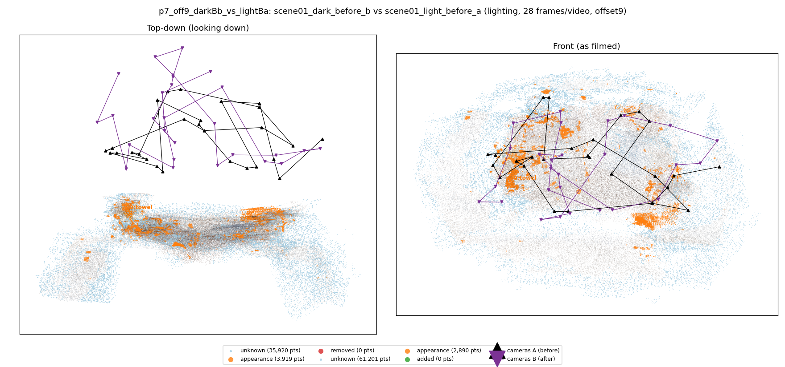
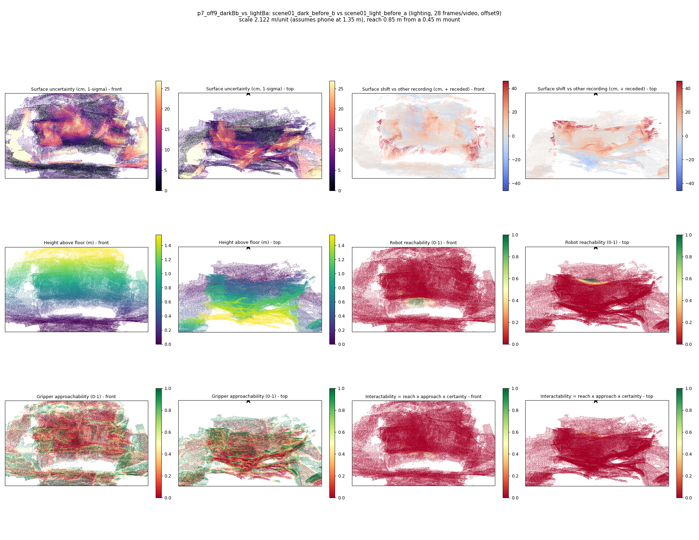

# p7_off9_darkBb_vs_lightBa

**scene01_dark_before_b** (A, before) vs **scene01_light_before_a** (B, after) - pair type **lighting**, 28 frames per video, variant `offset9`.

Distances are in cm, from a floor fit and an assumed phone height (scale 2.1215 m/unit, range [1.7287, 2.5144]).

| Measure | Value |
|---|---|
| Observed share (A / B) | 87.9% / 79.4% |
| Changed share of observed points (A / B) | 1.50% / 1.23% |
| Alignment residual across / within recordings | 0.0374 / 0.0356 |
| Thresholds (depth tau, see-through fraction, appearance) | 0.10697 / 1.0 / 0.89596 |
| Changes (moved / removed / added / appearance) | 0 / 0 / 0 / 1 |
| Reconstruction time | 27.5 s (GPU peak 9.57 GB) |

Nothing was moved between these recordings, so every flagged point is a false change: **false-change rate 1.36%**.

Heat maps (recording B): reachable 1%, approachable 28%, interactable 0%; surface uncertainty median 5.336 cm (90th pct 20.428); surface shift 99th pct 46.211 cm.

## Changes

- **0 appearance** towel (p=0.115, 1184 pts, centroid +/- 0.032): The towel looks different (turned over, deformed or swapped) but occupies the same place.
