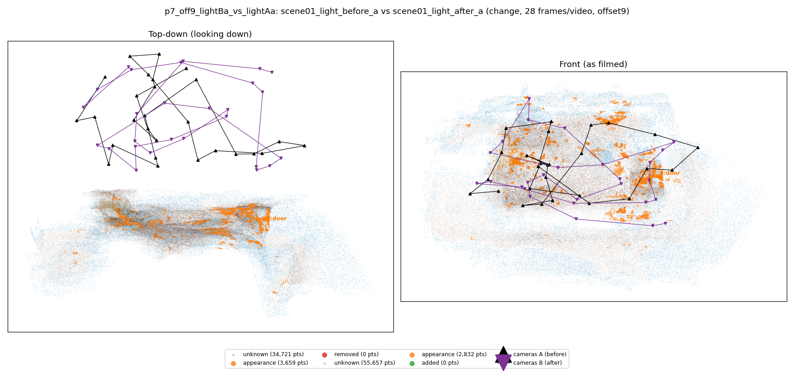
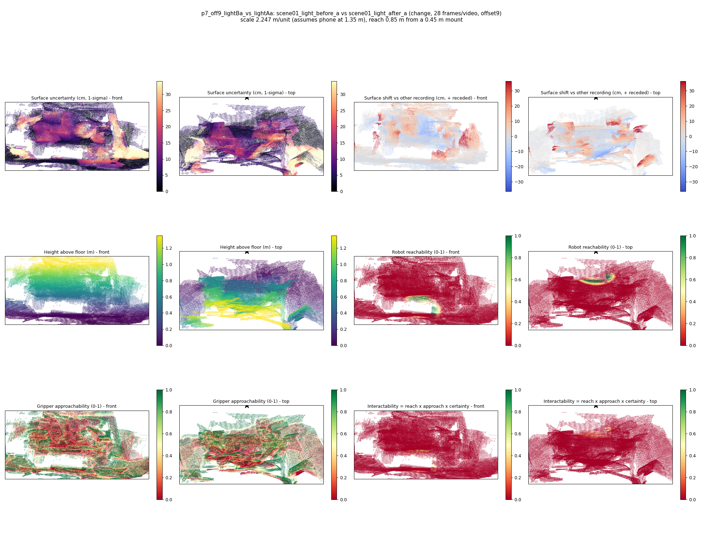

# p7_off9_lightBa_vs_lightAa

**scene01_light_before_a** (A, before) vs **scene01_light_after_a** (B, after) - pair type **change**, 28 frames per video, variant `offset9`.

Distances are in cm, from a floor fit and an assumed phone height (scale 2.2466 m/unit, range [1.8305, 2.6626]).

| Measure | Value |
|---|---|
| Observed share (A / B) | 88.3% / 81.3% |
| Changed share of observed points (A / B) | 1.40% / 1.17% |
| Alignment residual across / within recordings | 0.0314 / 0.0285 |
| Thresholds (depth tau, see-through fraction, appearance) | 0.08556 / 1.0 / 0.88609 |
| Changes (moved / removed / added / appearance) | 0 / 0 / 0 / 1 |
| Reconstruction time | 25.7 s (GPU peak 9.57 GB) |

Heat maps (recording B): reachable 1%, approachable 33%, interactable 0%; surface uncertainty median 6.055 cm (90th pct 24.474); surface shift 99th pct 36.279 cm.

## Changes

- **0 appearance** door (p=0.118, 861 pts, centroid +/- 0.025): The door looks different (turned over, deformed or swapped) but occupies the same place.
