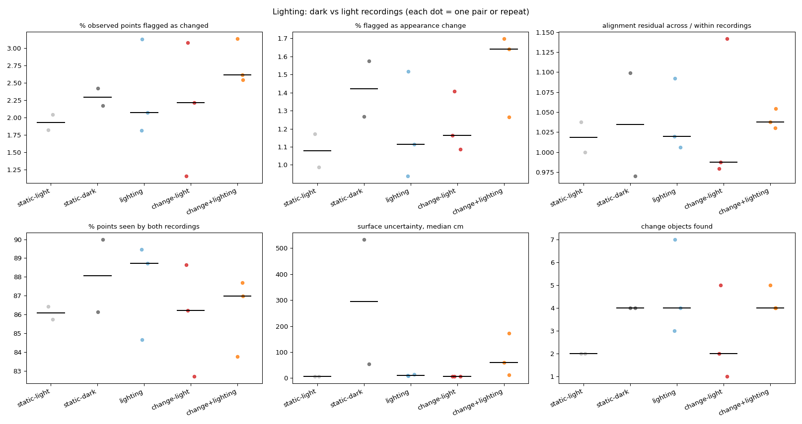

# Lighting comparison

| Group | Pairs | % observed points flagged as changed | % flagged as appearance change | alignment residual across / within recordings | % points seen by both recordings | surface uncertainty, median cm | change objects found |
|---|---|---|---|---|---|---|---|
| static-light | 2 | 1.93 (1.82-2.04) | 1.08 (0.99-1.17) | 1.02 (1.00-1.04) | 86.07 (85.73-86.41) | 6.59 (5.92-7.25) | 2.00 (2.00-2.00) |
| static-dark | 2 | 2.30 (2.17-2.42) | 1.42 (1.27-1.57) | 1.03 (0.97-1.10) | 88.07 (86.15-90.00) | 294.02 (53.96-534.08) | 4.00 (4.00-4.00) |
| lighting | 3 | 2.07 (1.81-3.13) | 1.11 (0.94-1.52) | 1.02 (1.01-1.09) | 88.72 (84.66-89.46) | 11.25 (8.04-14.27) | 4.00 (3.00-7.00) |
| change-light | 3 | 2.22 (1.16-3.07) | 1.16 (1.09-1.41) | 0.99 (0.98-1.14) | 86.23 (82.70-88.63) | 6.25 (5.75-7.22) | 2.00 (1.00-5.00) |
| change+lighting | 3 | 2.61 (2.54-3.13) | 1.64 (1.26-1.70) | 1.04 (1.03-1.05) | 86.97 (83.76-87.70) | 59.88 (12.17-172.52) | 4.00 (4.00-5.00) |

Median (range). **lighting** vs **static-light/static-dark** isolates what the lighting change alone flags as change; **change+lighting** vs **change-light** shows how much the real changes survive it.

## Reconstruction noise per recording

| Recording lighting | Samples | Surface uncertainty, median cm |
|---|---|---|
| dark | 10 | 47.03 |
| light | 16 | 6.58 |

## Same changes found through a lighting change?

For each after recording: changes found from a light 'before' vs from a dark 'before' (base settings, first frame pick). Labels exclude background classes.

| After | Light-before pair: changes / labels | Dark-before pair: changes / labels | Shared labels | Label overlap (Jaccard) |
|---|---|---|---|---|
| scene01_light_after_a | 1.5 / cup, guitar, hat | 4.0 / coaster, guitar, hat, jacket, keys, mug, towel | guitar, hat | 0.25 |
| scene01_light_after_b | 5.0 / baseball cap, glass vase, table tennis bat | 5.0 / guitar, hat, pillow, vase | - | 0.00 |

Ablation `no_appearance` (in the main summary) shows whether appearance features are what lighting trips; geometry-only detection should be nearly lighting-invariant.
