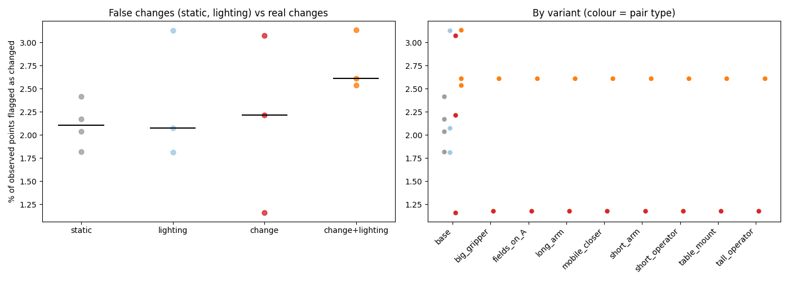

# Summary of 2026-10-10_scene01-heatmaps

29 finished steps.
Lighting (dark vs light) comparison: [lighting.md](lighting.md)

## Headline: changed fraction by pair type (base settings)

| Pair type | Steps | Median % changed | Range |
|---|---|---|---|
| static | 4 | 2.11 | 1.82 to 2.42 |
| lighting | 3 | 2.07 | 1.81 to 3.13 |
| change | 3 | 2.22 | 1.16 to 3.07 |
| change+lighting | 3 | 2.61 | 2.54 to 3.13 |

Static and lighting pairs have no real change, so their numbers are the false-change rate. A working detector shows change pairs clearly above both.

## All steps

| Step | Type | A vs B | Frames/video | Variant | % changed | Align resid (x/within) | Changes (mv/rm/add/app) | Recon s |
|---|---|---|---|---|---|---|---|---|
| [p1_darkBa_vs_darkBb](p1_darkBa_vs_darkBb/report.md) | static | scene01_dark_before_a vs scene01_dark_before_b | 28 | base | 2.42 | 0.049/0.0446 | 0/1/1/2 | 27.8 |
| [p1_darkBa_vs_lightAa](p1_darkBa_vs_lightAa/report.md) | change+lighting | scene01_dark_before_a vs scene01_light_after_a | 28 | base | 2.61 | 0.0407/0.0395 | 0/2/1/1 | 27.0 |
| [p1_darkBa_vs_lightBa](p1_darkBa_vs_lightBa/report.md) | lighting | scene01_dark_before_a vs scene01_light_before_a | 28 | base | 1.81 | 0.0365/0.0358 | 0/1/1/1 | 28.5 |
| [p1_lightBa_vs_lightAa](p1_lightBa_vs_lightAa/report.md) | change | scene01_light_before_a vs scene01_light_after_a | 28 | base | 1.16 | 0.0289/0.0295 | 0/0/0/2 | 27.0 |
| [p1_lightBa_vs_lightBb](p1_lightBa_vs_lightBb/report.md) | static | scene01_light_before_a vs scene01_light_before_b | 28 | base | 2.04 | 0.0337/0.0337 | 0/1/0/1 | 24.7 |
| [p1_lightBb_vs_lightAb](p1_lightBb_vs_lightAb/report.md) | change | scene01_light_before_b vs scene01_light_after_b | 28 | base | 3.07 | 0.0484/0.049 | 0/2/1/2 | 27.8 |
| [p1b_darkBb_vs_darkBc](p1b_darkBb_vs_darkBc/report.md) | static | scene01_dark_before_b vs scene01_dark_before_c | 28 | base | 2.17 | 0.0392/0.0404 | 0/0/1/3 | 27.7 |
| [p1b_darkBb_vs_lightAb](p1b_darkBb_vs_lightAb/report.md) | change+lighting | scene01_dark_before_b vs scene01_light_after_b | 28 | base | 3.13 | 0.0499/0.0481 | 0/3/1/1 | 27.9 |
| [p1b_darkBb_vs_lightBb](p1b_darkBb_vs_lightBb/report.md) | lighting | scene01_dark_before_b vs scene01_light_before_b | 28 | base | 3.13 | 0.0521/0.0477 | 0/1/3/3 | 27.8 |
| [p1b_darkBc_vs_lightAa](p1b_darkBc_vs_lightAa/report.md) | change+lighting | scene01_dark_before_c vs scene01_light_after_a | 28 | base | 2.54 | 0.0427/0.0405 | 0/0/2/2 | 27.4 |
| [p1b_darkBc_vs_lightBa](p1b_darkBc_vs_lightBa/report.md) | lighting | scene01_dark_before_c vs scene01_light_before_a | 28 | base | 2.07 | 0.0351/0.0349 | 0/1/1/2 | 27.5 |
| [p1b_lightAa_vs_lightAb](p1b_lightAa_vs_lightAb/report.md) | static | scene01_light_after_a vs scene01_light_after_b | 28 | base | 1.82 | 0.0389/0.0375 | 0/0/0/2 | 27.5 |
| [p1b_lightBb_vs_lightAa](p1b_lightBb_vs_lightAa/report.md) | change | scene01_light_before_b vs scene01_light_after_a | 28 | base | 2.22 | 0.0459/0.0402 | 0/0/1/0 | 27.8 |
| [p3_before_fields_darkBa_vs_lightAa](p3_before_fields_darkBa_vs_lightAa/report.md) | change+lighting | scene01_dark_before_a vs scene01_light_after_a | 28 | fields_on_A | 2.61 | 0.0407/0.0396 | 0/2/1/1 | 27.0 |
| [p3_before_fields_lightBa_vs_lightAa](p3_before_fields_lightBa_vs_lightAa/report.md) | change | scene01_light_before_a vs scene01_light_after_a | 28 | fields_on_A | 1.18 | 0.029/0.0293 | 0/0/0/2 | 27.0 |
| [p3_big_gripper_darkBa_vs_lightAa](p3_big_gripper_darkBa_vs_lightAa/report.md) | change+lighting | scene01_dark_before_a vs scene01_light_after_a | 28 | big_gripper | 2.61 | 0.0407/0.0396 | 0/2/1/1 | 27.0 |
| [p3_big_gripper_lightBa_vs_lightAa](p3_big_gripper_lightBa_vs_lightAa/report.md) | change | scene01_light_before_a vs scene01_light_after_a | 28 | big_gripper | 1.18 | 0.029/0.0293 | 0/0/0/2 | 27.0 |
| [p3_long_arm_darkBa_vs_lightAa](p3_long_arm_darkBa_vs_lightAa/report.md) | change+lighting | scene01_dark_before_a vs scene01_light_after_a | 28 | long_arm | 2.61 | 0.0407/0.0396 | 0/2/1/1 | 27.0 |
| [p3_long_arm_lightBa_vs_lightAa](p3_long_arm_lightBa_vs_lightAa/report.md) | change | scene01_light_before_a vs scene01_light_after_a | 28 | long_arm | 1.18 | 0.029/0.0293 | 0/0/0/2 | 27.0 |
| [p3_mobile_closer_darkBa_vs_lightAa](p3_mobile_closer_darkBa_vs_lightAa/report.md) | change+lighting | scene01_dark_before_a vs scene01_light_after_a | 28 | mobile_closer | 2.61 | 0.0407/0.0396 | 0/2/1/1 | 27.0 |
| [p3_mobile_closer_lightBa_vs_lightAa](p3_mobile_closer_lightBa_vs_lightAa/report.md) | change | scene01_light_before_a vs scene01_light_after_a | 28 | mobile_closer | 1.18 | 0.029/0.0293 | 0/0/0/2 | 27.0 |
| [p3_short_arm_darkBa_vs_lightAa](p3_short_arm_darkBa_vs_lightAa/report.md) | change+lighting | scene01_dark_before_a vs scene01_light_after_a | 28 | short_arm | 2.61 | 0.0407/0.0396 | 0/2/1/1 | 27.0 |
| [p3_short_arm_lightBa_vs_lightAa](p3_short_arm_lightBa_vs_lightAa/report.md) | change | scene01_light_before_a vs scene01_light_after_a | 28 | short_arm | 1.18 | 0.029/0.0293 | 0/0/0/2 | 27.0 |
| [p3_short_operator_darkBa_vs_lightAa](p3_short_operator_darkBa_vs_lightAa/report.md) | change+lighting | scene01_dark_before_a vs scene01_light_after_a | 28 | short_operator | 2.61 | 0.0407/0.0396 | 0/2/1/1 | 27.0 |
| [p3_short_operator_lightBa_vs_lightAa](p3_short_operator_lightBa_vs_lightAa/report.md) | change | scene01_light_before_a vs scene01_light_after_a | 28 | short_operator | 1.18 | 0.029/0.0293 | 0/0/0/2 | 27.0 |
| [p3_table_mount_darkBa_vs_lightAa](p3_table_mount_darkBa_vs_lightAa/report.md) | change+lighting | scene01_dark_before_a vs scene01_light_after_a | 28 | table_mount | 2.61 | 0.0407/0.0396 | 0/2/1/1 | 27.0 |
| [p3_table_mount_lightBa_vs_lightAa](p3_table_mount_lightBa_vs_lightAa/report.md) | change | scene01_light_before_a vs scene01_light_after_a | 28 | table_mount | 1.18 | 0.029/0.0293 | 0/0/0/2 | 27.0 |
| [p3_tall_operator_darkBa_vs_lightAa](p3_tall_operator_darkBa_vs_lightAa/report.md) | change+lighting | scene01_dark_before_a vs scene01_light_after_a | 28 | tall_operator | 2.61 | 0.0407/0.0396 | 0/2/1/1 | 27.0 |
| [p3_tall_operator_lightBa_vs_lightAa](p3_tall_operator_lightBa_vs_lightAa/report.md) | change | scene01_light_before_a vs scene01_light_after_a | 28 | tall_operator | 1.18 | 0.029/0.0293 | 0/0/0/2 | 27.0 |

## Detected changes (base settings)

**p1_darkBa_vs_darkBb** (static)
- A blanket appears in the second recording that was not there before.
- The towel looks different (turned over, deformed or swapped) but occupies the same place.
- A stack of books that was there in the first recording is no longer there.
- The blanket looks different (turned over, deformed or swapped) but occupies the same place.

**p1_darkBa_vs_lightAa** (change+lighting)
- A keys appears in the second recording that was not there before.
- A coaster that was there in the first recording is no longer there.
- A towel that was there in the first recording is no longer there.
- The jacket looks different (turned over, deformed or swapped) but occupies the same place.

**p1_darkBa_vs_lightBa** (lighting)
- A cushion appears in the second recording that was not there before.
- A towel that was there in the first recording is no longer there.
- The baseball cap looks different (turned over, deformed or swapped) but occupies the same place.

**p1_lightBa_vs_lightAa** (change)
- The hat looks different (turned over, deformed or swapped) but occupies the same place.
- The cup looks different (turned over, deformed or swapped) but occupies the same place.

**p1_lightBa_vs_lightBb** (static)
- The hat looks different (turned over, deformed or swapped) but occupies the same place.
- A guitar that was there in the first recording is no longer there.

**p1_lightBb_vs_lightAb** (change)
- A sofa that was there in the first recording is no longer there.
- A baseball cap that was there in the first recording is no longer there.
- The table tennis bat looks different (turned over, deformed or swapped) but occupies the same place.
- The glass vase looks different (turned over, deformed or swapped) but occupies the same place.
- A rug appears in the second recording that was not there before.

**p1b_darkBb_vs_darkBc** (static)
- The jacket looks different (turned over, deformed or swapped) but occupies the same place.
- A cup appears in the second recording that was not there before.
- The cup looks different (turned over, deformed or swapped) but occupies the same place.
- The book looks different (turned over, deformed or swapped) but occupies the same place.

**p1b_darkBb_vs_lightAb** (change+lighting)
- A pillow that was there in the first recording is no longer there.
- The hat looks different (turned over, deformed or swapped) but occupies the same place.
- A hat that was there in the first recording is no longer there.
- A guitar that was there in the first recording is no longer there.
- A vase appears in the second recording that was not there before.

**p1b_darkBb_vs_lightBb** (lighting)
- The hat looks different (turned over, deformed or swapped) but occupies the same place.
- A baseball cap appears in the second recording that was not there before.
- A blanket that was there in the first recording is no longer there.
- The book looks different (turned over, deformed or swapped) but occupies the same place.
- The towel looks different (turned over, deformed or swapped) but occupies the same place.
- A towel appears in the second recording that was not there before.
- A sofa appears in the second recording that was not there before.

**p1b_darkBc_vs_lightAa** (change+lighting)
- The hat looks different (turned over, deformed or swapped) but occupies the same place.
- The mug looks different (turned over, deformed or swapped) but occupies the same place.
- A guitar appears in the second recording that was not there before.
- A guitar appears in the second recording that was not there before.

**p1b_darkBc_vs_lightBa** (lighting)
- A guitar appears in the second recording that was not there before.
- A baseball cap that was there in the first recording is no longer there.
- The mug looks different (turned over, deformed or swapped) but occupies the same place.
- The baseball cap looks different (turned over, deformed or swapped) but occupies the same place.

**p1b_lightAa_vs_lightAb** (static)
- The blanket looks different (turned over, deformed or swapped) but occupies the same place.
- The shoe looks different (turned over, deformed or swapped) but occupies the same place.

**p1b_lightBb_vs_lightAa** (change)
- A guitar appears in the second recording that was not there before.

## Heat maps

Each step's `heatmaps.png` shows the maps; `viewer.html` has them as 3D layers.

| Step | Variant | Robot (reach m / mount m / base offset m) | Scale m/unit | Uncertainty cm (median / p90) | Shift cm p99 | Reachable | Approachable | Interactable |
|---|---|---|---|---|---|---|---|---|
| [p1_darkBa_vs_darkBb](p1_darkBa_vs_darkBb/heatmaps.png) | base | 0.85 / 0.45 / 0.0 | 259.44 | 534.079 / 1486.146 | 3578.913 | 0% | 100% | 0% |
| [p1_darkBa_vs_lightAa](p1_darkBa_vs_lightAa/heatmaps.png) | base | 0.85 / 0.45 / 0.0 | 68.7422 | 172.519 / 395.436 | 984.162 | 0% | 100% | 0% |
| [p1_darkBa_vs_lightBa](p1_darkBa_vs_lightBa/heatmaps.png) | base | 0.85 / 0.45 / 0.0 | 5.9589 | 11.253 / 32.537 | 78.978 | 0% | 35% | 0% |
| [p1_lightBa_vs_lightAa](p1_lightBa_vs_lightAa/heatmaps.png) | base | 0.85 / 0.45 / 0.0 | 2.5242 | 6.246 / 20.075 | 28.05 | 1% | 30% | 0% |
| [p1_lightBa_vs_lightBb](p1_lightBa_vs_lightBb/heatmaps.png) | base | 0.85 / 0.45 / 0.0 | 2.4587 | 5.921 / 20.363 | 27.007 | 14% | 33% | 1% |
| [p1_lightBb_vs_lightAb](p1_lightBb_vs_lightAb/heatmaps.png) | base | 0.85 / 0.45 / 0.0 | 2.152 | 7.224 / 20.524 | 33.219 | 12% | 30% | 1% |
| [p1b_darkBb_vs_darkBc](p1b_darkBb_vs_darkBc/heatmaps.png) | base | 0.85 / 0.45 / 0.0 | 20.5868 | 53.964 / 166.149 | 234.767 | 0% | 97% | 0% |
| [p1b_darkBb_vs_lightAb](p1b_darkBb_vs_lightAb/heatmaps.png) | base | 0.85 / 0.45 / 0.0 | 16.4687 | 59.876 / 150.138 | 205.713 | 0% | 94% | 0% |
| [p1b_darkBb_vs_lightBb](p1b_darkBb_vs_lightBb/heatmaps.png) | base | 0.85 / 0.45 / 0.0 | 2.012 | 8.041 / 20.806 | 29.059 | 8% | 29% | 0% |
| [p1b_darkBc_vs_lightAa](p1b_darkBc_vs_lightAa/heatmaps.png) | base | 0.85 / 0.45 / 0.0 | 3.9433 | 12.171 / 29.866 | 55.243 | 0% | 35% | 0% |
| [p1b_darkBc_vs_lightBa](p1b_darkBc_vs_lightBa/heatmaps.png) | base | 0.85 / 0.45 / 0.0 | 6.6366 | 14.267 / 44.31 | 89.946 | 0% | 47% | 0% |
| [p1b_lightAa_vs_lightAb](p1b_lightAa_vs_lightAb/heatmaps.png) | base | 0.85 / 0.45 / 0.0 | 2.3794 | 7.25 / 22.829 | 25.021 | 4% | 30% | 0% |
| [p1b_lightBb_vs_lightAa](p1b_lightBb_vs_lightAa/heatmaps.png) | base | 0.85 / 0.45 / 0.0 | 2.0134 | 5.75 / 18.258 | 35.797 | 7% | 30% | 1% |
| [p3_before_fields_darkBa_vs_lightAa](p3_before_fields_darkBa_vs_lightAa/heatmaps.png) | fields_on_A | 0.85 / 0.45 / 0.0 | 4.5192 | 8.856 / 27.656 | 55.514 | 0% | 34% | 0% |
| [p3_before_fields_lightBa_vs_lightAa](p3_before_fields_lightBa_vs_lightAa/heatmaps.png) | fields_on_A | 0.85 / 0.45 / 0.0 | 2.5271 | 4.429 / 17.029 | 32.626 | 1% | 26% | 0% |
| [p3_big_gripper_darkBa_vs_lightAa](p3_big_gripper_darkBa_vs_lightAa/heatmaps.png) | big_gripper | 0.85 / 0.45 / 0.0 | 4.5192 | 11.335 / 27.147 | 63.7 | 0% | 22% | 0% |
| [p3_big_gripper_lightBa_vs_lightAa](p3_big_gripper_lightBa_vs_lightAa/heatmaps.png) | big_gripper | 0.85 / 0.45 / 0.0 | 2.5271 | 6.267 / 20.082 | 27.477 | 1% | 24% | 0% |
| [p3_long_arm_darkBa_vs_lightAa](p3_long_arm_darkBa_vs_lightAa/heatmaps.png) | long_arm | 1.1 / 0.45 / 0.0 | 4.5192 | 11.335 / 27.147 | 63.7 | 0% | 31% | 0% |
| [p3_long_arm_lightBa_vs_lightAa](p3_long_arm_lightBa_vs_lightAa/heatmaps.png) | long_arm | 1.1 / 0.45 / 0.0 | 2.5271 | 6.267 / 20.082 | 27.477 | 14% | 29% | 1% |
| [p3_mobile_closer_darkBa_vs_lightAa](p3_mobile_closer_darkBa_vs_lightAa/heatmaps.png) | mobile_closer | 0.85 / 0.45 / 0.6 | 4.5192 | 11.335 / 27.147 | 63.7 | 0% | 31% | 0% |
| [p3_mobile_closer_lightBa_vs_lightAa](p3_mobile_closer_lightBa_vs_lightAa/heatmaps.png) | mobile_closer | 0.85 / 0.45 / 0.6 | 2.5271 | 6.267 / 20.082 | 27.477 | 28% | 29% | 1% |
| [p3_short_arm_darkBa_vs_lightAa](p3_short_arm_darkBa_vs_lightAa/heatmaps.png) | short_arm | 0.6 / 0.45 / 0.0 | 4.5192 | 11.335 / 27.147 | 63.7 | 0% | 31% | 0% |
| [p3_short_arm_lightBa_vs_lightAa](p3_short_arm_lightBa_vs_lightAa/heatmaps.png) | short_arm | 0.6 / 0.45 / 0.0 | 2.5271 | 6.267 / 20.082 | 27.477 | 0% | 29% | 0% |
| [p3_short_operator_darkBa_vs_lightAa](p3_short_operator_darkBa_vs_lightAa/heatmaps.png) | short_operator | 0.85 / 0.45 / 0.0 | 3.8497 | 9.656 / 23.567 | 54.521 | 0% | 28% | 0% |
| [p3_short_operator_lightBa_vs_lightAa](p3_short_operator_lightBa_vs_lightAa/heatmaps.png) | short_operator | 0.85 / 0.45 / 0.0 | 2.1527 | 5.505 / 17.71 | 23.986 | 6% | 29% | 1% |
| [p3_table_mount_darkBa_vs_lightAa](p3_table_mount_darkBa_vs_lightAa/heatmaps.png) | table_mount | 0.85 / 0.75 / 0.0 | 4.5192 | 11.335 / 27.147 | 63.7 | 0% | 31% | 0% |
| [p3_table_mount_lightBa_vs_lightAa](p3_table_mount_lightBa_vs_lightAa/heatmaps.png) | table_mount | 0.85 / 0.75 / 0.0 | 2.5271 | 6.267 / 20.082 | 27.477 | 0% | 29% | 0% |
| [p3_tall_operator_darkBa_vs_lightAa](p3_tall_operator_darkBa_vs_lightAa/heatmaps.png) | tall_operator | 0.85 / 0.45 / 0.0 | 5.1887 | 13.014 / 30.711 | 73.765 | 0% | 34% | 0% |
| [p3_tall_operator_lightBa_vs_lightAa](p3_tall_operator_lightBa_vs_lightAa/heatmaps.png) | tall_operator | 0.85 / 0.45 / 0.0 | 2.9014 | 7.034 / 22.373 | 30.881 | 0% | 31% | 0% |

