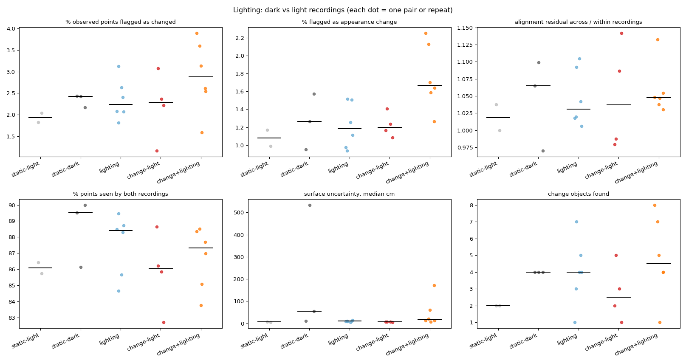

# Lighting comparison

| Group | Pairs | % observed points flagged as changed | % flagged as appearance change | alignment residual across / within recordings | % points seen by both recordings | surface uncertainty, median cm | change objects found |
|---|---|---|---|---|---|---|---|
| static-light | 2 | 1.93 (1.82-2.04) | 1.08 (0.99-1.17) | 1.02 (1.00-1.04) | 86.07 (85.73-86.41) | 6.59 (5.92-7.25) | 2.00 (2.00-2.00) |
| static-dark | 3 | 2.42 (2.17-2.44) | 1.27 (0.95-1.57) | 1.07 (0.97-1.10) | 89.50 (86.15-90.00) | 53.96 (10.07-534.08) | 4.00 (4.00-4.00) |
| lighting | 6 | 2.24 (1.81-3.13) | 1.18 (0.94-1.52) | 1.03 (1.01-1.10) | 88.40 (84.66-89.46) | 10.04 (4.40-14.27) | 4.00 (1.00-7.00) |
| change-light | 4 | 2.29 (1.16-3.07) | 1.20 (1.09-1.41) | 1.04 (0.98-1.14) | 86.04 (82.70-88.63) | 6.54 (5.75-7.22) | 2.50 (1.00-5.00) |
| change+lighting | 6 | 2.87 (1.59-3.90) | 1.67 (1.26-2.25) | 1.05 (1.03-1.13) | 87.34 (83.76-88.52) | 17.32 (6.24-172.52) | 4.50 (1.00-8.00) |

Median (range). **lighting** vs **static-light/static-dark** isolates what the lighting change alone flags as change; **change+lighting** vs **change-light** shows how much the real changes survive it.

## Reconstruction noise per recording

| Recording lighting | Samples | Surface uncertainty, median cm |
|---|---|---|
| dark | 18 | 12.81 |
| light | 24 | 6.58 |

## Same changes found through a lighting change?

For each after recording: changes found from a light 'before' vs from a dark 'before' (base settings, first frame pick). Labels exclude background classes.

| After | Light-before pair: changes / labels | Dark-before pair: changes / labels | Shared labels | Label overlap (Jaccard) |
|---|---|---|---|---|
| scene01_light_after_a | 1.5 / cup, guitar, hat | 3.0 / blanket, coaster, guitar, hat, jacket, keys, mug, towel | guitar, hat | 0.22 |
| scene01_light_after_b | 4.0 / baseball cap, cup, glass vase, jacket, table tennis bat | 6.7 / bag, baseball cap, book, glass vase, guitar, hat, jacket, mug, pillow, table tennis bat, vase | baseball cap, glass vase, jacket, table tennis bat | 0.33 |

Ablation `no_appearance` (in the main summary) shows whether appearance features are what lighting trips; geometry-only detection should be nearly lighting-invariant.
