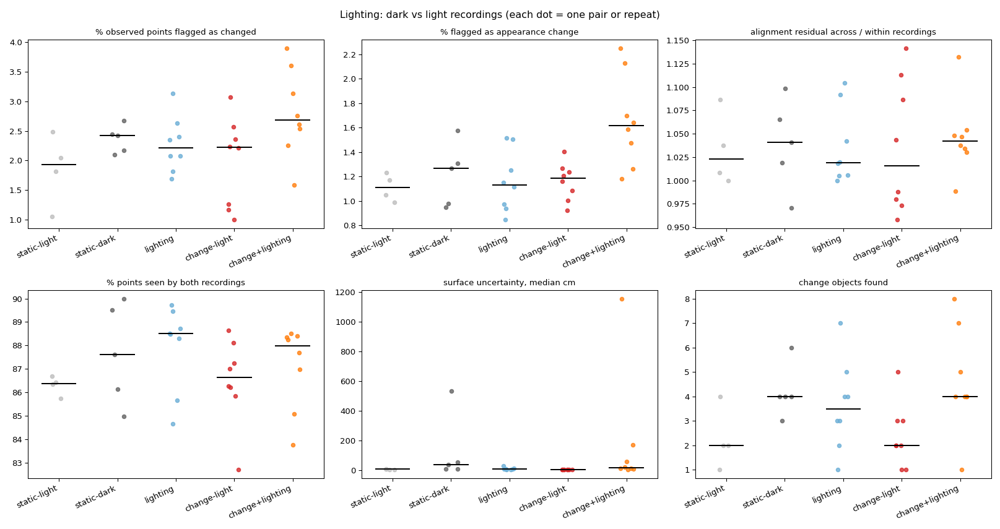

# Lighting comparison

| Group | Pairs | % observed points flagged as changed | % flagged as appearance change | alignment residual across / within recordings | % points seen by both recordings | surface uncertainty, median cm | change objects found |
|---|---|---|---|---|---|---|---|
| static-light | 4 | 1.93 (1.05-2.49) | 1.11 (0.99-1.23) | 1.02 (1.00-1.09) | 86.38 (85.73-86.69) | 8.43 (5.92-10.95) | 2.00 (1.00-4.00) |
| static-dark | 5 | 2.42 (2.10-2.67) | 1.27 (0.95-1.57) | 1.04 (0.97-1.10) | 87.61 (84.97-90.00) | 38.59 (9.62-534.08) | 4.00 (3.00-6.00) |
| lighting | 8 | 2.22 (1.69-3.13) | 1.13 (0.85-1.52) | 1.02 (1.00-1.10) | 88.50 (84.66-89.73) | 10.04 (4.40-32.31) | 3.50 (1.00-7.00) |
| change-light | 8 | 2.22 (1.00-3.07) | 1.19 (0.92-1.41) | 1.02 (0.96-1.14) | 86.64 (82.70-88.63) | 6.83 (5.75-7.94) | 2.00 (1.00-5.00) |
| change+lighting | 8 | 2.68 (1.59-3.90) | 1.61 (1.18-2.25) | 1.04 (0.99-1.13) | 87.97 (83.76-88.52) | 17.55 (6.24-1154.60) | 4.00 (1.00-8.00) |

Median (range). **lighting** vs **static-light/static-dark** isolates what the lighting change alone flags as change; **change+lighting** vs **change-light** shows how much the real changes survive it.

## Reconstruction noise per recording

| Recording lighting | Samples | Surface uncertainty, median cm |
|---|---|---|
| dark | 26 | 12.81 |
| light | 40 | 6.66 |

## Same changes found through a lighting change?

For each after recording: changes found from a light 'before' vs from a dark 'before' (base settings, first frame pick). Labels exclude background classes.

| After | Light-before pair: changes / labels | Dark-before pair: changes / labels | Shared labels | Label overlap (Jaccard) |
|---|---|---|---|---|
| scene01_light_after_a | 1.5 / cup, guitar, hat | 3.0 / blanket, coaster, guitar, hat, jacket, keys, mug, towel | guitar, hat | 0.22 |
| scene01_light_after_b | 4.0 / baseball cap, cup, glass vase, jacket, table tennis bat | 6.7 / bag, baseball cap, book, glass vase, guitar, hat, jacket, mug, pillow, table tennis bat, vase | baseball cap, glass vase, jacket, table tennis bat | 0.33 |

Ablation `no_appearance` (in the main summary) shows whether appearance features are what lighting trips; geometry-only detection should be nearly lighting-invariant.
