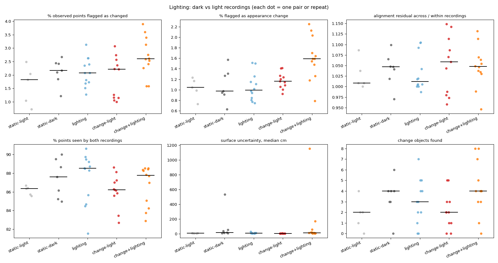

# Lighting comparison

| Group | Pairs | % observed points flagged as changed | % flagged as appearance change | alignment residual across / within recordings | % points seen by both recordings | surface uncertainty, median cm | change objects found |
|---|---|---|---|---|---|---|---|
| static-light | 5 | 1.82 (0.73-2.49) | 1.05 (0.73-1.23) | 1.01 (1.00-1.09) | 86.34 (85.56-86.69) | 8.19 (5.92-10.95) | 2.00 (0.00-4.00) |
| static-dark | 7 | 2.17 (1.22-2.67) | 0.98 (0.63-1.57) | 1.05 (0.97-1.10) | 87.61 (84.97-90.00) | 20.01 (9.62-534.08) | 4.00 (0.00-6.00) |
| lighting | 12 | 2.08 (1.28-3.13) | 1.00 (0.75-1.52) | 1.01 (0.99-1.10) | 88.50 (81.53-90.64) | 10.04 (4.40-32.31) | 3.00 (0.00-7.00) |
| change-light | 11 | 2.22 (1.00-3.07) | 1.16 (0.92-1.42) | 1.06 (0.96-1.15) | 86.23 (82.70-88.63) | 6.84 (5.75-8.21) | 2.00 (0.00-5.00) |
| change+lighting | 12 | 2.60 (1.59-3.90) | 1.59 (0.79-2.25) | 1.05 (0.95-1.13) | 87.77 (82.88-88.53) | 15.13 (6.24-1154.60) | 4.00 (0.00-8.00) |

Median (range). **lighting** vs **static-light/static-dark** isolates what the lighting change alone flags as change; **change+lighting** vs **change-light** shows how much the real changes survive it.

## Reconstruction noise per recording

| Recording lighting | Samples | Surface uncertainty, median cm |
|---|---|---|
| dark | 38 | 11.43 |
| light | 56 | 7.54 |

## Same changes found through a lighting change?

For each after recording: changes found from a light 'before' vs from a dark 'before' (base settings, first frame pick). Labels exclude background classes.

| After | Light-before pair: changes / labels | Dark-before pair: changes / labels | Shared labels | Label overlap (Jaccard) |
|---|---|---|---|---|
| scene01_light_after_a | 1.5 / cup, guitar, hat | 3.0 / blanket, coaster, guitar, hat, jacket, keys, mug, towel | guitar, hat | 0.22 |
| scene01_light_after_b | 4.0 / baseball cap, cup, glass vase, jacket, table tennis bat | 6.7 / bag, baseball cap, book, glass vase, guitar, hat, jacket, mug, pillow, table tennis bat, vase | baseball cap, glass vase, jacket, table tennis bat | 0.33 |

Ablation `no_appearance` (in the main summary) shows whether appearance features are what lighting trips; geometry-only detection should be nearly lighting-invariant.
