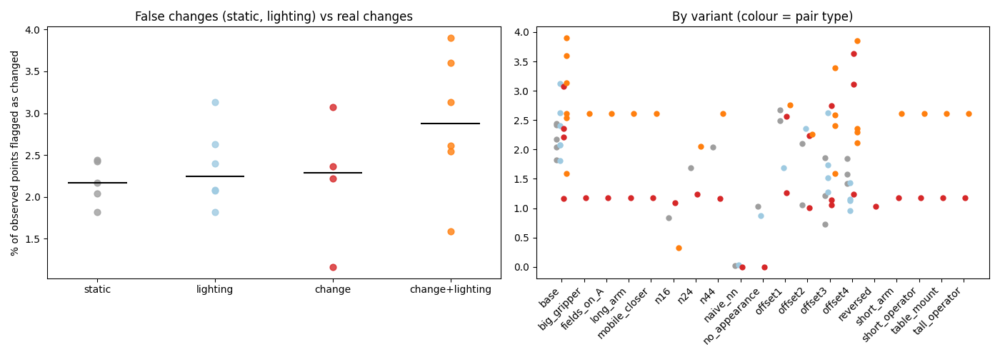

# Summary of 2026-10-10_scene01-heatmaps

93 finished steps.
Lighting (dark vs light) comparison: [lighting.md](lighting.md)

## Headline: changed fraction by pair type (base settings)

| Pair type | Steps | Median % changed | Range |
|---|---|---|---|
| static | 5 | 2.17 | 1.82 to 2.44 |
| lighting | 6 | 2.24 | 1.81 to 3.13 |
| change | 4 | 2.29 | 1.16 to 3.07 |
| change+lighting | 6 | 2.87 | 1.59 to 3.90 |

Static and lighting pairs have no real change, so their numbers are the false-change rate. A working detector shows change pairs clearly above both.

## All steps

| Step | Type | A vs B | Frames/video | Variant | % changed | Align resid (x/within) | Changes (mv/rm/add/app) | Recon s |
|---|---|---|---|---|---|---|---|---|
| [p1_darkBa_vs_darkBb](p1_darkBa_vs_darkBb/report.md) | static | scene01_dark_before_a vs scene01_dark_before_b | 28 | base | 2.42 | 0.049/0.0446 | 0/1/1/2 | 27.8 |
| [p1_darkBa_vs_lightAa](p1_darkBa_vs_lightAa/report.md) | change+lighting | scene01_dark_before_a vs scene01_light_after_a | 28 | base | 2.61 | 0.0407/0.0395 | 0/2/1/1 | 27.0 |
| [p1_darkBa_vs_lightBa](p1_darkBa_vs_lightBa/report.md) | lighting | scene01_dark_before_a vs scene01_light_before_a | 28 | base | 1.81 | 0.0365/0.0358 | 0/1/1/1 | 28.5 |
| [p1_lightBa_vs_lightAa](p1_lightBa_vs_lightAa/report.md) | change | scene01_light_before_a vs scene01_light_after_a | 28 | base | 1.16 | 0.0289/0.0295 | 0/0/0/2 | 27.0 |
| [p1_lightBa_vs_lightBb](p1_lightBa_vs_lightBb/report.md) | static | scene01_light_before_a vs scene01_light_before_b | 28 | base | 2.04 | 0.0337/0.0337 | 0/1/0/1 | 24.7 |
| [p1_lightBb_vs_lightAb](p1_lightBb_vs_lightAb/report.md) | change | scene01_light_before_b vs scene01_light_after_b | 28 | base | 3.07 | 0.0484/0.049 | 0/2/1/2 | 27.8 |
| [p1b_darkBb_vs_darkBc](p1b_darkBb_vs_darkBc/report.md) | static | scene01_dark_before_b vs scene01_dark_before_c | 28 | base | 2.17 | 0.0392/0.0404 | 0/0/1/3 | 27.7 |
| [p1b_darkBb_vs_lightAb](p1b_darkBb_vs_lightAb/report.md) | change+lighting | scene01_dark_before_b vs scene01_light_after_b | 28 | base | 3.13 | 0.0499/0.0481 | 0/3/1/1 | 27.9 |
| [p1b_darkBb_vs_lightBb](p1b_darkBb_vs_lightBb/report.md) | lighting | scene01_dark_before_b vs scene01_light_before_b | 28 | base | 3.13 | 0.0521/0.0477 | 0/1/3/3 | 27.8 |
| [p1b_darkBc_vs_lightAa](p1b_darkBc_vs_lightAa/report.md) | change+lighting | scene01_dark_before_c vs scene01_light_after_a | 28 | base | 2.54 | 0.0427/0.0405 | 0/0/2/2 | 27.4 |
| [p1b_darkBc_vs_lightBa](p1b_darkBc_vs_lightBa/report.md) | lighting | scene01_dark_before_c vs scene01_light_before_a | 28 | base | 2.07 | 0.0351/0.0349 | 0/1/1/2 | 27.5 |
| [p1b_lightAa_vs_lightAb](p1b_lightAa_vs_lightAb/report.md) | static | scene01_light_after_a vs scene01_light_after_b | 28 | base | 1.82 | 0.0389/0.0375 | 0/0/0/2 | 27.5 |
| [p1b_lightBb_vs_lightAa](p1b_lightBb_vs_lightAa/report.md) | change | scene01_light_before_b vs scene01_light_after_a | 28 | base | 2.22 | 0.0459/0.0402 | 0/0/1/0 | 27.8 |
| [p3_before_fields_darkBa_vs_lightAa](p3_before_fields_darkBa_vs_lightAa/report.md) | change+lighting | scene01_dark_before_a vs scene01_light_after_a | 28 | fields_on_A | 2.61 | 0.0407/0.0396 | 0/2/1/1 | 27.0 |
| [p3_before_fields_lightBa_vs_lightAa](p3_before_fields_lightBa_vs_lightAa/report.md) | change | scene01_light_before_a vs scene01_light_after_a | 28 | fields_on_A | 1.18 | 0.029/0.0293 | 0/0/0/2 | 27.0 |
| [p3_big_gripper_darkBa_vs_lightAa](p3_big_gripper_darkBa_vs_lightAa/report.md) | change+lighting | scene01_dark_before_a vs scene01_light_after_a | 28 | big_gripper | 2.61 | 0.0407/0.0396 | 0/2/1/1 | 27.0 |
| [p3_big_gripper_lightBa_vs_lightAa](p3_big_gripper_lightBa_vs_lightAa/report.md) | change | scene01_light_before_a vs scene01_light_after_a | 28 | big_gripper | 1.18 | 0.029/0.0293 | 0/0/0/2 | 27.0 |
| [p3_long_arm_darkBa_vs_lightAa](p3_long_arm_darkBa_vs_lightAa/report.md) | change+lighting | scene01_dark_before_a vs scene01_light_after_a | 28 | long_arm | 2.61 | 0.0407/0.0396 | 0/2/1/1 | 27.0 |
| [p3_long_arm_lightBa_vs_lightAa](p3_long_arm_lightBa_vs_lightAa/report.md) | change | scene01_light_before_a vs scene01_light_after_a | 28 | long_arm | 1.18 | 0.029/0.0293 | 0/0/0/2 | 27.0 |
| [p3_mobile_closer_darkBa_vs_lightAa](p3_mobile_closer_darkBa_vs_lightAa/report.md) | change+lighting | scene01_dark_before_a vs scene01_light_after_a | 28 | mobile_closer | 2.61 | 0.0407/0.0396 | 0/2/1/1 | 27.0 |
| [p3_mobile_closer_lightBa_vs_lightAa](p3_mobile_closer_lightBa_vs_lightAa/report.md) | change | scene01_light_before_a vs scene01_light_after_a | 28 | mobile_closer | 1.18 | 0.029/0.0293 | 0/0/0/2 | 27.0 |
| [p3_short_arm_darkBa_vs_lightAa](p3_short_arm_darkBa_vs_lightAa/report.md) | change+lighting | scene01_dark_before_a vs scene01_light_after_a | 28 | short_arm | 2.61 | 0.0407/0.0396 | 0/2/1/1 | 27.0 |
| [p3_short_arm_lightBa_vs_lightAa](p3_short_arm_lightBa_vs_lightAa/report.md) | change | scene01_light_before_a vs scene01_light_after_a | 28 | short_arm | 1.18 | 0.029/0.0293 | 0/0/0/2 | 27.0 |
| [p3_short_operator_darkBa_vs_lightAa](p3_short_operator_darkBa_vs_lightAa/report.md) | change+lighting | scene01_dark_before_a vs scene01_light_after_a | 28 | short_operator | 2.61 | 0.0407/0.0396 | 0/2/1/1 | 27.0 |
| [p3_short_operator_lightBa_vs_lightAa](p3_short_operator_lightBa_vs_lightAa/report.md) | change | scene01_light_before_a vs scene01_light_after_a | 28 | short_operator | 1.18 | 0.029/0.0293 | 0/0/0/2 | 27.0 |
| [p3_table_mount_darkBa_vs_lightAa](p3_table_mount_darkBa_vs_lightAa/report.md) | change+lighting | scene01_dark_before_a vs scene01_light_after_a | 28 | table_mount | 2.61 | 0.0407/0.0396 | 0/2/1/1 | 27.0 |
| [p3_table_mount_lightBa_vs_lightAa](p3_table_mount_lightBa_vs_lightAa/report.md) | change | scene01_light_before_a vs scene01_light_after_a | 28 | table_mount | 1.18 | 0.029/0.0293 | 0/0/0/2 | 27.0 |
| [p3_tall_operator_darkBa_vs_lightAa](p3_tall_operator_darkBa_vs_lightAa/report.md) | change+lighting | scene01_dark_before_a vs scene01_light_after_a | 28 | tall_operator | 2.61 | 0.0407/0.0396 | 0/2/1/1 | 27.0 |
| [p3_tall_operator_lightBa_vs_lightAa](p3_tall_operator_lightBa_vs_lightAa/report.md) | change | scene01_light_before_a vs scene01_light_after_a | 28 | tall_operator | 1.18 | 0.029/0.0293 | 0/0/0/2 | 27.0 |
| [p4_naive_nn_darkBa_vs_lightBa](p4_naive_nn_darkBa_vs_lightBa/report.md) | lighting | scene01_dark_before_a vs scene01_light_before_a | 28 | naive_nn | 0.03 | 0.0368/0.0359 | 0/0/0/0 | 28.5 |
| [p4_naive_nn_lightBa_vs_lightAa](p4_naive_nn_lightBa_vs_lightAa/report.md) | change | scene01_light_before_a vs scene01_light_after_a | 28 | naive_nn | 0.00 | 0.0289/0.0294 | 0/0/0/0 | 27.0 |
| [p4_naive_nn_lightBa_vs_lightBb](p4_naive_nn_lightBa_vs_lightBb/report.md) | static | scene01_light_before_a vs scene01_light_before_b | 28 | naive_nn | 0.03 | 0.0339/0.034 | 0/0/0/0 | 24.7 |
| [p4_no_appearance_darkBa_vs_lightBa](p4_no_appearance_darkBa_vs_lightBa/report.md) | lighting | scene01_dark_before_a vs scene01_light_before_a | 28 | no_appearance | 0.88 | 0.0368/0.0359 | 0/1/1/0 | 28.5 |
| [p4_no_appearance_lightBa_vs_lightAa](p4_no_appearance_lightBa_vs_lightAa/report.md) | change | scene01_light_before_a vs scene01_light_after_a | 28 | no_appearance | 0.00 | 0.0289/0.0294 | 0/0/0/0 | 27.0 |
| [p4_no_appearance_lightBa_vs_lightBb](p4_no_appearance_lightBa_vs_lightBb/report.md) | static | scene01_light_before_a vs scene01_light_before_b | 28 | no_appearance | 1.04 | 0.0339/0.034 | 0/1/0/0 | 24.7 |
| [p5_darkBa_vs_darkBc](p5_darkBa_vs_darkBc/report.md) | static | scene01_dark_before_a vs scene01_dark_before_c | 28 | base | 2.44 | 0.0442/0.0415 | 0/1/1/2 | 25.5 |
| [p5_darkBa_vs_lightAb](p5_darkBa_vs_lightAb/report.md) | change+lighting | scene01_dark_before_a vs scene01_light_after_b | 28 | base | 3.90 | 0.05/0.0477 | 0/1/2/5 | 24.8 |
| [p5_darkBa_vs_lightBb](p5_darkBa_vs_lightBb/report.md) | lighting | scene01_dark_before_a vs scene01_light_before_b | 28 | base | 2.08 | 0.0452/0.0444 | 0/0/1/0 | 26.8 |
| [p5_darkBb_vs_lightAa](p5_darkBb_vs_lightAa/report.md) | change+lighting | scene01_dark_before_b vs scene01_light_after_a | 28 | base | 1.59 | 0.0359/0.0343 | 0/0/0/1 | 25.2 |
| [p5_darkBb_vs_lightBa](p5_darkBb_vs_lightBa/report.md) | lighting | scene01_dark_before_b vs scene01_light_before_a | 28 | base | 2.63 | 0.0348/0.0315 | 0/0/2/2 | 28.4 |
| [p5_darkBc_vs_lightAb](p5_darkBc_vs_lightAb/report.md) | change+lighting | scene01_dark_before_c vs scene01_light_after_b | 28 | base | 3.60 | 0.0531/0.0469 | 0/3/1/3 | 25.4 |
| [p5_darkBc_vs_lightBb](p5_darkBc_vs_lightBb/report.md) | lighting | scene01_dark_before_c vs scene01_light_before_b | 28 | base | 2.40 | 0.0445/0.0427 | 0/0/2/3 | 24.6 |
| [p5_lightBa_vs_lightAb](p5_lightBa_vs_lightAb/report.md) | change | scene01_light_before_a vs scene01_light_after_b | 28 | base | 2.36 | 0.0376/0.0346 | 0/1/0/2 | 24.4 |
| [p5_reversed_lightAa_vs_lightBa](p5_reversed_lightAa_vs_lightBa/report.md) | change | scene01_light_after_a vs scene01_light_before_a | 28 | reversed | 1.03 | 0.0285/0.0289 | 0/0/0/2 | 28.4 |
| [p6_n16_darkBa_vs_lightAa](p6_n16_darkBa_vs_lightAa/report.md) | change+lighting | scene01_dark_before_a vs scene01_light_after_a | 16 | n16 | 0.32 | 0.0375/0.0369 | 0/0/0/0 | 11.1 |
| [p6_n16_lightBa_vs_lightAa](p6_n16_lightBa_vs_lightAa/report.md) | change | scene01_light_before_a vs scene01_light_after_a | 16 | n16 | 1.10 | 0.0262/0.0266 | 0/0/0/2 | 10.9 |
| [p6_n16_lightBa_vs_lightBb](p6_n16_lightBa_vs_lightBb/report.md) | static | scene01_light_before_a vs scene01_light_before_b | 16 | n16 | 0.84 | 0.0322/0.0315 | 0/0/0/1 | 12.0 |
| [p6_n24_darkBa_vs_lightAa](p6_n24_darkBa_vs_lightAa/report.md) | change+lighting | scene01_dark_before_a vs scene01_light_after_a | 24 | n24 | 2.05 | 0.0414/0.0405 | 0/2/1/2 | 22.1 |
| [p6_n24_lightBa_vs_lightAa](p6_n24_lightBa_vs_lightAa/report.md) | change | scene01_light_before_a vs scene01_light_after_a | 24 | n24 | 1.24 | 0.0287/0.0275 | 0/0/0/2 | 23.5 |
| [p6_n24_lightBa_vs_lightBb](p6_n24_lightBa_vs_lightBb/report.md) | static | scene01_light_before_a vs scene01_light_before_b | 24 | n24 | 1.69 | 0.0323/0.0316 | 0/0/1/0 | 22.0 |
| [p6_n44_darkBa_vs_lightAa](p6_n44_darkBa_vs_lightAa/report.md) | change+lighting | scene01_dark_before_a vs scene01_light_after_a | 44 | n44 | 2.61 | 0.0407/0.0395 | 0/2/1/1 | 25.4 |
| [p6_n44_lightBa_vs_lightAa](p6_n44_lightBa_vs_lightAa/report.md) | change | scene01_light_before_a vs scene01_light_after_a | 44 | n44 | 1.16 | 0.0289/0.0295 | 0/0/0/2 | 25.8 |
| [p6_n44_lightBa_vs_lightBb](p6_n44_lightBa_vs_lightBb/report.md) | static | scene01_light_before_a vs scene01_light_before_b | 44 | n44 | 2.04 | 0.0337/0.0337 | 0/1/0/1 | 25.5 |
| [p7_off1_darkBa_vs_darkBb](p7_off1_darkBa_vs_darkBb/report.md) | static | scene01_dark_before_a vs scene01_dark_before_b | 28 | offset1 | 2.67 | 0.0483/0.0464 | 0/2/1/3 | 25.8 |
| [p7_off1_darkBa_vs_lightAa](p7_off1_darkBa_vs_lightAa/report.md) | change+lighting | scene01_dark_before_a vs scene01_light_after_a | 28 | offset1 | 2.75 | 0.0421/0.0407 | 0/1/1/2 | 25.7 |
| [p7_off1_darkBa_vs_lightBa](p7_off1_darkBa_vs_lightBa/report.md) | lighting | scene01_dark_before_a vs scene01_light_before_a | 28 | offset1 | 1.69 | 0.0391/0.0389 | 0/0/1/1 | 25.7 |
| [p7_off1_lightBa_vs_lightAa](p7_off1_lightBa_vs_lightAa/report.md) | change | scene01_light_before_a vs scene01_light_after_a | 28 | offset1 | 1.27 | 0.0287/0.0275 | 0/0/0/2 | 25.5 |
| [p7_off1_lightBa_vs_lightBb](p7_off1_lightBa_vs_lightBb/report.md) | static | scene01_light_before_a vs scene01_light_before_b | 28 | offset1 | 2.49 | 0.0401/0.0369 | 0/0/2/2 | 25.6 |
| [p7_off1_lightBb_vs_lightAb](p7_off1_lightBb_vs_lightAb/report.md) | change | scene01_light_before_b vs scene01_light_after_b | 28 | offset1 | 2.57 | 0.0589/0.0529 | 0/2/0/0 | 25.7 |
| [p7_off2_darkBa_vs_darkBb](p7_off2_darkBa_vs_darkBb/report.md) | static | scene01_dark_before_a vs scene01_dark_before_b | 28 | offset2 | 2.10 | 0.0488/0.0479 | 0/1/0/2 | 25.8 |
| [p7_off2_darkBa_vs_lightAa](p7_off2_darkBa_vs_lightAa/report.md) | change+lighting | scene01_dark_before_a vs scene01_light_after_a | 28 | offset2 | 2.26 | 0.0436/0.0441 | 0/1/1/2 | 25.8 |
| [p7_off2_darkBa_vs_lightBa](p7_off2_darkBa_vs_lightBa/report.md) | lighting | scene01_dark_before_a vs scene01_light_before_a | 28 | offset2 | 2.35 | 0.0382/0.0382 | 0/1/1/1 | 25.6 |
| [p7_off2_lightBa_vs_lightAa](p7_off2_lightBa_vs_lightAa/report.md) | change | scene01_light_before_a vs scene01_light_after_a | 28 | offset2 | 1.00 | 0.0291/0.0299 | 0/0/0/1 | 25.8 |
| [p7_off2_lightBa_vs_lightBb](p7_off2_lightBa_vs_lightBb/report.md) | static | scene01_light_before_a vs scene01_light_before_b | 28 | offset2 | 1.05 | 0.0376/0.0373 | 0/0/0/1 | 25.7 |
| [p7_off2_lightBb_vs_lightAb](p7_off2_lightBb_vs_lightAb/report.md) | change | scene01_light_before_b vs scene01_light_after_b | 28 | offset2 | 2.23 | 0.0549/0.0573 | 0/1/0/2 | 25.9 |
| [p7_off3_darkBa_vs_darkBb](p7_off3_darkBa_vs_darkBb/report.md) | static | scene01_dark_before_a vs scene01_dark_before_b | 28 | offset3 | 1.85 | 0.0503/0.048 | 0/2/1/0 | 27.7 |
| [p7_off3_darkBa_vs_darkBc](p7_off3_darkBa_vs_darkBc/report.md) | static | scene01_dark_before_a vs scene01_dark_before_c | 28 | offset3 | 1.22 | 0.0513/0.049 | 0/0/0/0 | 27.5 |
| [p7_off3_darkBa_vs_lightAa](p7_off3_darkBa_vs_lightAa/report.md) | change+lighting | scene01_dark_before_a vs scene01_light_after_a | 28 | offset3 | 2.40 | 0.0448/0.0421 | 0/1/0/2 | 27.1 |
| [p7_off3_darkBa_vs_lightAb](p7_off3_darkBa_vs_lightAb/report.md) | change+lighting | scene01_dark_before_a vs scene01_light_after_b | 28 | offset3 | 3.39 | 0.0565/0.0528 | 0/1/2/5 | 27.3 |
| [p7_off3_darkBa_vs_lightBa](p7_off3_darkBa_vs_lightBa/report.md) | lighting | scene01_dark_before_a vs scene01_light_before_a | 28 | offset3 | 1.28 | 0.0377/0.0377 | 0/0/0/0 | 27.9 |
| [p7_off3_darkBa_vs_lightBb](p7_off3_darkBa_vs_lightBb/report.md) | lighting | scene01_dark_before_a vs scene01_light_before_b | 28 | offset3 | 1.74 | 0.0453/0.0459 | 0/0/1/1 | 27.4 |
| [p7_off3_darkBb_vs_lightAa](p7_off3_darkBb_vs_lightAa/report.md) | change+lighting | scene01_dark_before_b vs scene01_light_after_a | 28 | offset3 | 1.59 | 0.0406/0.0429 | 0/0/0/0 | 27.5 |
| [p7_off3_darkBb_vs_lightBa](p7_off3_darkBb_vs_lightBa/report.md) | lighting | scene01_dark_before_b vs scene01_light_before_a | 28 | offset3 | 2.63 | 0.0404/0.0366 | 1/2/2/0 | 27.4 |
| [p7_off3_darkBc_vs_lightAb](p7_off3_darkBc_vs_lightAb/report.md) | change+lighting | scene01_dark_before_c vs scene01_light_after_b | 28 | offset3 | 2.59 | 0.0608/0.0546 | 0/1/0/2 | 27.0 |
| [p7_off3_darkBc_vs_lightBb](p7_off3_darkBc_vs_lightBb/report.md) | lighting | scene01_dark_before_c vs scene01_light_before_b | 28 | offset3 | 1.52 | 0.0499/0.0497 | 0/0/0/0 | 27.2 |
| [p7_off3_lightBa_vs_lightAa](p7_off3_lightBa_vs_lightAa/report.md) | change | scene01_light_before_a vs scene01_light_after_a | 28 | offset3 | 1.15 | 0.0326/0.0308 | 0/0/0/0 | 28.6 |
| [p7_off3_lightBa_vs_lightAb](p7_off3_lightBa_vs_lightAb/report.md) | change | scene01_light_before_a vs scene01_light_after_b | 28 | offset3 | 1.05 | 0.044/0.0383 | 0/0/0/0 | 27.4 |
| [p7_off3_lightBa_vs_lightBb](p7_off3_lightBa_vs_lightBb/report.md) | static | scene01_light_before_a vs scene01_light_before_b | 28 | offset3 | 0.73 | 0.0364/0.0361 | 0/0/0/0 | 26.9 |
| [p7_off3_lightBb_vs_lightAb](p7_off3_lightBb_vs_lightAb/report.md) | change | scene01_light_before_b vs scene01_light_after_b | 28 | offset3 | 2.74 | 0.0561/0.0524 | 0/2/0/3 | 27.1 |
| [p7_off4_darkBa_vs_darkBb](p7_off4_darkBa_vs_darkBb/report.md) | static | scene01_dark_before_a vs scene01_dark_before_b | 28 | offset4 | 1.85 | 0.0512/0.0504 | 0/1/0/0 | 27.4 |
| [p7_off4_darkBa_vs_darkBc](p7_off4_darkBa_vs_darkBc/report.md) | static | scene01_dark_before_a vs scene01_dark_before_c | 28 | offset4 | 1.42 | 0.0574/0.0543 | 0/1/0/1 | 27.4 |
| [p7_off4_darkBa_vs_lightAa](p7_off4_darkBa_vs_lightAa/report.md) | change+lighting | scene01_dark_before_a vs scene01_light_after_a | 28 | offset4 | 2.36 | 0.0437/0.0431 | 0/0/0/3 | 27.1 |
| [p7_off4_darkBa_vs_lightAb](p7_off4_darkBa_vs_lightAb/report.md) | change+lighting | scene01_dark_before_a vs scene01_light_after_b | 28 | offset4 | 3.86 | 0.056/0.0511 | 0/0/1/7 | 27.1 |
| [p7_off4_darkBa_vs_lightBa](p7_off4_darkBa_vs_lightBa/report.md) | lighting | scene01_dark_before_a vs scene01_light_before_a | 28 | offset4 | 0.96 | 0.0394/0.0389 | 0/0/0/1 | 27.6 |
| [p7_off4_darkBa_vs_lightBb](p7_off4_darkBa_vs_lightBb/report.md) | lighting | scene01_dark_before_a vs scene01_light_before_b | 28 | offset4 | 1.12 | 0.0428/0.0427 | 0/0/0/2 | 27.3 |
| [p7_off4_darkBb_vs_lightAa](p7_off4_darkBb_vs_lightAa/report.md) | change+lighting | scene01_dark_before_b vs scene01_light_after_a | 28 | offset4 | 2.12 | 0.0388/0.0398 | 0/0/2/1 | 27.5 |
| [p7_off4_darkBb_vs_lightBa](p7_off4_darkBb_vs_lightBa/report.md) | lighting | scene01_dark_before_b vs scene01_light_before_a | 28 | offset4 | 1.15 | 0.0369/0.0349 | 0/0/0/2 | 27.3 |
| [p7_off4_darkBc_vs_lightAb](p7_off4_darkBc_vs_lightAb/report.md) | change+lighting | scene01_dark_before_c vs scene01_light_after_b | 28 | offset4 | 2.29 | 0.0503/0.0494 | 0/1/0/1 | 27.1 |
| [p7_off4_darkBc_vs_lightBb](p7_off4_darkBc_vs_lightBb/report.md) | lighting | scene01_dark_before_c vs scene01_light_before_b | 28 | offset4 | 1.43 | 0.0461/0.046 | 0/0/0/0 | 27.2 |
| [p7_off4_lightBa_vs_lightAa](p7_off4_lightBa_vs_lightAa/report.md) | change | scene01_light_before_a vs scene01_light_after_a | 28 | offset4 | 1.24 | 0.0327/0.0331 | 0/0/0/2 | 27.4 |
| [p7_off4_lightBa_vs_lightAb](p7_off4_lightBa_vs_lightAb/report.md) | change | scene01_light_before_a vs scene01_light_after_b | 28 | offset4 | 3.64 | 0.0405/0.037 | 1/2/0/3 | 27.4 |
| [p7_off4_lightBa_vs_lightBb](p7_off4_lightBa_vs_lightBb/report.md) | static | scene01_light_before_a vs scene01_light_before_b | 28 | offset4 | 1.57 | 0.0355/0.0359 | 0/0/0/1 | 27.3 |
| [p7_off4_lightBb_vs_lightAb](p7_off4_lightBb_vs_lightAb/report.md) | change | scene01_light_before_b vs scene01_light_after_b | 28 | offset4 | 3.11 | 0.0512/0.0492 | 0/2/0/3 | 27.3 |

## Detected changes (base settings)

**p1_darkBa_vs_darkBb** (static)
- A blanket appears in the second recording that was not there before.
- The towel looks different (turned over, deformed or swapped) but occupies the same place.
- A stack of books that was there in the first recording is no longer there.
- The blanket looks different (turned over, deformed or swapped) but occupies the same place.

**p1_darkBa_vs_lightAa** (change+lighting)
- A keys appears in the second recording that was not there before.
- A coaster that was there in the first recording is no longer there.
- A towel that was there in the first recording is no longer there.
- The jacket looks different (turned over, deformed or swapped) but occupies the same place.

**p1_darkBa_vs_lightBa** (lighting)
- A cushion appears in the second recording that was not there before.
- A towel that was there in the first recording is no longer there.
- The baseball cap looks different (turned over, deformed or swapped) but occupies the same place.

**p1_lightBa_vs_lightAa** (change)
- The hat looks different (turned over, deformed or swapped) but occupies the same place.
- The cup looks different (turned over, deformed or swapped) but occupies the same place.

**p1_lightBa_vs_lightBb** (static)
- The hat looks different (turned over, deformed or swapped) but occupies the same place.
- A guitar that was there in the first recording is no longer there.

**p1_lightBb_vs_lightAb** (change)
- A sofa that was there in the first recording is no longer there.
- A baseball cap that was there in the first recording is no longer there.
- The table tennis bat looks different (turned over, deformed or swapped) but occupies the same place.
- The glass vase looks different (turned over, deformed or swapped) but occupies the same place.
- A rug appears in the second recording that was not there before.

**p1b_darkBb_vs_darkBc** (static)
- The jacket looks different (turned over, deformed or swapped) but occupies the same place.
- A cup appears in the second recording that was not there before.
- The cup looks different (turned over, deformed or swapped) but occupies the same place.
- The book looks different (turned over, deformed or swapped) but occupies the same place.

**p1b_darkBb_vs_lightAb** (change+lighting)
- A pillow that was there in the first recording is no longer there.
- The hat looks different (turned over, deformed or swapped) but occupies the same place.
- A hat that was there in the first recording is no longer there.
- A guitar that was there in the first recording is no longer there.
- A vase appears in the second recording that was not there before.

**p1b_darkBb_vs_lightBb** (lighting)
- The hat looks different (turned over, deformed or swapped) but occupies the same place.
- A baseball cap appears in the second recording that was not there before.
- A blanket that was there in the first recording is no longer there.
- The book looks different (turned over, deformed or swapped) but occupies the same place.
- The towel looks different (turned over, deformed or swapped) but occupies the same place.
- A towel appears in the second recording that was not there before.
- A sofa appears in the second recording that was not there before.

**p1b_darkBc_vs_lightAa** (change+lighting)
- The hat looks different (turned over, deformed or swapped) but occupies the same place.
- The mug looks different (turned over, deformed or swapped) but occupies the same place.
- A guitar appears in the second recording that was not there before.
- A guitar appears in the second recording that was not there before.

**p1b_darkBc_vs_lightBa** (lighting)
- A guitar appears in the second recording that was not there before.
- A baseball cap that was there in the first recording is no longer there.
- The mug looks different (turned over, deformed or swapped) but occupies the same place.
- The baseball cap looks different (turned over, deformed or swapped) but occupies the same place.

**p1b_lightAa_vs_lightAb** (static)
- The blanket looks different (turned over, deformed or swapped) but occupies the same place.
- The shoe looks different (turned over, deformed or swapped) but occupies the same place.

**p1b_lightBb_vs_lightAa** (change)
- A guitar appears in the second recording that was not there before.

**p5_darkBa_vs_darkBc** (static)
- A throw appears in the second recording that was not there before.
- The mug looks different (turned over, deformed or swapped) but occupies the same place.
- A bag that was there in the first recording is no longer there.
- The towel looks different (turned over, deformed or swapped) but occupies the same place.

**p5_darkBa_vs_lightAb** (change+lighting)
- A bag appears in the second recording that was not there before.
- The table tennis bat looks different (turned over, deformed or swapped) but occupies the same place.
- The floor looks different (turned over, deformed or swapped) but occupies the same place.
- The baseball cap looks different (turned over, deformed or swapped) but occupies the same place.
- The bag looks different (turned over, deformed or swapped) but occupies the same place.
- A book appears in the second recording that was not there before.
- A floor that was there in the first recording is no longer there.
- The glass vase looks different (turned over, deformed or swapped) but occupies the same place.

**p5_darkBa_vs_lightBb** (lighting)
- A blanket appears in the second recording that was not there before.

**p5_darkBb_vs_lightAa** (change+lighting)
- The blanket looks different (turned over, deformed or swapped) but occupies the same place.

**p5_darkBb_vs_lightBa** (lighting)
- The throw looks different (turned over, deformed or swapped) but occupies the same place.
- A guitar appears in the second recording that was not there before.
- The cup looks different (turned over, deformed or swapped) but occupies the same place.
- A sofa appears in the second recording that was not there before.

**p5_darkBc_vs_lightAb** (change+lighting)
- A pillow that was there in the first recording is no longer there.
- The table tennis bat looks different (turned over, deformed or swapped) but occupies the same place.
- The mug looks different (turned over, deformed or swapped) but occupies the same place.
- A jacket that was there in the first recording is no longer there.
- A guitar that was there in the first recording is no longer there.
- The floor looks different (turned over, deformed or swapped) but occupies the same place.
- A pillow appears in the second recording that was not there before.

**p5_darkBc_vs_lightBb** (lighting)
- The towel looks different (turned over, deformed or swapped) but occupies the same place.
- The blanket looks different (turned over, deformed or swapped) but occupies the same place.
- A guitar appears in the second recording that was not there before.
- The mug looks different (turned over, deformed or swapped) but occupies the same place.
- A towel appears in the second recording that was not there before.

**p5_lightBa_vs_lightAb** (change)
- The cup looks different (turned over, deformed or swapped) but occupies the same place.
- The baseball cap looks different (turned over, deformed or swapped) but occupies the same place.
- A jacket that was there in the first recording is no longer there.

## Heat maps

Each step's `heatmaps.png` shows the maps; `viewer.html` has them as 3D layers.

| Step | Variant | Robot (reach m / mount m / base offset m) | Scale m/unit | Uncertainty cm (median / p90) | Shift cm p99 | Reachable | Approachable | Interactable |
|---|---|---|---|---|---|---|---|---|
| [p1_darkBa_vs_darkBb](p1_darkBa_vs_darkBb/heatmaps.png) | base | 0.85 / 0.45 / 0.0 | 259.44 | 534.079 / 1486.146 | 3578.913 | 0% | 100% | 0% |
| [p1_darkBa_vs_lightAa](p1_darkBa_vs_lightAa/heatmaps.png) | base | 0.85 / 0.45 / 0.0 | 68.7422 | 172.519 / 395.436 | 984.162 | 0% | 100% | 0% |
| [p1_darkBa_vs_lightBa](p1_darkBa_vs_lightBa/heatmaps.png) | base | 0.85 / 0.45 / 0.0 | 5.9589 | 11.253 / 32.537 | 78.978 | 0% | 35% | 0% |
| [p1_lightBa_vs_lightAa](p1_lightBa_vs_lightAa/heatmaps.png) | base | 0.85 / 0.45 / 0.0 | 2.5242 | 6.246 / 20.075 | 28.05 | 1% | 30% | 0% |
| [p1_lightBa_vs_lightBb](p1_lightBa_vs_lightBb/heatmaps.png) | base | 0.85 / 0.45 / 0.0 | 2.4587 | 5.921 / 20.363 | 27.007 | 14% | 33% | 1% |
| [p1_lightBb_vs_lightAb](p1_lightBb_vs_lightAb/heatmaps.png) | base | 0.85 / 0.45 / 0.0 | 2.152 | 7.224 / 20.524 | 33.219 | 12% | 30% | 1% |
| [p1b_darkBb_vs_darkBc](p1b_darkBb_vs_darkBc/heatmaps.png) | base | 0.85 / 0.45 / 0.0 | 20.5868 | 53.964 / 166.149 | 234.767 | 0% | 97% | 0% |
| [p1b_darkBb_vs_lightAb](p1b_darkBb_vs_lightAb/heatmaps.png) | base | 0.85 / 0.45 / 0.0 | 16.4687 | 59.876 / 150.138 | 205.713 | 0% | 94% | 0% |
| [p1b_darkBb_vs_lightBb](p1b_darkBb_vs_lightBb/heatmaps.png) | base | 0.85 / 0.45 / 0.0 | 2.012 | 8.041 / 20.806 | 29.059 | 8% | 29% | 0% |
| [p1b_darkBc_vs_lightAa](p1b_darkBc_vs_lightAa/heatmaps.png) | base | 0.85 / 0.45 / 0.0 | 3.9433 | 12.171 / 29.866 | 55.243 | 0% | 35% | 0% |
| [p1b_darkBc_vs_lightBa](p1b_darkBc_vs_lightBa/heatmaps.png) | base | 0.85 / 0.45 / 0.0 | 6.6366 | 14.267 / 44.31 | 89.946 | 0% | 47% | 0% |
| [p1b_lightAa_vs_lightAb](p1b_lightAa_vs_lightAb/heatmaps.png) | base | 0.85 / 0.45 / 0.0 | 2.3794 | 7.25 / 22.829 | 25.021 | 4% | 30% | 0% |
| [p1b_lightBb_vs_lightAa](p1b_lightBb_vs_lightAa/heatmaps.png) | base | 0.85 / 0.45 / 0.0 | 2.0134 | 5.75 / 18.258 | 35.797 | 7% | 30% | 1% |
| [p3_before_fields_darkBa_vs_lightAa](p3_before_fields_darkBa_vs_lightAa/heatmaps.png) | fields_on_A | 0.85 / 0.45 / 0.0 | 4.5192 | 8.856 / 27.656 | 55.514 | 0% | 34% | 0% |
| [p3_before_fields_lightBa_vs_lightAa](p3_before_fields_lightBa_vs_lightAa/heatmaps.png) | fields_on_A | 0.85 / 0.45 / 0.0 | 2.5271 | 4.429 / 17.029 | 32.626 | 1% | 26% | 0% |
| [p3_big_gripper_darkBa_vs_lightAa](p3_big_gripper_darkBa_vs_lightAa/heatmaps.png) | big_gripper | 0.85 / 0.45 / 0.0 | 4.5192 | 11.335 / 27.147 | 63.7 | 0% | 22% | 0% |
| [p3_big_gripper_lightBa_vs_lightAa](p3_big_gripper_lightBa_vs_lightAa/heatmaps.png) | big_gripper | 0.85 / 0.45 / 0.0 | 2.5271 | 6.267 / 20.082 | 27.477 | 1% | 24% | 0% |
| [p3_long_arm_darkBa_vs_lightAa](p3_long_arm_darkBa_vs_lightAa/heatmaps.png) | long_arm | 1.1 / 0.45 / 0.0 | 4.5192 | 11.335 / 27.147 | 63.7 | 0% | 31% | 0% |
| [p3_long_arm_lightBa_vs_lightAa](p3_long_arm_lightBa_vs_lightAa/heatmaps.png) | long_arm | 1.1 / 0.45 / 0.0 | 2.5271 | 6.267 / 20.082 | 27.477 | 14% | 29% | 1% |
| [p3_mobile_closer_darkBa_vs_lightAa](p3_mobile_closer_darkBa_vs_lightAa/heatmaps.png) | mobile_closer | 0.85 / 0.45 / 0.6 | 4.5192 | 11.335 / 27.147 | 63.7 | 0% | 31% | 0% |
| [p3_mobile_closer_lightBa_vs_lightAa](p3_mobile_closer_lightBa_vs_lightAa/heatmaps.png) | mobile_closer | 0.85 / 0.45 / 0.6 | 2.5271 | 6.267 / 20.082 | 27.477 | 28% | 29% | 1% |
| [p3_short_arm_darkBa_vs_lightAa](p3_short_arm_darkBa_vs_lightAa/heatmaps.png) | short_arm | 0.6 / 0.45 / 0.0 | 4.5192 | 11.335 / 27.147 | 63.7 | 0% | 31% | 0% |
| [p3_short_arm_lightBa_vs_lightAa](p3_short_arm_lightBa_vs_lightAa/heatmaps.png) | short_arm | 0.6 / 0.45 / 0.0 | 2.5271 | 6.267 / 20.082 | 27.477 | 0% | 29% | 0% |
| [p3_short_operator_darkBa_vs_lightAa](p3_short_operator_darkBa_vs_lightAa/heatmaps.png) | short_operator | 0.85 / 0.45 / 0.0 | 3.8497 | 9.656 / 23.567 | 54.521 | 0% | 28% | 0% |
| [p3_short_operator_lightBa_vs_lightAa](p3_short_operator_lightBa_vs_lightAa/heatmaps.png) | short_operator | 0.85 / 0.45 / 0.0 | 2.1527 | 5.505 / 17.71 | 23.986 | 6% | 29% | 1% |
| [p3_table_mount_darkBa_vs_lightAa](p3_table_mount_darkBa_vs_lightAa/heatmaps.png) | table_mount | 0.85 / 0.75 / 0.0 | 4.5192 | 11.335 / 27.147 | 63.7 | 0% | 31% | 0% |
| [p3_table_mount_lightBa_vs_lightAa](p3_table_mount_lightBa_vs_lightAa/heatmaps.png) | table_mount | 0.85 / 0.75 / 0.0 | 2.5271 | 6.267 / 20.082 | 27.477 | 0% | 29% | 0% |
| [p3_tall_operator_darkBa_vs_lightAa](p3_tall_operator_darkBa_vs_lightAa/heatmaps.png) | tall_operator | 0.85 / 0.45 / 0.0 | 5.1887 | 13.014 / 30.711 | 73.765 | 0% | 34% | 0% |
| [p3_tall_operator_lightBa_vs_lightAa](p3_tall_operator_lightBa_vs_lightAa/heatmaps.png) | tall_operator | 0.85 / 0.45 / 0.0 | 2.9014 | 7.034 / 22.373 | 30.881 | 0% | 31% | 0% |
| [p4_naive_nn_darkBa_vs_lightBa](p4_naive_nn_darkBa_vs_lightBa/heatmaps.png) | naive_nn | 0.85 / 0.45 / 0.0 | 52.7766 | 99.967 / 279.925 | 661.997 | 0% | 100% | 0% |
| [p4_naive_nn_lightBa_vs_lightAa](p4_naive_nn_lightBa_vs_lightAa/heatmaps.png) | naive_nn | 0.85 / 0.45 / 0.0 | 2.5171 | 6.592 / 21.094 | 28.8 | 1% | 33% | 0% |
| [p4_naive_nn_lightBa_vs_lightBb](p4_naive_nn_lightBa_vs_lightBb/heatmaps.png) | naive_nn | 0.85 / 0.45 / 0.0 | 2.3471 | 5.706 / 20.775 | 27.364 | 21% | 36% | 1% |
| [p4_no_appearance_darkBa_vs_lightBa](p4_no_appearance_darkBa_vs_lightBa/heatmaps.png) | no_appearance | 0.85 / 0.45 / 0.0 | 52.7766 | 99.967 / 279.925 | 661.997 | 0% | 100% | 0% |
| [p4_no_appearance_lightBa_vs_lightAa](p4_no_appearance_lightBa_vs_lightAa/heatmaps.png) | no_appearance | 0.85 / 0.45 / 0.0 | 2.5171 | 6.592 / 21.094 | 28.8 | 1% | 33% | 0% |
| [p4_no_appearance_lightBa_vs_lightBb](p4_no_appearance_lightBa_vs_lightBb/heatmaps.png) | no_appearance | 0.85 / 0.45 / 0.0 | 2.3471 | 5.706 / 20.775 | 27.364 | 21% | 36% | 1% |
| [p5_darkBa_vs_darkBc](p5_darkBa_vs_darkBc/heatmaps.png) | base | 0.85 / 0.45 / 0.0 | 5.5326 | 10.074 / 31.655 | 65.647 | 0% | 30% | 0% |
| [p5_darkBa_vs_lightAb](p5_darkBa_vs_lightAb/heatmaps.png) | base | 0.85 / 0.45 / 0.0 | 5.3781 | 13.563 / 34.05 | 69.686 | 0% | 35% | 0% |
| [p5_darkBa_vs_lightBb](p5_darkBa_vs_lightBb/heatmaps.png) | base | 0.85 / 0.45 / 0.0 | 4.0883 | 9.456 / 26.153 | 47.171 | 0% | 32% | 0% |
| [p5_darkBb_vs_lightAa](p5_darkBb_vs_lightAa/heatmaps.png) | base | 0.85 / 0.45 / 0.0 | 1.9202 | 6.235 / 18.488 | 38.36 | 1% | 29% | 0% |
| [p5_darkBb_vs_lightBa](p5_darkBb_vs_lightBa/heatmaps.png) | base | 0.85 / 0.45 / 0.0 | 2.0331 | 4.396 / 16.568 | 40.75 | 0% | 23% | 0% |
| [p5_darkBc_vs_lightAb](p5_darkBc_vs_lightAb/heatmaps.png) | base | 0.85 / 0.45 / 0.0 | 6.2618 | 21.067 / 53.925 | 75.751 | 0% | 49% | 0% |
| [p5_darkBc_vs_lightBb](p5_darkBc_vs_lightBb/heatmaps.png) | base | 0.85 / 0.45 / 0.0 | 3.7366 | 10.614 / 30.607 | 49.584 | 0% | 34% | 0% |
| [p5_lightBa_vs_lightAb](p5_lightBa_vs_lightAb/heatmaps.png) | base | 0.85 / 0.45 / 0.0 | 2.4803 | 6.841 / 22.45 | 26.379 | 9% | 29% | 1% |
| [p5_reversed_lightAa_vs_lightBa](p5_reversed_lightAa_vs_lightBa/heatmaps.png) | reversed | 0.85 / 0.45 / 0.0 | 2.3747 | 4.385 / 17.304 | 30.676 | 0% | 27% | 0% |
| [p6_n16_darkBa_vs_lightAa](p6_n16_darkBa_vs_lightAa/heatmaps.png) | n16 | 0.85 / 0.45 / 0.0 | 11.6562 | 21.185 / 57.355 | 176.93 | 0% | 75% | 0% |
| [p6_n16_lightBa_vs_lightAa](p6_n16_lightBa_vs_lightAa/heatmaps.png) | n16 | 0.85 / 0.45 / 0.0 | 2.8643 | 4.82 / 18.219 | 30.831 | 0% | 38% | 0% |
| [p6_n16_lightBa_vs_lightBb](p6_n16_lightBa_vs_lightBb/heatmaps.png) | n16 | 0.85 / 0.45 / 0.0 | 2.3989 | 6.151 / 21.853 | 28.351 | 13% | 42% | 2% |
| [p6_n24_darkBa_vs_lightAa](p6_n24_darkBa_vs_lightAa/heatmaps.png) | n24 | 0.85 / 0.45 / 0.0 | 7.2884 | 17.502 / 44.38 | 108.204 | 0% | 48% | 0% |
| [p6_n24_lightBa_vs_lightAa](p6_n24_lightBa_vs_lightAa/heatmaps.png) | n24 | 0.85 / 0.45 / 0.0 | 2.4679 | 5.702 / 18.56 | 26.268 | 1% | 30% | 0% |
| [p6_n24_lightBa_vs_lightBb](p6_n24_lightBa_vs_lightBb/heatmaps.png) | n24 | 0.85 / 0.45 / 0.0 | 2.3182 | 5.992 / 20.088 | 30.518 | 18% | 35% | 2% |
| [p6_n44_darkBa_vs_lightAa](p6_n44_darkBa_vs_lightAa/heatmaps.png) | n44 | 0.85 / 0.45 / 0.0 | 68.7422 | 172.519 / 395.436 | 984.162 | 0% | 100% | 0% |
| [p6_n44_lightBa_vs_lightAa](p6_n44_lightBa_vs_lightAa/heatmaps.png) | n44 | 0.85 / 0.45 / 0.0 | 2.5242 | 6.246 / 20.075 | 28.05 | 1% | 30% | 0% |
| [p6_n44_lightBa_vs_lightBb](p6_n44_lightBa_vs_lightBb/heatmaps.png) | n44 | 0.85 / 0.45 / 0.0 | 2.4587 | 5.921 / 20.363 | 27.007 | 14% | 33% | 1% |
| [p7_off1_darkBa_vs_darkBb](p7_off1_darkBa_vs_darkBb/heatmaps.png) | offset1 | 0.85 / 0.45 / 0.0 | 4.833 | 9.624 / 26.66 | 68.272 | 0% | 38% | 0% |
| [p7_off1_darkBa_vs_lightAa](p7_off1_darkBa_vs_lightAa/heatmaps.png) | offset1 | 0.85 / 0.45 / 0.0 | 5.4466 | 14.026 / 33.059 | 81.042 | 0% | 34% | 0% |
| [p7_off1_darkBa_vs_lightBa](p7_off1_darkBa_vs_lightBa/heatmaps.png) | offset1 | 0.85 / 0.45 / 0.0 | 4.2422 | 9.217 / 27.934 | 53.571 | 0% | 28% | 0% |
| [p7_off1_lightBa_vs_lightAa](p7_off1_lightBa_vs_lightAa/heatmaps.png) | offset1 | 0.85 / 0.45 / 0.0 | 2.4408 | 6.822 / 20.129 | 30.453 | 1% | 30% | 0% |
| [p7_off1_lightBa_vs_lightBb](p7_off1_lightBa_vs_lightBb/heatmaps.png) | offset1 | 0.85 / 0.45 / 0.0 | 2.4065 | 10.952 / 26.971 | 30.446 | 15% | 34% | 1% |
| [p7_off1_lightBb_vs_lightAb](p7_off1_lightBb_vs_lightAb/heatmaps.png) | offset1 | 0.85 / 0.45 / 0.0 | 2.1586 | 7.504 / 22.333 | 27.623 | 12% | 32% | 1% |
| [p7_off2_darkBa_vs_darkBb](p7_off2_darkBa_vs_darkBb/heatmaps.png) | offset2 | 0.85 / 0.45 / 0.0 | 20.9266 | 38.595 / 104.667 | 275.667 | 0% | 94% | 0% |
| [p7_off2_darkBa_vs_lightAa](p7_off2_darkBa_vs_lightAa/heatmaps.png) | offset2 | 0.85 / 0.45 / 0.0 | 498.4785 | 1154.598 / 2877.893 | 5734.527 | 0% | 100% | 0% |
| [p7_off2_darkBa_vs_lightBa](p7_off2_darkBa_vs_lightBa/heatmaps.png) | offset2 | 0.85 / 0.45 / 0.0 | 17.8641 | 32.315 / 93.296 | 188.352 | 0% | 88% | 0% |
| [p7_off2_lightBa_vs_lightAa](p7_off2_lightBa_vs_lightAa/heatmaps.png) | offset2 | 0.85 / 0.45 / 0.0 | 2.4907 | 6.101 / 20.74 | 29.283 | 1% | 32% | 0% |
| [p7_off2_lightBa_vs_lightBb](p7_off2_lightBa_vs_lightBb/heatmaps.png) | offset2 | 0.85 / 0.45 / 0.0 | 2.4378 | 9.614 / 25.633 | 29.174 | 8% | 34% | 1% |
| [p7_off2_lightBb_vs_lightAb](p7_off2_lightBb_vs_lightAb/heatmaps.png) | offset2 | 0.85 / 0.45 / 0.0 | 1.9223 | 7.94 / 22.228 | 30.34 | 17% | 32% | 2% |
| [p7_off3_darkBa_vs_darkBb](p7_off3_darkBa_vs_darkBb/heatmaps.png) | offset3 | 0.85 / 0.45 / 0.0 | 5.9926 | 13.403 / 31.269 | 77.202 | 0% | 42% | 0% |
| [p7_off3_darkBa_vs_darkBc](p7_off3_darkBa_vs_darkBc/heatmaps.png) | offset3 | 0.85 / 0.45 / 0.0 | 8.2082 | 20.007 / 52.461 | 99.885 | 0% | 55% | 0% |
| [p7_off3_darkBa_vs_lightAa](p7_off3_darkBa_vs_lightAa/heatmaps.png) | offset3 | 0.85 / 0.45 / 0.0 | 4.5649 | 11.401 / 28.449 | 52.592 | 0% | 34% | 0% |
| [p7_off3_darkBa_vs_lightAb](p7_off3_darkBa_vs_lightAb/heatmaps.png) | offset3 | 0.85 / 0.45 / 0.0 | 5.5978 | 17.132 / 43.816 | 77.862 | 0% | 39% | 0% |
| [p7_off3_darkBa_vs_lightBa](p7_off3_darkBa_vs_lightBa/heatmaps.png) | offset3 | 0.85 / 0.45 / 0.0 | 4.3703 | 9.162 / 28.537 | 46.693 | 0% | 28% | 0% |
| [p7_off3_darkBa_vs_lightBb](p7_off3_darkBa_vs_lightBb/heatmaps.png) | offset3 | 0.85 / 0.45 / 0.0 | 4.3518 | 13.538 / 33.76 | 51.924 | 0% | 34% | 0% |
| [p7_off3_darkBb_vs_lightAa](p7_off3_darkBb_vs_lightAa/heatmaps.png) | offset3 | 0.85 / 0.45 / 0.0 | 2.1686 | 7.757 / 21.768 | 34.755 | 0% | 31% | 0% |
| [p7_off3_darkBb_vs_lightBa](p7_off3_darkBb_vs_lightBa/heatmaps.png) | offset3 | 0.85 / 0.45 / 0.0 | 3.7803 | 7.9 / 30.06 | 69.421 | 0% | 30% | 0% |
| [p7_off3_darkBc_vs_lightAb](p7_off3_darkBc_vs_lightAb/heatmaps.png) | offset3 | 0.85 / 0.45 / 0.0 | 4.0765 | 16.229 / 44.225 | 59.422 | 0% | 40% | 0% |
| [p7_off3_darkBc_vs_lightBb](p7_off3_darkBc_vs_lightBb/heatmaps.png) | offset3 | 0.85 / 0.45 / 0.0 | 3.828 | 15.484 / 43.273 | 58.101 | 0% | 40% | 0% |
| [p7_off3_lightBa_vs_lightAa](p7_off3_lightBa_vs_lightAa/heatmaps.png) | offset3 | 0.85 / 0.45 / 0.0 | 2.4603 | 5.874 / 21.704 | 30.241 | 1% | 33% | 0% |
| [p7_off3_lightBa_vs_lightAb](p7_off3_lightBa_vs_lightAb/heatmaps.png) | offset3 | 0.85 / 0.45 / 0.0 | 2.482 | 8.045 / 26.214 | 30.851 | 5% | 31% | 1% |
| [p7_off3_lightBa_vs_lightBb](p7_off3_lightBa_vs_lightBb/heatmaps.png) | offset3 | 0.85 / 0.45 / 0.0 | 2.2791 | 8.192 / 23.772 | 30.387 | 14% | 32% | 1% |
| [p7_off3_lightBb_vs_lightAb](p7_off3_lightBb_vs_lightAb/heatmaps.png) | offset3 | 0.85 / 0.45 / 0.0 | 2.249 | 8.205 / 24.987 | 32.915 | 6% | 32% | 0% |
| [p7_off4_darkBa_vs_darkBb](p7_off4_darkBa_vs_darkBb/heatmaps.png) | offset4 | 0.85 / 0.45 / 0.0 | 7.1564 | 16.995 / 46.213 | 81.73 | 0% | 47% | 0% |
| [p7_off4_darkBa_vs_darkBc](p7_off4_darkBa_vs_darkBc/heatmaps.png) | offset4 | 0.85 / 0.45 / 0.0 | 7.7428 | 19.924 / 50.877 | 98.087 | 0% | 53% | 0% |
| [p7_off4_darkBa_vs_lightAa](p7_off4_darkBa_vs_lightAa/heatmaps.png) | offset4 | 0.85 / 0.45 / 0.0 | 4.9661 | 13.019 / 34.306 | 61.199 | 0% | 36% | 0% |
| [p7_off4_darkBa_vs_lightAb](p7_off4_darkBa_vs_lightAb/heatmaps.png) | offset4 | 0.85 / 0.45 / 0.0 | 4.1626 | 11.866 / 32.569 | 56.625 | 0% | 32% | 0% |
| [p7_off4_darkBa_vs_lightBa](p7_off4_darkBa_vs_lightBa/heatmaps.png) | offset4 | 0.85 / 0.45 / 0.0 | 9.1754 | 20.854 / 57.154 | 104.806 | 0% | 61% | 0% |
| [p7_off4_darkBa_vs_lightBb](p7_off4_darkBa_vs_lightBb/heatmaps.png) | offset4 | 0.85 / 0.45 / 0.0 | 2.619 | 7.182 / 22.0 | 34.104 | 4% | 30% | 0% |
| [p7_off4_darkBb_vs_lightAa](p7_off4_darkBb_vs_lightAa/heatmaps.png) | offset4 | 0.85 / 0.45 / 0.0 | 14.2225 | 56.841 / 141.068 | 224.953 | 0% | 96% | 0% |
| [p7_off4_darkBb_vs_lightBa](p7_off4_darkBb_vs_lightBa/heatmaps.png) | offset4 | 0.85 / 0.45 / 0.0 | 6.0895 | 17.117 / 52.978 | 104.338 | 0% | 52% | 0% |
| [p7_off4_darkBc_vs_lightAb](p7_off4_darkBc_vs_lightAb/heatmaps.png) | offset4 | 0.85 / 0.45 / 0.0 | 3.547 | 13.726 / 38.986 | 53.343 | 0% | 36% | 0% |
| [p7_off4_darkBc_vs_lightBb](p7_off4_darkBc_vs_lightBb/heatmaps.png) | offset4 | 0.85 / 0.45 / 0.0 | 3.0331 | 11.384 / 32.276 | 56.461 | 0% | 36% | 0% |
| [p7_off4_lightBa_vs_lightAa](p7_off4_lightBa_vs_lightAa/heatmaps.png) | offset4 | 0.85 / 0.45 / 0.0 | 2.5001 | 6.854 / 25.676 | 33.872 | 0% | 30% | 0% |
| [p7_off4_lightBa_vs_lightAb](p7_off4_lightBa_vs_lightAb/heatmaps.png) | offset4 | 0.85 / 0.45 / 0.0 | 11.132 | 29.968 / 98.682 | 140.519 | 0% | 73% | 0% |
| [p7_off4_lightBa_vs_lightBb](p7_off4_lightBa_vs_lightBb/heatmaps.png) | offset4 | 0.85 / 0.45 / 0.0 | 3.9293 | 11.444 / 33.176 | 53.734 | 0% | 36% | 0% |
| [p7_off4_lightBb_vs_lightAb](p7_off4_lightBb_vs_lightAb/heatmaps.png) | offset4 | 0.85 / 0.45 / 0.0 | 2.1709 | 7.389 / 22.043 | 28.655 | 7% | 34% | 0% |

## Stability across different frame picks

Same pair, different frames chosen from the videos. Small spread = the result is a property of the scene, not of which frames were used.

| Pair | Repeats | % changed (mean +/- sd) | Changes (mean +/- sd) | Interactable (mean +/- sd) |
|---|---|---|---|---|
| darkBa_vs_darkBb | 5 | 2.18 +/- 0.32 | 3.4 +/- 1.6 | 0% +/- 0 |
| darkBa_vs_lightAa | 5 | 2.48 +/- 0.18 | 3.6 +/- 0.5 | 0% +/- 0 |
| darkBa_vs_lightBa | 5 | 1.62 +/- 0.48 | 1.8 +/- 1.2 | 0% +/- 0 |
| lightBa_vs_lightAa | 5 | 1.16 +/- 0.09 | 1.4 +/- 0.8 | 0% +/- 0 |
| lightBa_vs_lightBb | 5 | 1.58 +/- 0.64 | 1.6 +/- 1.4 | 1% +/- 1 |
| lightBb_vs_lightAb | 5 | 2.74 +/- 0.33 | 4.0 +/- 1.3 | 1% +/- 1 |
| darkBa_vs_darkBc | 3 | 1.69 +/- 0.53 | 2.0 +/- 1.6 | 0% +/- 0 |
| darkBa_vs_lightAb | 3 | 3.72 +/- 0.23 | 8.0 +/- 0.0 | 0% +/- 0 |
| darkBa_vs_lightBb | 3 | 1.65 +/- 0.40 | 1.7 +/- 0.5 | 0% +/- 0 |
| darkBb_vs_lightAa | 3 | 1.77 +/- 0.25 | 1.3 +/- 1.2 | 0% +/- 0 |
| darkBb_vs_lightBa | 3 | 2.14 +/- 0.70 | 3.7 +/- 1.2 | 0% +/- 0 |
| darkBc_vs_lightAb | 3 | 2.83 +/- 0.56 | 4.0 +/- 2.2 | 0% +/- 0 |
| darkBc_vs_lightBb | 3 | 1.79 +/- 0.44 | 1.7 +/- 2.4 | 0% +/- 0 |
| lightBa_vs_lightAb | 3 | 2.35 +/- 1.05 | 3.0 +/- 2.4 | 0% +/- 0 |

