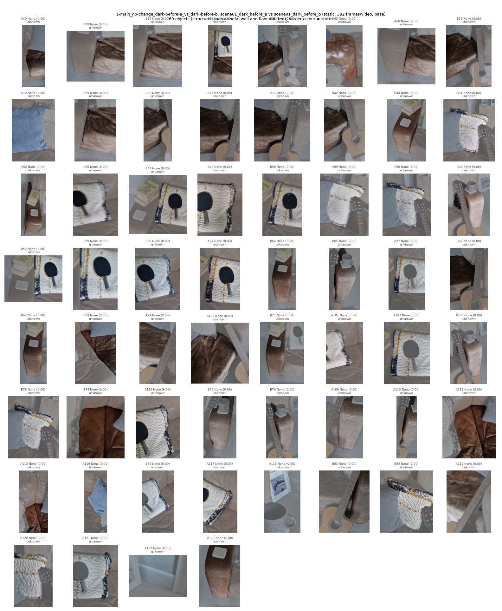
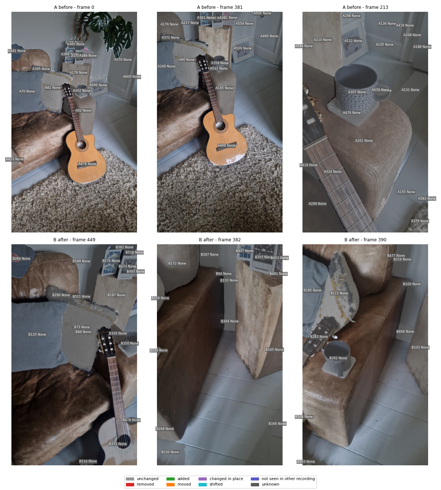
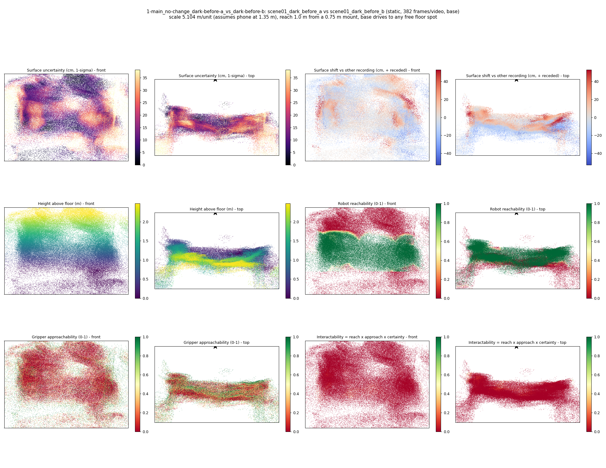
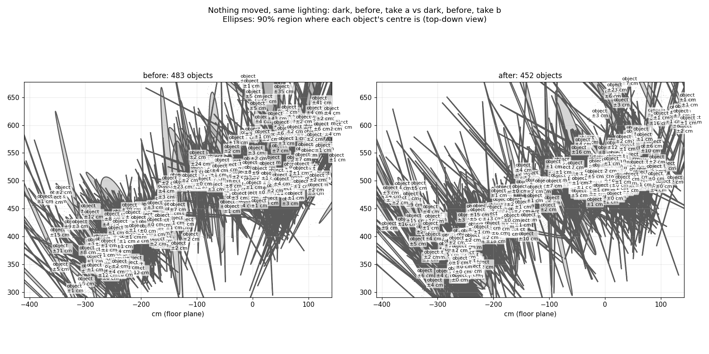
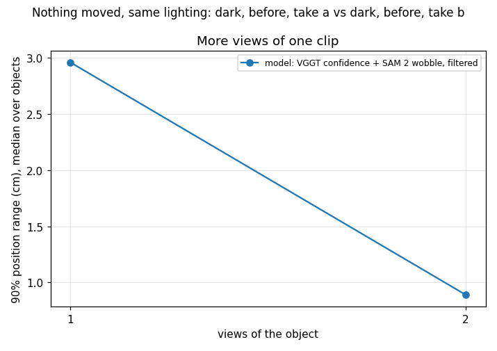
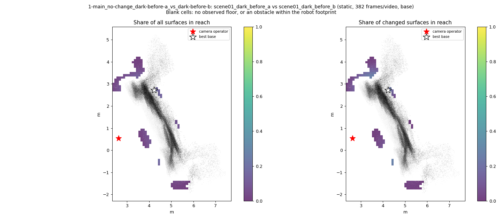
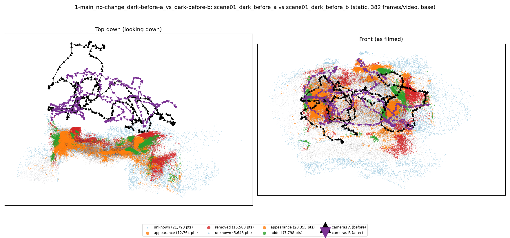

# Nothing moved, same lighting: dark, before, take a vs dark, before, take b

**What this run tests:** How many false alarms does it raise when nothing changed?

Before: `scene01_dark_before_a`. After: `scene01_dark_before_b`. 382 frames per recording, 44 SAM 2 views each. Step folder `1-main_no-change_dark-before-a_vs_dark-before-b` (part of *Main comparisons*).

SAM 2 failed (AttributeError: 'BaseModelOutputWithPooling' object has no attribute 'float'); objects below come from point clusters.

| Measure | Value |
|---|---|
| Objects found (A / B) | 483 / 452 |
| Objects compared / changed | 0 / 0 (0%) |
| Moved / added / removed / changed in place / shifted | 0 / 0 / 0 / 0 / 0 |
| Point-level changed share (old method) | 4.82% |
| Scale | 5.1045 m/unit (phone height cue 5.1045, objects cue None from 0 objects) |
| Reconstruction | 744 frames in 19 chunks, 429.4 s, worst anchor residual 0.0098 |
| Where objects are (90% range, median over objects) | ±2.96 cm from VGGT confidence and SAM 2 mask wobble over 1 views (one view alone: ±2.96 cm); check from views disagreeing: ±None cm |
| Consistency check (3 = honest, higher = overconfident) | 69.39 |

Nothing was moved between these recordings, so every changed object is a false alarm (**0 of 0**).

## Changes

- none

Scene report with the full object inventory and simulator ranges: [scene_report.md](scene_report.md)

Interactive 3D: download `viewer.html` and open it in a browser (objects are labelled; heat maps are layers in the legend).
