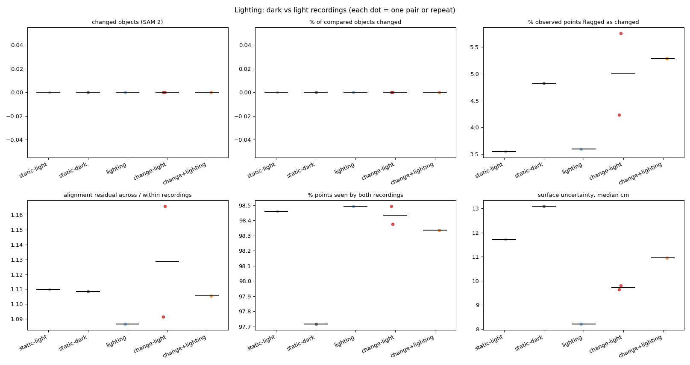

# Lighting comparison

| Group | Pairs | changed objects (SAM 2) | % of compared objects changed | % observed points flagged as changed | alignment residual across / within recordings | % points seen by both recordings | surface uncertainty, median cm |
|---|---|---|---|---|---|---|---|
| static-light | 1 | 0.00 (0.00-0.00) | 0.00 (0.00-0.00) | 3.55 (3.55-3.55) | 1.11 (1.11-1.11) | 98.46 (98.46-98.46) | 11.71 (11.71-11.71) |
| static-dark | 1 | 0.00 (0.00-0.00) | 0.00 (0.00-0.00) | 4.82 (4.82-4.82) | 1.11 (1.11-1.11) | 97.72 (97.72-97.72) | 13.10 (13.10-13.10) |
| lighting | 1 | 0.00 (0.00-0.00) | 0.00 (0.00-0.00) | 3.60 (3.60-3.60) | 1.09 (1.09-1.09) | 98.50 (98.50-98.50) | 8.20 (8.20-8.20) |
| change-light | 2 | 0.00 (0.00-0.00) | 0.00 (0.00-0.00) | 5.00 (4.24-5.76) | 1.13 (1.09-1.17) | 98.44 (98.38-98.50) | 9.72 (9.63-9.80) |
| change+lighting | 1 | 0.00 (0.00-0.00) | 0.00 (0.00-0.00) | 5.29 (5.29-5.29) | 1.11 (1.11-1.11) | 98.33 (98.33-98.33) | 10.96 (10.96-10.96) |

Median (range). **lighting** vs **static-light/static-dark** isolates what the lighting change alone flags as change; **change+lighting** vs **change-light** shows how much the real changes survive it.

## Reconstruction noise per recording

| Recording lighting | Samples | Surface uncertainty, median cm |
|---|---|---|
| dark | 4 | 11.60 |
| light | 8 | 8.96 |

## Same changes found through a lighting change?

For each after recording: changes found from a light 'before' vs from a dark 'before' (base settings, first frame pick). Labels exclude background classes.

| After | Light-before pair: changes / labels | Dark-before pair: changes / labels | Shared labels | Label overlap (Jaccard) |
|---|---|---|---|---|
| scene01_light_after_a | 0.0 / - | 0.0 / - | - | nan |

Ablation `no_appearance` (in the main summary) shows whether appearance features are what lighting trips; geometry-only detection should be nearly lighting-invariant.
