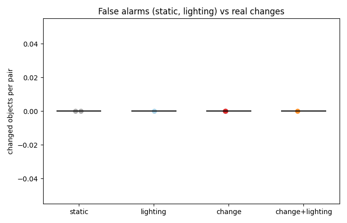
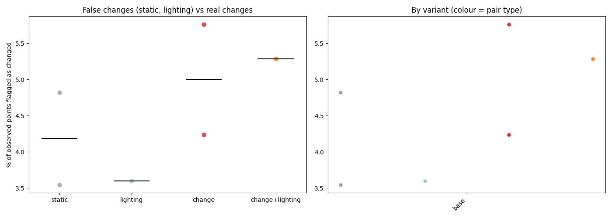

# Summary of 2026-10-10_scene01-objects

6 finished steps.
Lighting (dark vs light) comparison: [lighting.md](lighting.md)

## Headline: changed objects by pair type (SAM 2 objects, base settings)

| Pair type | Pairs | Changed objects, median (range) | Share of compared objects | Moved / added / removed / in place / shifted (total) |
|---|---|---|---|---|
| static | 2 | 0 (0-0) | 0% | 0 / 0 / 0 / 0 / 0 |
| lighting | 1 | 0 (0-0) | 0% | 0 / 0 / 0 / 0 / 0 |
| change | 2 | 0 (0-0) | 0% | 0 / 0 / 0 / 0 / 0 |
| change+lighting | 1 | 0 (0-0) | 0% | 0 / 0 / 0 / 0 / 0 |

**Separation: AUROC 0.50** (chance of a real-change pair having more changed objects than a no-change pair; 1.0 = perfect, 0.5 = no better than chance; 3 vs 3 pairs).

## Point-level changed fraction by pair type (base settings)

| Pair type | Steps | Median % changed | Range |
|---|---|---|---|
| static | 2 | 4.18 | 3.55 to 4.82 |
| lighting | 1 | 3.60 | 3.60 to 3.60 |
| change | 2 | 5.00 | 4.24 to 5.76 |
| change+lighting | 1 | 5.29 | 5.29 to 5.29 |

Static and lighting pairs have no real change, so their numbers are the false-change rate. A working detector shows change pairs clearly above both.

## All steps

| Step | Type | A vs B | Frames/video | Variant | % changed | Align resid (x/within) | Changes (mv/rm/add/app) | Recon s |
|---|---|---|---|---|---|---|---|---|
| [1-main_moved-and-light-changed_dark-before-a_vs_light-after-a](1-main_moved-and-light-changed_dark-before-a_vs_light-after-a/report.md) | change+lighting | scene01_dark_before_a vs scene01_light_after_a | 382 | base | 5.29 | 0.044/0.0398 | 0/0/0/0 | 434.7 |
| [1-main_moved_light-before-a_vs_light-after-a](1-main_moved_light-before-a_vs_light-after-a/report.md) | change | scene01_light_before_a vs scene01_light_after_a | 364 | base | 4.24 | 0.0322/0.0295 | 0/0/0/0 | 592.4 |
| [1-main_moved_light-before-b_vs_light-after-b](1-main_moved_light-before-b_vs_light-after-b/report.md) | change | scene01_light_before_b vs scene01_light_after_b | 372 | base | 5.76 | 0.0562/0.0482 | 0/0/0/0 | 429.5 |
| [1-main_no-change-light-vs-dark_dark-before-a_vs_light-before-a](1-main_no-change-light-vs-dark_dark-before-a_vs_light-before-a/report.md) | lighting | scene01_dark_before_a vs scene01_light_before_a | 382 | base | 3.60 | 0.0402/0.037 | 0/0/0/0 | 429.9 |
| [1-main_no-change_dark-before-a_vs_dark-before-b](1-main_no-change_dark-before-a_vs_dark-before-b/report.md) | static | scene01_dark_before_a vs scene01_dark_before_b | 382 | base | 4.82 | 0.0501/0.0452 | 0/0/0/0 | 429.4 |
| [1-main_no-change_light-before-a_vs_light-before-b](1-main_no-change_light-before-a_vs_light-before-b/report.md) | static | scene01_light_before_a vs scene01_light_before_b | 364 | base | 3.55 | 0.0384/0.0346 | 0/0/0/0 | 421.7 |

## Detected changes (base settings)

## Heat maps

Each step's `heatmaps.png` shows the maps; `viewer.html` has them as 3D layers.

| Step | Variant | Robot (reach m / mount m / base offset m) | Scale m/unit | Uncertainty cm (median / p90) | Shift cm p99 | Reachable | Approachable | Interactable |
|---|---|---|---|---|---|---|---|---|
| [1-main_moved-and-light-changed_dark-before-a_vs_light-after-a](1-main_moved-and-light-changed_dark-before-a_vs_light-after-a/heatmaps.png) | base | 1.0 / 0.75 / 0.0 | 3.9504 | 10.956 / 26.741 | 45.36 | 46% | 12% | 0% |
| [1-main_moved_light-before-a_vs_light-after-a](1-main_moved_light-before-a_vs_light-after-a/heatmaps.png) | base | 1.0 / 0.75 / 0.0 | 3.206 | 9.633 / 26.684 | 33.882 | 51% | 12% | 0% |
| [1-main_moved_light-before-b_vs_light-after-b](1-main_moved_light-before-b_vs_light-after-b/heatmaps.png) | base | 1.0 / 0.75 / 0.0 | 2.1864 | 9.802 / 22.904 | 25.65 | 52% | 10% | 1% |
| [1-main_no-change-light-vs-dark_dark-before-a_vs_light-before-a](1-main_no-change-light-vs-dark_dark-before-a_vs_light-before-a/heatmaps.png) | base | 1.0 / 0.75 / 0.0 | 3.3615 | 8.201 / 22.398 | 33.705 | 52% | 10% | 0% |
| [1-main_no-change_dark-before-a_vs_dark-before-b](1-main_no-change_dark-before-a_vs_dark-before-b/heatmaps.png) | base | 1.0 / 0.75 / 0.0 | 5.1045 | 13.096 / 30.775 | 52.807 | 54% | 16% | 0% |
| [1-main_no-change_light-before-a_vs_light-before-b](1-main_no-change_light-before-a_vs_light-before-b/heatmaps.png) | base | 1.0 / 0.75 / 0.0 | 2.8617 | 11.71 / 27.53 | 29.965 | 47% | 11% | 0% |

