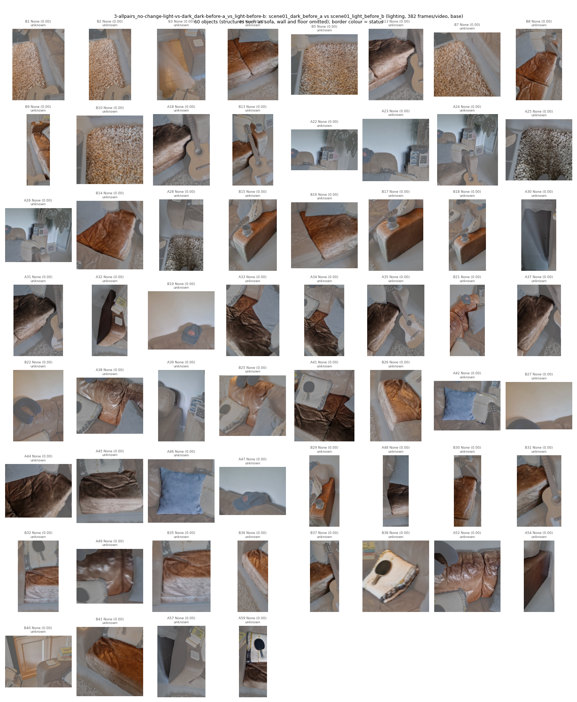
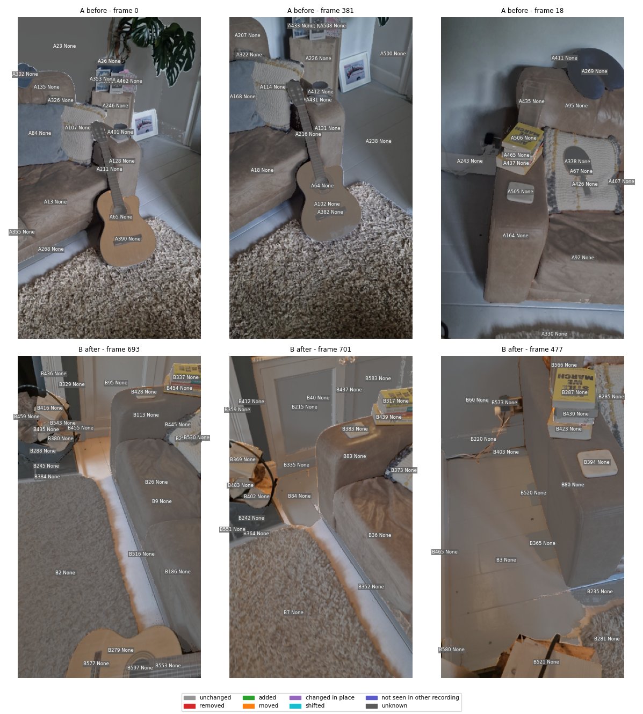
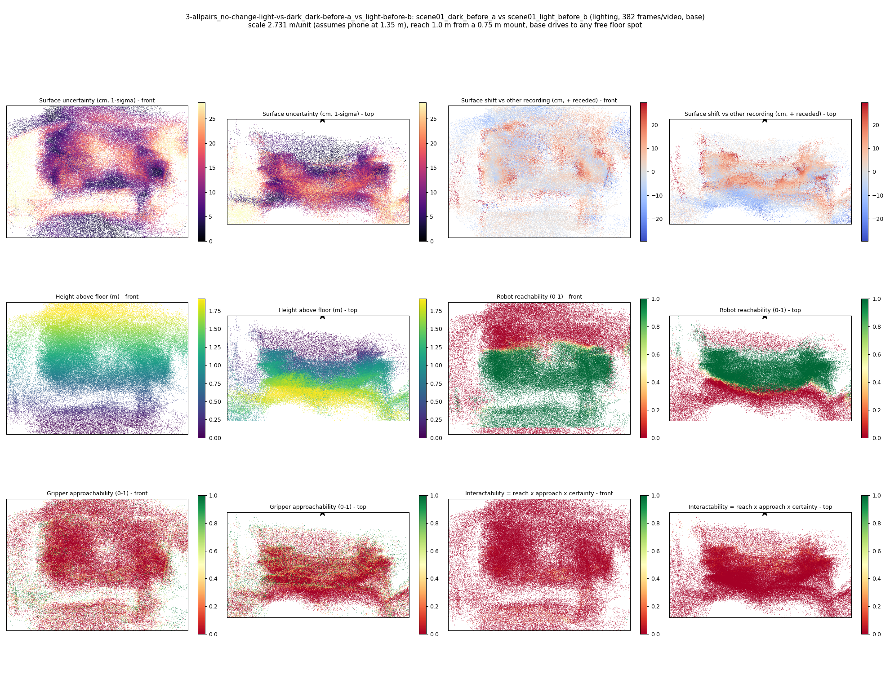
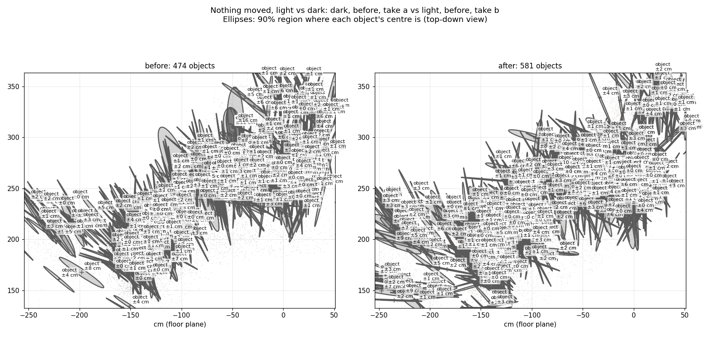
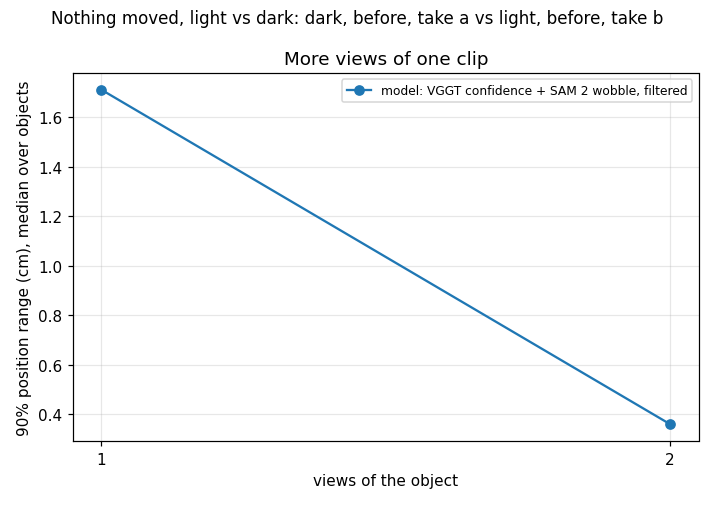
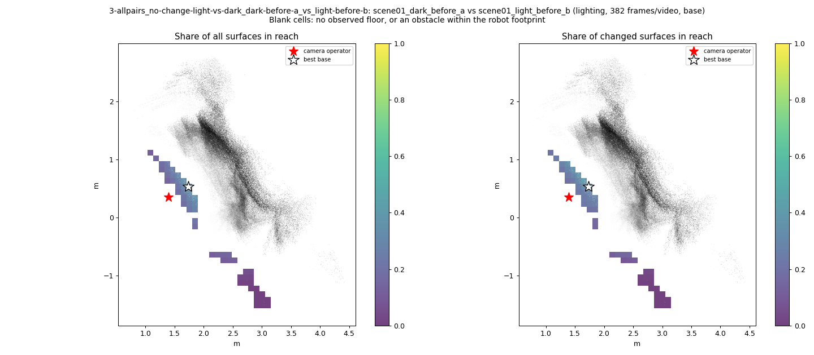
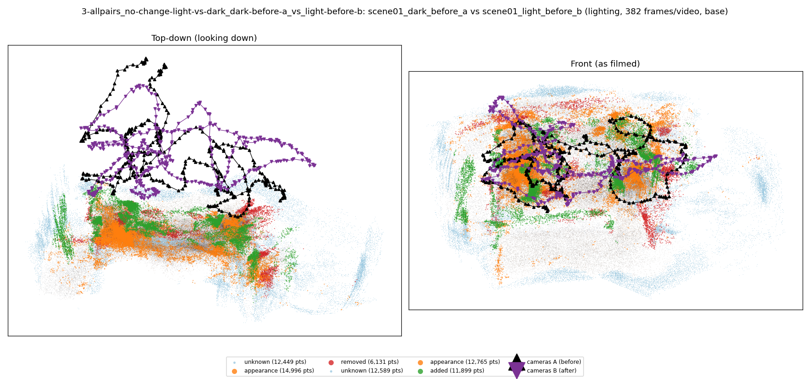

# Nothing moved, light vs dark: dark, before, take a vs light, before, take b

**What this run tests:** Does a lighting change alone cause false alarms?

Before: `scene01_dark_before_a`. After: `scene01_light_before_b`. 382 frames per recording, 44 SAM 2 views each. Step folder `3-allpairs_no-change-light-vs-dark_dark-before-a_vs_light-before-b` (part of *Every other pair*).

SAM 2 failed (AttributeError: 'BaseModelOutputWithPooling' object has no attribute 'float'); objects below come from point clusters.

| Measure | Value |
|---|---|
| Objects found (A / B) | 474 / 581 |
| Objects compared / changed | 0 / 0 (0%) |
| Moved / added / removed / changed in place / shifted | 0 / 0 / 0 / 0 / 0 |
| Point-level changed share (old method) | 3.90% |
| Scale | 2.7307 m/unit (phone height cue 2.7307, objects cue None from 0 objects) |
| Reconstruction | 754 frames in 19 chunks, 437.8 s, worst anchor residual 0.0104 |
| Where objects are (90% range, median over objects) | ±1.67 cm from VGGT confidence and SAM 2 mask wobble over 1 views (one view alone: ±1.71 cm); check from views disagreeing: ±None cm |
| Consistency check (3 = honest, higher = overconfident) | 28.5 |

Nothing was moved between these recordings, so every changed object is a false alarm (**0 of 0**).

## Changes

- none

Scene report with the full object inventory and simulator ranges: [scene_report.md](scene_report.md)

Interactive 3D: download `viewer.html` and open it in a browser (objects are labelled; heat maps are layers in the legend).
