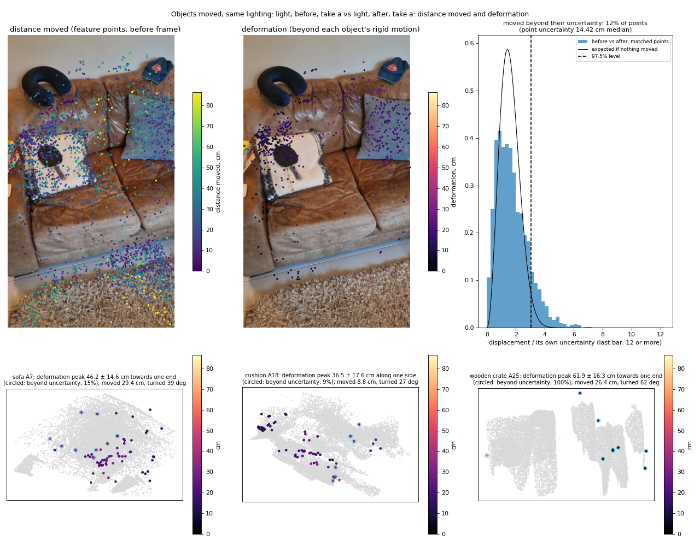
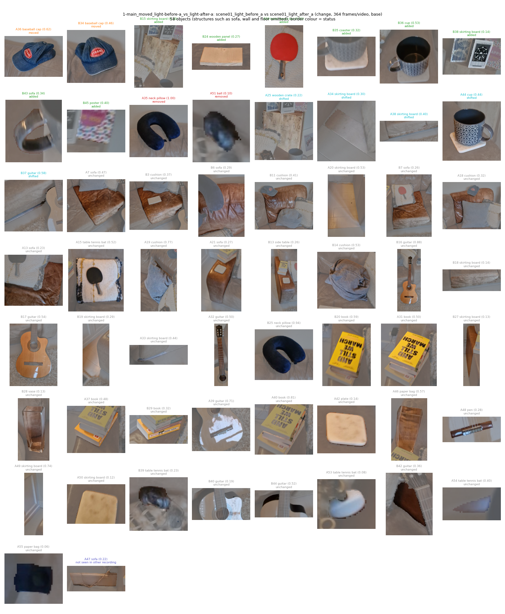
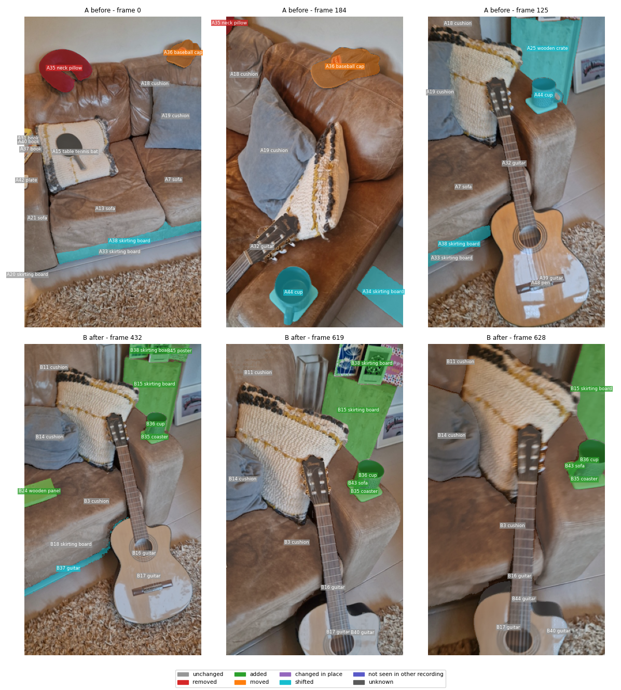
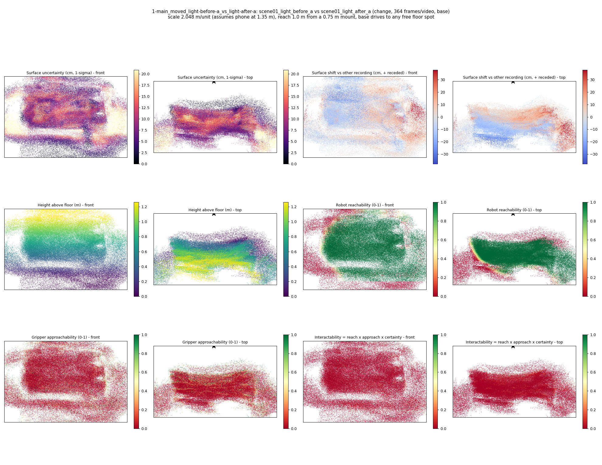
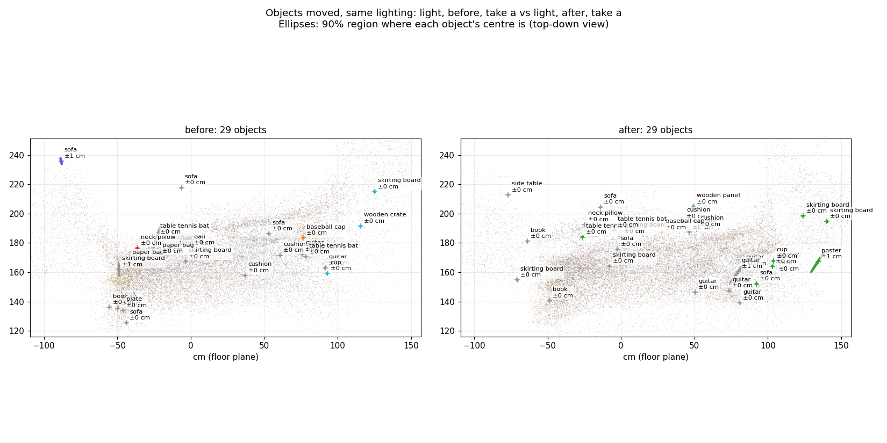
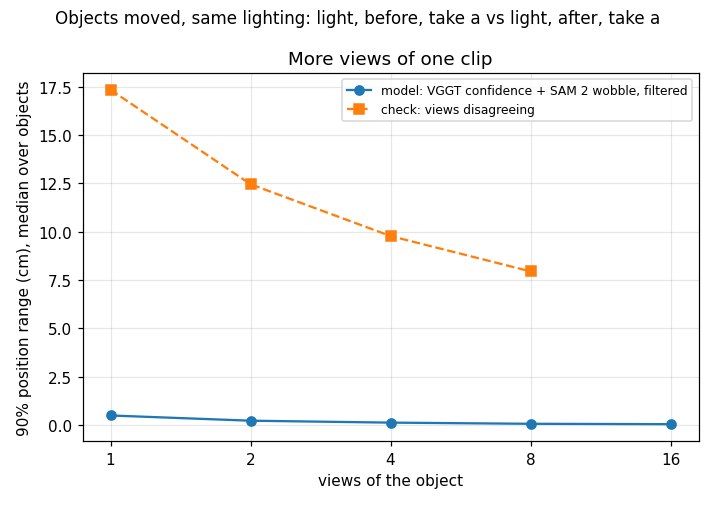
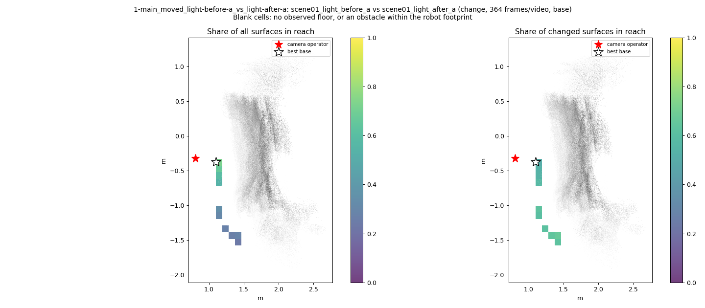
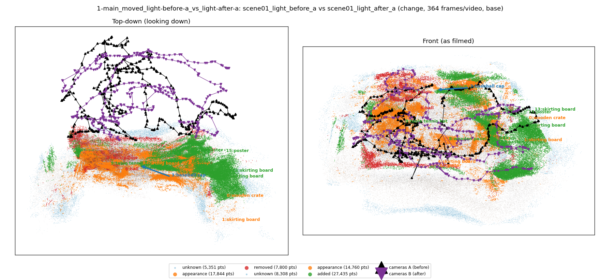

# Objects moved, same lighting: light, before, take a vs light, after, take a

**What this run tests:** Does it find the objects that really moved, were added or removed?

Before: `scene01_light_before_a`. After: `scene01_light_after_a`. 364 frames per recording, 44 SAM 2 views each. Step folder `1-main_moved_light-before-a_vs_light-after-a` (part of *Main comparisons*).

| Measure | Value |
|---|---|
| Objects found (A / B) | 29 / 29 |
| Objects compared / changed | 31 / 12 (39%) |
| Moved / added / removed / changed in place / shifted | 1 / 8 / 2 / 0 / 1 |
| Point-level changed share (old method) | 5.72% |
| Scale | 2.0479 m/unit, 90% [1.799, 2.2696] (most likely from metric depth cue 2.4907 and objects cue 1.4518 from 24 objects) |
| Reconstruction | 735 frames in 19 chunks, 607.2 s, worst anchor residual 0.0061 |
| Where objects are (90% range, median over objects) | ±0.06 cm from VGGT confidence and SAM 2 mask wobble over 11 views (one view alone: ±0.97 cm); check from views disagreeing: ±5.3 cm |
| Consistency check (3 = honest, higher = overconfident) | 29058.06 |
| Do unchanged objects agree between the recordings? | 0% within their combined 90% ranges (20 objects; about 90% expected where nothing moved) |
| Camera poses (bundle adjustment from VGGT) | reprojection error 8.3 -> 0.66 px median (1.98 px p90; worst frame 2.33 px), 117 sparse frames resected, 42 interpolated, cameras turned 1.15 deg; pose uncertainty 0.45 px median, 36 unconstrained frames count for less in positions, motion, change votes and splats |
| Matched feature points before/after | 4036; uncertainty per point 14.419 cm median (1 sigma, from the triangulation; of which 14.094 cm misalignment between the recordings); 12% moved beyond their own uncertainty |
| Objects moved / deformed (feature points) | 11 / 4 of 13 measured |

## Distance moved and deformation (matched feature points)

Each object's feature points are matched between the recordings. Its rigid motion gives the distance moved; what the rigid motion cannot explain is deformation (e.g. a bent cushion corner).

Every matched point carries its own uncertainty (from how many frames saw it, from what angles); deformation counts only where it is beyond that.

| Object | Moved (90%) | Turned | Deformation p90 / peak (± point uncertainty) | Where | Share beyond uncertainty |
|---|---|---|---|---|---|
| sofa A7 | 29.4 cm (22.34-34.59) | 39 deg | 32.2 / 46.2 ± 14.62 cm | towards one end | 15% |
| cushion A18 | 8.8 cm (6.27-12.64) | 27 deg | 28.9 / 36.5 ± 17.58 cm | along one side | 9% |
| wooden crate A25 | 26.4 cm (14.28-43.52) | 62 deg | 26.8 / 61.9 ± 16.29 cm | towards one end | 100% |
| cushion A19 | 25.5 cm (20.59-32.48) | 27 deg | 25.9 / 33.7 ± 15.06 cm | towards one end | 11% |
| guitar A32 | 26.9 cm (19.53-31.57) | 32 deg | 24.4 / 27.3 ± 14.53 cm | towards one end | 0% |
| table tennis bat A15 | 14.1 cm (12.07-16.05) | 10 deg | 20.9 / 33.3 ± 14.24 cm | towards one end | 0% |
| sofa A13 | 33.1 cm (18.73-44.09) | 43 deg | 19.6 / 20.7 ± 14.38 cm | along one side | 0% |
| skirting board A33 | 19.6 cm (13.44-35.03) | 22 deg | 17.8 / 17.8 ± 14.46 cm | at a corner | 0% |
| guitar A39 | 33.3 cm (28.4-36.9) | 37 deg | 16.8 / 17.5 ± 16.3 cm | at a corner | 0% |
| sofa A21 | 12.6 cm (7.91-16.7) | 11 deg | 15.4 / 36.1 ± 16.54 cm | towards one end | 0% |
| neck pillow A35 | 8.3 cm (5.62-21.97) | 20 deg | 8.1 / 14.1 ± 14.17 cm | at a corner | 0% |

## Object assets (node graphs)

`assets/` holds 58 objects as node graphs (nodes with weights, edges with rest length, spring constant from the Rigidity Copilot and measured strain, convex hull also as `_hull.obj`) and `scene_graph.json` with contacts.

Rigidity Copilot (CLIP asked what each object is made of and how stiff it is; an expectation from appearance, checked against the measured strain where there is any):

| Object | Status | Material (CLIP) | Rigidity 0-1 | Young's modulus | Measured | Check |
|---|---|---|---|---|---|---|
| wooden crate | shifted | wood | 0.88 | 8.5e+09 Pa | rigid at this precision | agrees |
| skirting board | shifted | metal | 0.86 | 5.1e+09 Pa | - | - |
| neck pillow | removed | soft foam or stuffing | 0.29 | 2.2e+05 Pa | - | - |
| baseball cap | moved | fabric or cloth | 0.60 | 2e+06 Pa | - | - |
| skirting board | shifted | wood | 0.84 | 2.5e+09 Pa | - | - |
| cup | shifted | ceramic or porcelain | 0.89 | 1.5e+10 Pa | rigid at this precision | agrees |
| ball | removed | rubber | 0.61 | 9.2e+08 Pa | - | - |
| skirting board | added | wood | 0.88 | 7.1e+09 Pa | - | - |
| wooden panel | added | wood | 0.87 | 8e+09 Pa | - | - |
| table tennis bat | added | rubber | 0.72 | 2.3e+08 Pa | - | - |
| baseball cap | moved | fabric or cloth | 0.65 | 3.8e+06 Pa | - | - |
| coaster | added | rubber | 0.69 | 2.6e+08 Pa | - | - |
| cup | added | metal | 0.90 | 2.1e+10 Pa | - | - |
| guitar | shifted | wood | 0.85 | 4.8e+09 Pa | - | - |
| skirting board | added | paper or cardboard | 0.84 | 2.5e+09 Pa | - | - |

Contacts: A025_wooden_crate rests on A034_skirting_board; A007_sofa rests on A038_skirting_board; A013_sofa rests on A038_skirting_board; B038_skirting_board rests on B015_skirting_board; B043_sofa rests on B035_coaster; B043_sofa rests on B036_cup; A018_cushion rests on A007_sofa; A047_sofa rests on A020_skirting_board; A046_paper_bag rests on A021_sofa; A046_paper_bag rests on A031_book.

## Changes

- **A25 wooden crate** (shifted, 84 x 41 x 24 cm): The wooden crate's surface moved by about 24 cm (squashed, pushed or deformed). Its centre is known to within about 0 cm (90%, from 9 views; one view alone: 1 cm). Matched feature points: moved 26 cm (90%: 14-44 cm), turned 62 deg. Its shape changed: up to 61.9 cm beyond its rigid motion, towards one end (100% of it).
- **A34 skirting board** (shifted, 65 x 28 x 9 cm): The skirting board's surface moved by about 29 cm (squashed, pushed or deformed). Its centre is known to within about 0 cm (90%, from 5 views; one view alone: 2 cm).
- **A35 neck pillow** (removed, 45 x 25 x 10 cm): A neck pillow that was there before is no longer there. Its centre is known to within about 0 cm (90%, from 12 views; one view alone: 1 cm). Matched feature points: moved 8 cm (90%: 6-22 cm), turned 20 deg.
- **A36 baseball cap** (moved, 53 x 15 x 10 cm): The baseball cap moved to the left and towards the camera by about 42 cm (90% interval 37 to 47). Its centre is known to within about 0 cm (90%, from 9 views; one view alone: 1 cm).
- **A38 skirting board** (shifted, 91 x 20 x 13 cm): The skirting board's surface moved by about 25 cm (squashed, pushed or deformed). Its centre is known to within about 0 cm (90%, from 7 views; one view alone: 1 cm).
- **A44 cup** (shifted, 26 x 18 x 9 cm): The cup's surface moved by about 21 cm (squashed, pushed or deformed). Its centre is known to within about 0 cm (90%, from 11 views; one view alone: 1 cm).
- **A51 ball** (removed, 31 x 16 x 7 cm): A ball that was there before is no longer there. Its centre is known to within about 0 cm (90%, from 10 views; one view alone: 1 cm).
- **B15 skirting board** (added, 86 x 43 x 27 cm): A skirting board is there now that was not there before. Its centre is known to within about 0 cm (90%, from 15 views; one view alone: 1 cm).
- **B24 wooden panel** (added, 74 x 28 x 27 cm): A wooden panel is there now that was not there before. Its centre is known to within about 0 cm (90%, from 14 views; one view alone: 1 cm).
- **B30 table tennis bat** (added, 30 x 19 x 14 cm): A table tennis bat is there now that was not there before. Its centre is known to within about 0 cm (90%, from 12 views; one view alone: 1 cm).
- **B34 baseball cap** (moved, 37 x 26 x 5 cm): The baseball cap moved to the left and towards the camera by about 42 cm (90% interval 37 to 47). Its centre is known to within about 0 cm (90%, from 9 views; one view alone: 0 cm).
- **B35 coaster** (added, 32 x 18 x 10 cm): A coaster is there now that was not there before. Its centre is known to within about 0 cm (90%, from 10 views; one view alone: 1 cm).
- **B36 cup** (added, 25 x 16 x 5 cm): A cup is there now that was not there before. Its centre is known to within about 0 cm (90%, from 9 views; one view alone: 1 cm).
- **B37 guitar** (shifted, 45 x 15 x 8 cm): The guitar's surface moved by about 20 cm (squashed, pushed or deformed). Its centre is known to within about 2 cm (90%, from 3 views; one view alone: 4 cm).
- **B38 skirting board** (added, 36 x 14 x 7 cm): A skirting board is there now that was not there before. Its centre is known to within about 0 cm (90%, from 4 views; one view alone: 1 cm).
- **B43 sofa** (added, 25 x 6 x 2 cm): A sofa is there now that was not there before. Its centre is known to within about 0 cm (90%, from 4 views; one view alone: 1 cm).
- **B45 poster** (added, 3 x 2 x 0 cm): A poster is there now that was not there before. Its centre is known to within about 1 cm (90%, from 1 views; one view alone: 1 cm).

Scene report with the full object inventory and simulator ranges: [scene_report.md](scene_report.md)

Interactive 3D: download `viewer.html` and open it in a browser (objects are labelled; heat maps are layers in the legend).
