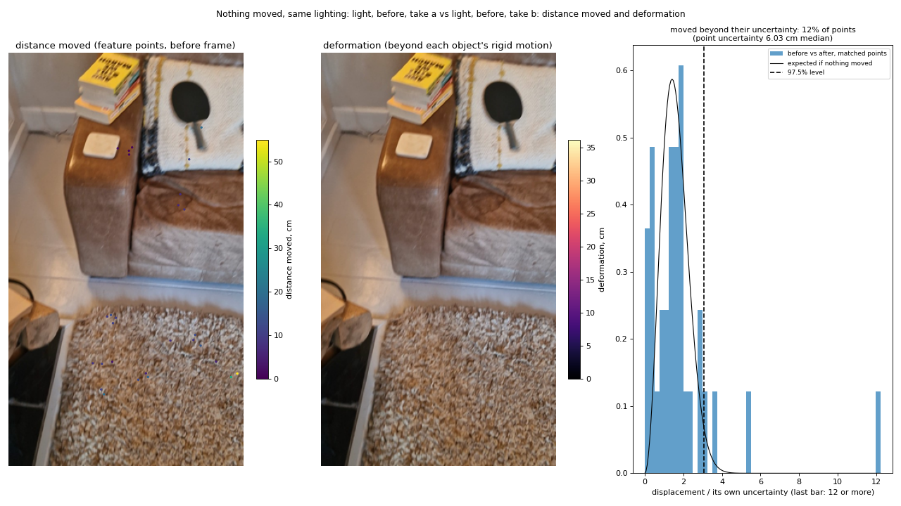
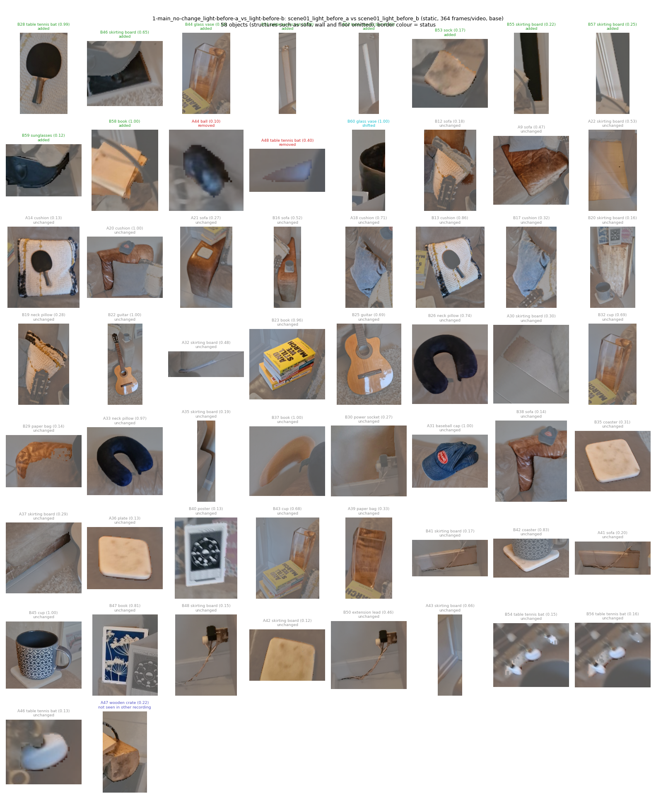
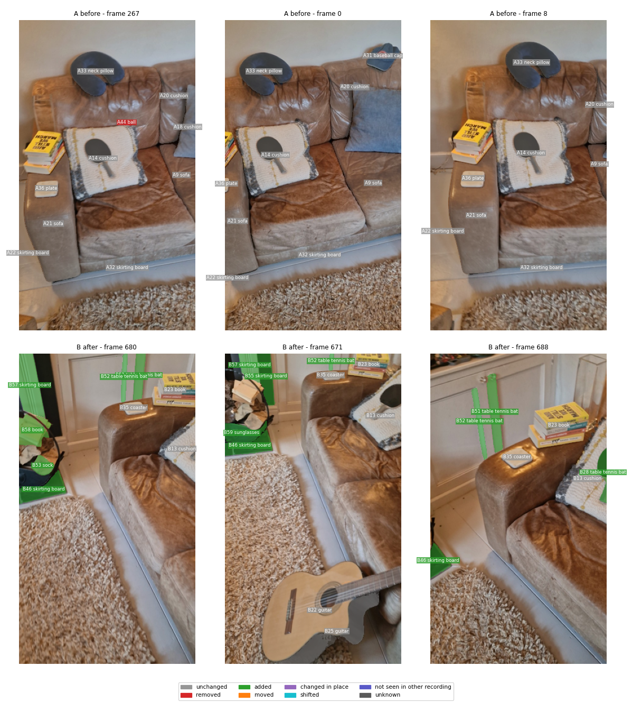
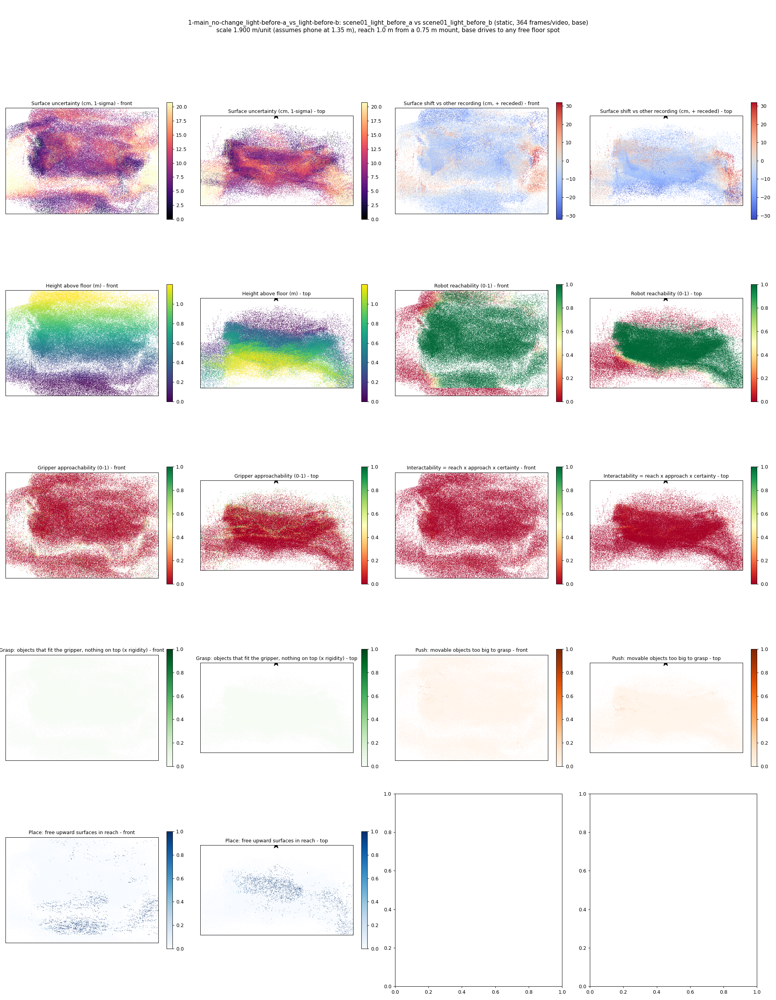
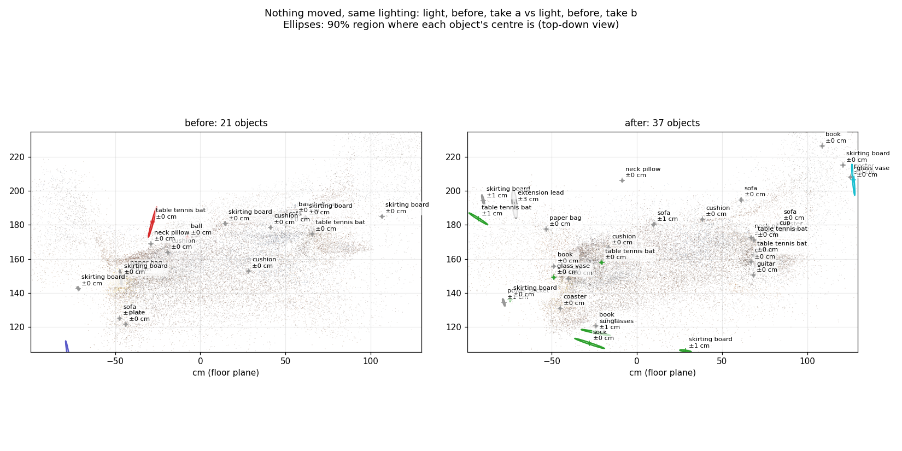
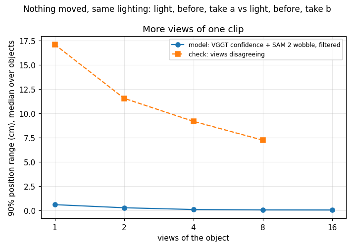
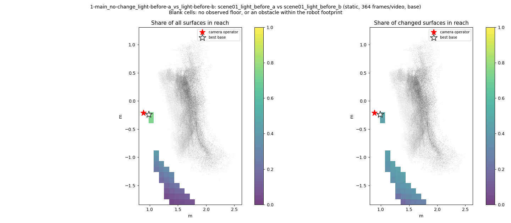
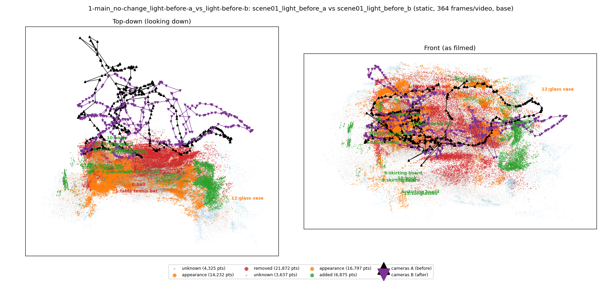

# Nothing moved, same lighting: light, before, take a vs light, before, take b

**What this run tests:** How many false alarms does it raise when nothing changed?

Before: `scene01_light_before_a`. After: `scene01_light_before_b`. 364 frames per recording, 44 SAM 2 views each. Step folder `1-main_no-change_light-before-a_vs_light-before-b` (part of *Main comparisons*).

| Measure | Value |
|---|---|
| Objects found (A / B) | 21 / 37 |
| Objects compared / changed | 39 / 13 (33%) |
| Moved / added / removed / changed in place / shifted | 0 / 10 / 2 / 0 / 1 |
| Point-level changed share (old method) | 5.01% |
| Scale | 1.9 m/unit, 90% [1.7192, 2.106] (most likely from metric depth cue 2.4983 and objects cue 1.6366 from 15 objects) |
| Reconstruction | 736 frames in 19 chunks, 454.6 s, worst anchor residual 0.0058 |
| Where objects are (90% range, median over objects) | ±0.11 cm from VGGT confidence and SAM 2 mask wobble over 8 views (one view alone: ±0.88 cm); check from views disagreeing: ±4.93 cm |
| Consistency check (3 = honest, higher = overconfident) | 24852.31 |
| Do unchanged objects agree between the recordings? | 0% within their combined 90% ranges (9 objects; about 90% expected where nothing moved) |
| Camera poses (bundle adjustment from VGGT) | reprojection error 8.2 -> 0.83 px median (2.05 px p90; worst frame 2.85 px), 100 sparse frames resected, 45 interpolated, cameras turned 1.87 deg; pose uncertainty 0.50 px median, 46 unconstrained frames count for less in positions, motion, change votes and splats |
| How the recordings are tied together | 2073 adjusted points seen in both (their error 1.14 px); per recording 0.84 / 0.83 px median; 18% of feature observations kept; one focal length for both recordings |
| Matched feature points before/after | 33; uncertainty per point 6.025 cm median (1 sigma, from the triangulation; of which 5.95 cm misalignment between the recordings); 12% moved beyond their own uncertainty |
| Alignment between the recordings (static points) | 33 links agree with a rigid scene; correction 10.46 cm, 11.898 deg, scale 4.616% (88% inliers) |
| Objects moved / deformed (feature points) | 0 / 0 of 0 measured |

## Object assets (node graphs)

`assets/` holds 58 objects as node graphs (nodes with weights, edges with rest length, spring constant from the Rigidity Copilot and measured strain, convex hull also as `_hull.obj`) and `scene_graph.json` with contacts.

Rigidity Copilot (CLIP asked what each object is made of and how stiff it is; an expectation from appearance, checked against the measured strain where there is any):

| Object | Status | Material (CLIP) | Rigidity 0-1 | Young's modulus | Measured | Check |
|---|---|---|---|---|---|---|
| ball | removed | rubber | 0.61 | 9.2e+08 Pa | - | - |
| table tennis bat | removed | metal | 0.79 | 2.6e+09 Pa | - | - |
| table tennis bat | added | rubber | 0.71 | 4.3e+08 Pa | - | - |
| glass vase | added | glass | 0.88 | 5.3e+09 Pa | - | - |
| skirting board | added | rubber | 0.78 | 5.6e+08 Pa | - | - |
| table tennis bat | added | wood | 0.75 | 4.2e+08 Pa | - | - |
| table tennis bat | added | ceramic or porcelain | 0.75 | 1.1e+09 Pa | - | - |
| sock | added | metal | 0.81 | 4.8e+09 Pa | - | - |
| skirting board | added | wood | 0.81 | 7.6e+08 Pa | - | - |
| skirting board | added | wood | 0.85 | 2.9e+09 Pa | - | - |
| book | added | wood | 0.89 | 9.4e+09 Pa | - | - |
| sunglasses | added | metal | 0.90 | 2.8e+10 Pa | - | - |
| glass vase | shifted | ceramic or porcelain | 0.75 | 3.3e+09 Pa | - | - |
| wooden crate | not seen in other recording | wood | 0.87 | 8.3e+09 Pa | - | - |
| sofa | unchanged | leather | 0.56 | 6.1e+07 Pa | - | - |

Contacts: B029_paper_bag rests on B028_table_tennis_bat; B028_table_tennis_bat rests on B035_coaster; A009_sofa rests on A032_skirting_board; A031_baseball_cap rests on A018_cushion; A039_paper_bag rests on A021_sofa; A041_sofa rests on A022_skirting_board; B029_paper_bag rests on B013_cushion; B016_sofa rests on B025_guitar; B047_book rests on B020_skirting_board; B029_paper_bag rests on B023_book.

Nothing was moved between these recordings, so every changed object is a false alarm (**13 of 39**).

## Changes

- **A44 ball** (removed, 24 x 14 x 4 cm): A ball that was there before is no longer there. Its centre is known to within about 0 cm (90%, from 10 views; one view alone: 1 cm). It is on top of the cushion and next to the cushion, the cushion, the cushion.
- **A48 table tennis bat** (removed, 3 x 1 x 0 cm): A table tennis bat that was there before is no longer there. Its centre is known to within about 0 cm (90%, from 1 views; one view alone: 0 cm). It is on top of the sofa and next to the baseball cap, the sofa, the skirting board.
- **B28 table tennis bat** (added, 30 x 16 x 14 cm): A table tennis bat is there now that was not there before. Its centre is known to within about 0 cm (90%, from 17 views; one view alone: 1 cm). It is on top of the cushion and next to the guitar, the neck pillow, the paper bag. Resting on it: the blanket, the cup.
- **B44 glass vase** (added, 18 x 15 x 6 cm): A glass vase is there now that was not there before. Its centre is known to within about 0 cm (90%, from 8 views; one view alone: 1 cm). It is on top of the book and next to the cup, the soft toy, the chair. Resting on it: the paper bag, the cup.
- **B46 skirting board** (added, 30 x 23 x 4 cm): A skirting board is there now that was not there before. Its centre is known to within about 0 cm (90%, from 4 views; one view alone: 1 cm). It is next to the rug, the rug, the sunglasses. Resting on it: the table tennis bat.
- **B51 table tennis bat** (added, 32 x 19 x 3 cm): A table tennis bat is there now that was not there before. Its centre is known to within about 1 cm (90%, from 2 views; one view alone: 1 cm). It is next to the shelf, the table tennis bat, the side table.
- **B52 table tennis bat** (added, 37 x 17 x 3 cm): A table tennis bat is there now that was not there before. Its centre is known to within about 0 cm (90%, from 3 views; one view alone: 1 cm). It is next to the shelf, the table tennis bat, the side table.
- **B53 sock** (added, 6 x 4 x 0 cm): A sock is there now that was not there before. Its centre is known to within about 0 cm (90%, from 1 views; one view alone: 0 cm). It is next to the book, the rug, the skirting board.
- **B55 skirting board** (added, 21 x 6 x 0 cm): A skirting board is there now that was not there before. Its centre is known to within about 1 cm (90%, from 2 views; one view alone: 1 cm). It is next to the shelf, the skirting board, the side table.
- **B57 skirting board** (added, 28 x 6 x 1 cm): A skirting board is there now that was not there before. Its centre is known to within about 0 cm (90%, from 2 views; one view alone: 1 cm). It is next to the shelf, the skirting board.
- **B58 book** (added, 3 x 1 x 0 cm): A book is there now that was not there before. Its centre is known to within about 1 cm (90%, from 1 views; one view alone: 1 cm). It is next to the sock.
- **B59 sunglasses** (added, 11 x 3 x 0 cm): A sunglasses is there now that was not there before. Its centre is known to within about 1 cm (90%, from 1 views; one view alone: 1 cm). It is next to the rug, the rug, the skirting board.
- **B60 glass vase** (shifted, 2 x 1 x 0 cm): The glass vase's surface moved by about 45 cm (squashed, pushed or deformed). Its centre is known to within about 0 cm (90%, from 1 views; one view alone: 0 cm). It is on top of the poster and next to the book, the shelf.

Scene report with the full object inventory and simulator ranges: [scene_report.md](scene_report.md)

Interactive 3D: download `viewer.html` and open it in a browser (objects are labelled; heat maps are layers in the legend).
