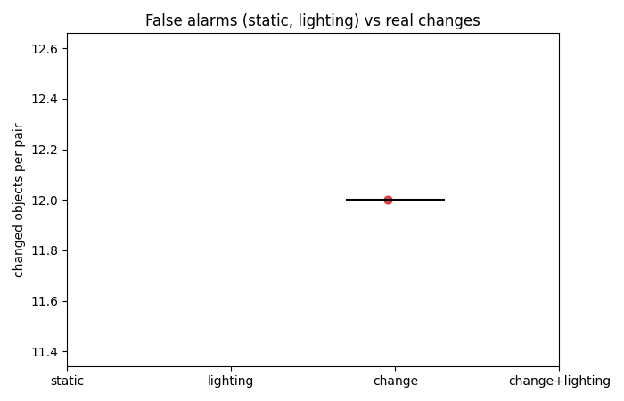
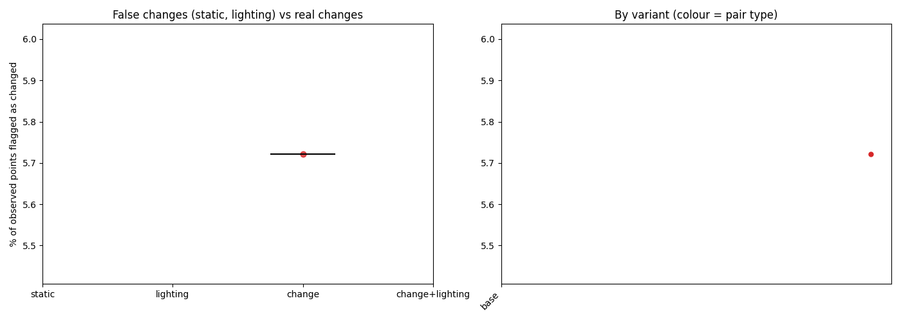

# Summary of 2026-10-11_scene01-objects-fixed

1 finished steps.
Lighting (dark vs light) comparison: [lighting.md](lighting.md)

## Headline: changed objects by pair type (SAM 2 objects, base settings)

| Pair type | Pairs | Changed objects, median (range) | Share of compared objects | Moved / added / removed / in place / shifted (total) |
|---|---|---|---|---|
| change | 1 | 12 (12-12) | 39% | 1 / 8 / 2 / 0 / 1 |

Most frequent changes on real-change pairs (label, status: pairs):

skirting board shifted: 2, baseball cap moved: 2, skirting board added: 2, wooden crate shifted: 1, neck pillow removed: 1, cup shifted: 1, ball removed: 1, wooden panel added: 1, table tennis bat added: 1, coaster added: 1, cup added: 1, guitar shifted: 1, sofa added: 1, poster added: 1

## Point-level changed fraction by pair type (base settings)

| Pair type | Steps | Median % changed | Range |
|---|---|---|---|
| change | 1 | 5.72 | 5.72 to 5.72 |

Static and lighting pairs have no real change, so their numbers are the false-change rate. A working detector shows change pairs clearly above both.

## All steps

| Step | Type | A vs B | Frames/video | Variant | % changed | Align resid (x/within) | Changes (mv/rm/add/app) | Recon s |
|---|---|---|---|---|---|---|---|---|
| [1-main_moved_light-before-a_vs_light-after-a](1-main_moved_light-before-a_vs_light-after-a/report.md) | change | scene01_light_before_a vs scene01_light_after_a | 364 | base | 5.72 | 0.0984/0.0785 | 0/2/8/5 | 607.2 |

## Detected changes (base settings)

**1-main_moved_light-before-a_vs_light-after-a** (change)
- The wooden crate's surface moved by about 24 cm (squashed, pushed or deformed). Its centre is known to within about 0 cm (90%, from 9 views; one view alone: 1 cm). Matched feature points: moved 26 cm (90%: 14-44 cm), turned 62 deg. Its shape changed: up to 61.9 cm beyond its rigid motion, towards one end (100% of it).
- The skirting board's surface moved by about 29 cm (squashed, pushed or deformed). Its centre is known to within about 0 cm (90%, from 5 views; one view alone: 2 cm).
- A neck pillow that was there before is no longer there. Its centre is known to within about 0 cm (90%, from 12 views; one view alone: 1 cm). Matched feature points: moved 8 cm (90%: 6-22 cm), turned 20 deg.
- The baseball cap moved to the left and towards the camera by about 42 cm (90% interval 37 to 47). Its centre is known to within about 0 cm (90%, from 9 views; one view alone: 1 cm).
- The skirting board's surface moved by about 25 cm (squashed, pushed or deformed). Its centre is known to within about 0 cm (90%, from 7 views; one view alone: 1 cm).
- The cup's surface moved by about 21 cm (squashed, pushed or deformed). Its centre is known to within about 0 cm (90%, from 11 views; one view alone: 1 cm).
- A ball that was there before is no longer there. Its centre is known to within about 0 cm (90%, from 10 views; one view alone: 1 cm).
- A skirting board is there now that was not there before. Its centre is known to within about 0 cm (90%, from 15 views; one view alone: 1 cm).

## Heat maps

Each step's `heatmaps.png` shows the maps; `viewer.html` has them as 3D layers.

| Step | Variant | Robot (reach m / mount m / base offset m) | Scale m/unit | Uncertainty cm (median / p90) | Shift cm p99 | Reachable | Approachable | Interactable |
|---|---|---|---|---|---|---|---|---|
| [1-main_moved_light-before-a_vs_light-after-a](1-main_moved_light-before-a_vs_light-after-a/heatmaps.png) | base | 1.0 / 0.75 / 0.0 | 2.0479 | 7.456 / 16.46 | 37.966 | 79% | 5% | 0% |

