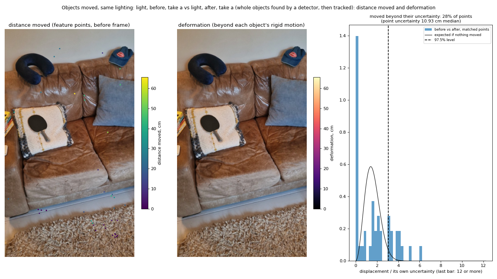
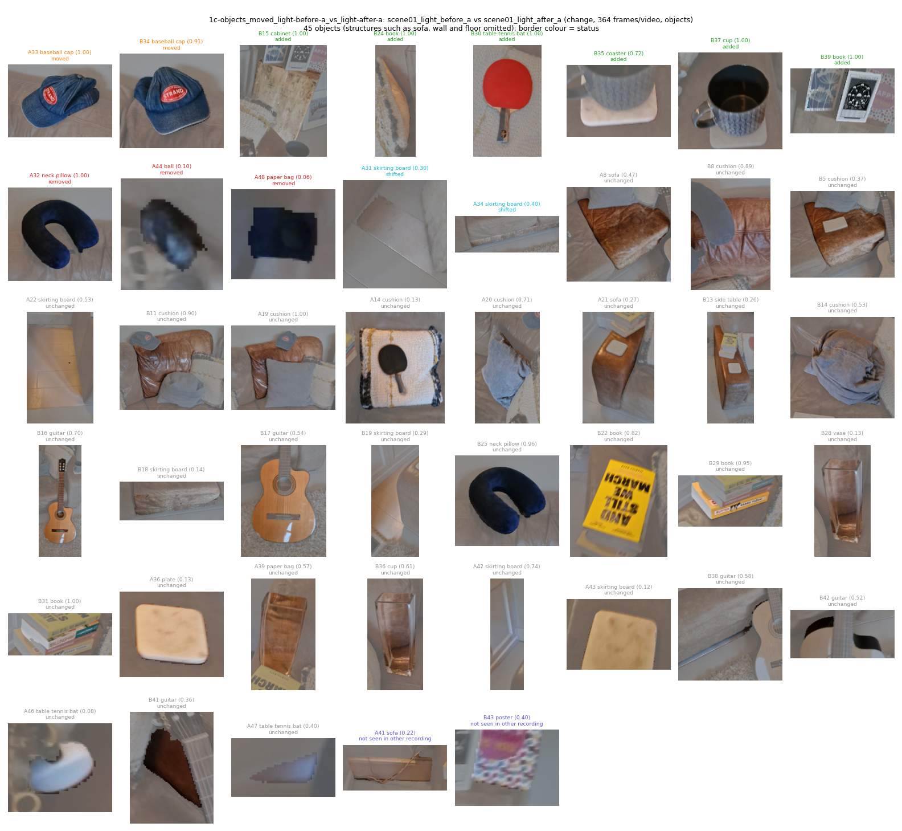
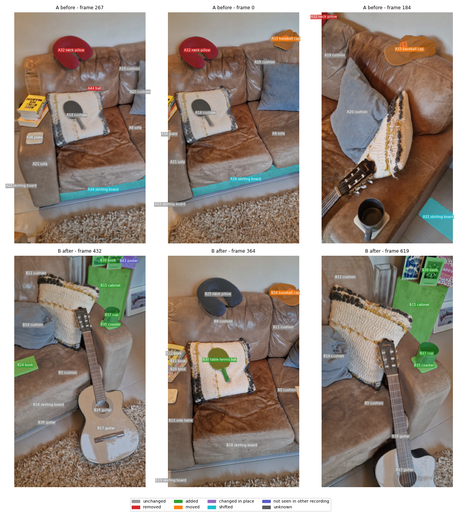
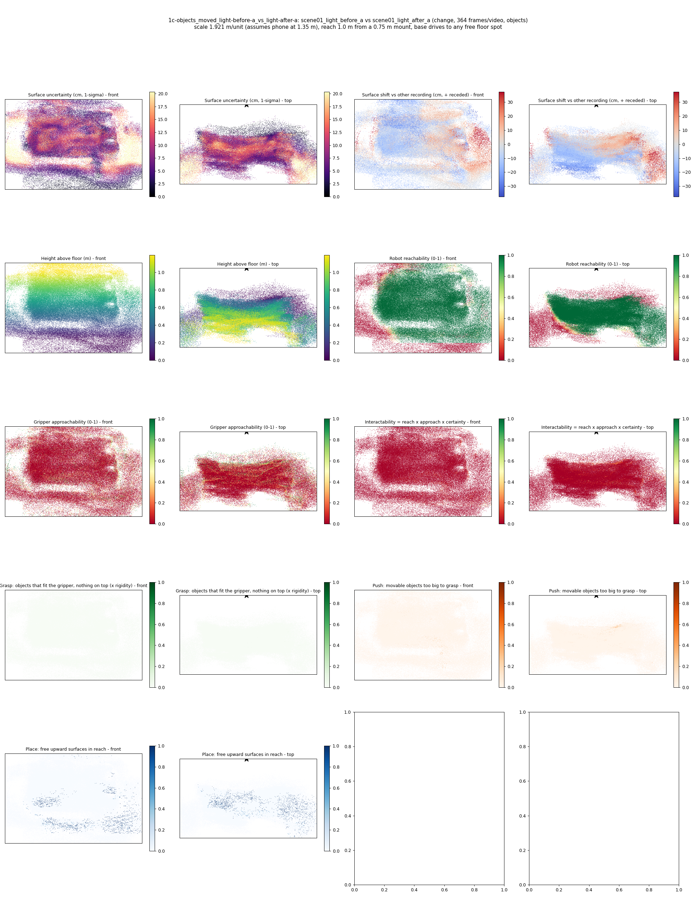
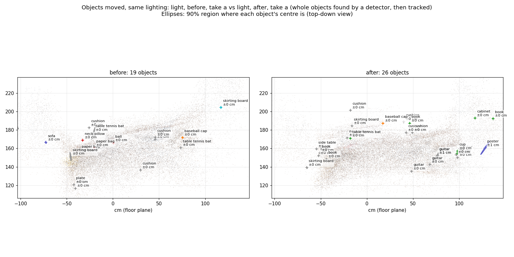
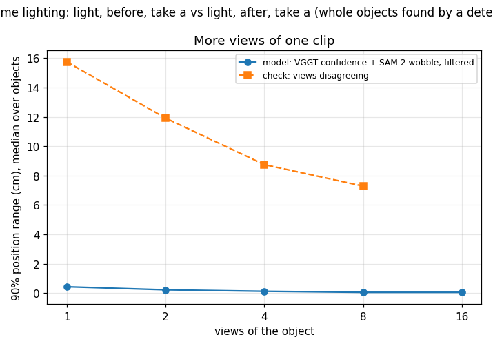
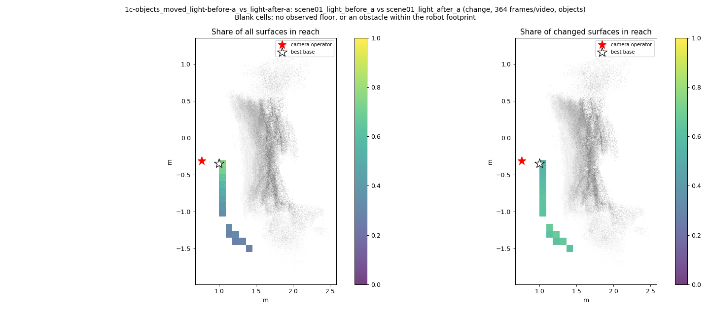
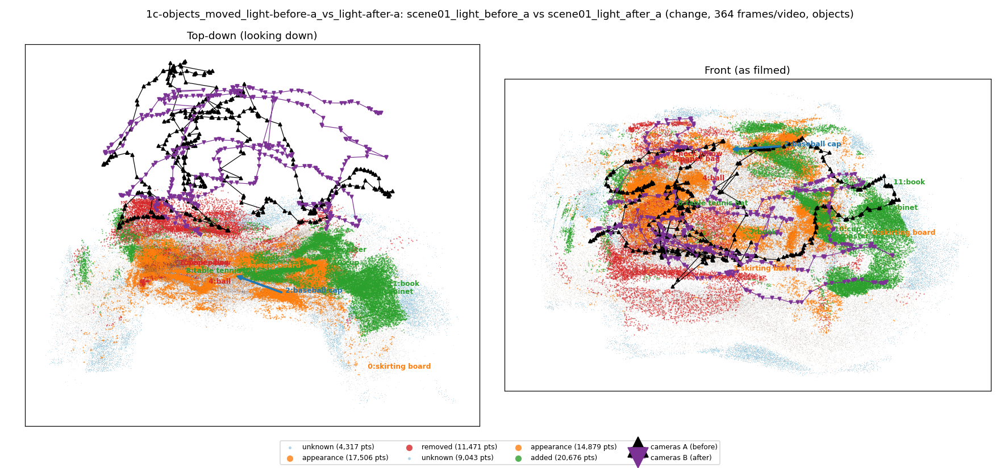

# Objects moved, same lighting: light, before, take a vs light, after, take a (whole objects found by a detector, then tracked)

**What this run tests:** Does it find the objects that really moved, were added or removed?

Before: `scene01_light_before_a`. After: `scene01_light_after_a`. 364 frames per recording, 44 SAM 2 views each. Step folder `1c-objects_moved_light-before-a_vs_light-after-a` (part of *Whole objects*).

| Measure | Value |
|---|---|
| Objects found (A / B) | 19 / 26 |
| Objects compared / changed | 28 / 10 (36%) |
| Moved / added / removed / changed in place / shifted | 1 / 6 / 3 / 0 / 0 |
| Point-level changed share (old method) | 5.44% |
| Scale | 1.9208 m/unit, 90% [1.7287, 2.1692] (most likely from metric depth cue 2.5241 and objects cue 1.6217 from 15 objects) |
| Reconstruction | 735 frames in 19 chunks, 468.4 s, worst anchor residual 0.0061 |
| Where objects are (90% range, median over objects) | ±0.05 cm from VGGT confidence and SAM 2 mask wobble over 11 views (one view alone: ±0.82 cm); check from views disagreeing: ±4.9 cm |
| Consistency check (3 = honest, higher = overconfident) | 57371.49 |
| Do unchanged objects agree between the recordings? | 0% within their combined 90% ranges (4 objects; about 90% expected where nothing moved) |
| Camera poses (bundle adjustment from VGGT) | reprojection error 8.3 -> 0.59 px median (1.71 px p90; worst frame 2.90 px), 96 sparse frames resected, 40 interpolated, cameras turned 1.60 deg; pose uncertainty 0.38 px median, 32 unconstrained frames count for less in positions, motion, change votes and splats |
| How the recordings are tied together | 1018 adjusted points seen in both (their error 1.09 px); per recording 0.61 / 0.57 px median; 19% of feature observations kept; one focal length for both recordings |
| Matched feature points before/after | 43; uncertainty per point 10.931 cm median (1 sigma, from the triangulation; of which 10.921 cm misalignment between the recordings); 28% moved beyond their own uncertainty |
| Alignment between the recordings (static points) | 41 links agree with a rigid scene; correction 12.58 cm, 8.561 deg, scale 14.33% (34% inliers) |
| Objects moved / deformed (feature points) | 0 / 0 of 0 measured |

## Object assets (node graphs)

`assets/` holds 45 objects as node graphs (nodes with weights, edges with rest length, spring constant from the Rigidity Copilot and measured strain, convex hull also as `_hull.obj`) and `scene_graph.json` with contacts.

Rigidity Copilot (CLIP asked what each object is made of and how stiff it is; an expectation from appearance, checked against the measured strain where there is any):

| Object | Status | Material (CLIP) | Rigidity 0-1 | Young's modulus | Measured | Check |
|---|---|---|---|---|---|---|
| skirting board | shifted | metal | 0.86 | 5.1e+09 Pa | - | - |
| neck pillow | removed | soft foam or stuffing | 0.27 | 2e+05 Pa | - | - |
| baseball cap | moved | fabric or cloth | 0.59 | 1.4e+06 Pa | - | - |
| skirting board | shifted | wood | 0.84 | 2.5e+09 Pa | - | - |
| ball | removed | rubber | 0.61 | 9.2e+08 Pa | - | - |
| paper bag | removed | rubber | 0.69 | 1.9e+08 Pa | - | - |
| cabinet | added | wood | 0.88 | 7.1e+09 Pa | - | - |
| book | added | wood | 0.80 | 3.3e+09 Pa | - | - |
| table tennis bat | added | rubber | 0.72 | 2.3e+08 Pa | - | - |
| baseball cap | moved | fabric or cloth | 0.65 | 3.9e+06 Pa | - | - |
| coaster | added | rubber | 0.68 | 1.6e+08 Pa | - | - |
| cup | added | metal | 0.90 | 1.8e+10 Pa | - | - |
| book | added | paper or cardboard | 0.84 | 2.5e+09 Pa | - | - |
| sofa | not seen in other recording | plastic | 0.84 | 2.6e+09 Pa | - | - |
| poster | not seen in other recording | paper or cardboard | 0.73 | 4.7e+08 Pa | - | - |

Contacts: A033_baseball_cap rests on A020_cushion; A008_sofa rests on A034_skirting_board; B039_book rests on B015_cabinet; B039_book rests on B043_poster; A019_cushion rests on A008_sofa; A039_paper_bag rests on A021_sofa; A041_sofa rests on A022_skirting_board; B014_cushion rests on B017_guitar.

## Changes

- **A31 skirting board** (shifted, 63 x 27 x 11 cm): The skirting board's surface moved by about 28 cm (squashed, pushed or deformed). Its centre is known to within about 0 cm (90%, from 5 views; one view alone: 1 cm). It is on top of the skirting board and next to the sofa, the wooden crate.
- **A32 neck pillow** (removed, 42 x 23 x 9 cm): A neck pillow that was there before is no longer there. Its centre is known to within about 0 cm (90%, from 12 views; one view alone: 0 cm). It is on top of the cushion and next to the paper bag, the neck pillow, the sofa.
- **A33 baseball cap** (moved, 43 x 15 x 10 cm): The baseball cap moved to the left and towards the camera by about 39 cm (90% interval 35 to 44). Its centre is known to within about 0 cm (90%, from 9 views; one view alone: 1 cm). It is on top of the cushion and next to the neck pillow, the sofa, the sofa.
- **A34 skirting board** (shifted, 85 x 31 x 13 cm): The skirting board's surface moved by about 20 cm (squashed, pushed or deformed). Its centre is known to within about 0 cm (90%, from 7 views; one view alone: 1 cm). It is next to the sofa, the sofa, the sofa.
- **A44 ball** (removed, 26 x 15 x 7 cm): A ball that was there before is no longer there. Its centre is known to within about 0 cm (90%, from 10 views; one view alone: 0 cm). It is on top of the cushion and next to the cushion, the cushion, the cushion.
- **A48 paper bag** (removed, 6 x 1 x 1 cm): A paper bag that was there before is no longer there. Its centre is known to within about 0 cm (90%, from 2 views; one view alone: 0 cm). It is on top of the sofa and next to the neck pillow, the sofa, the sofa.
- **B15 cabinet** (added, 76 x 40 x 25 cm): A cabinet is there now that was not there before. Its centre is known to within about 0 cm (90%, from 15 views; one view alone: 1 cm). It is next to the skirting board, the guitar, the sofa. Resting on it: the book, the poster.
- **B24 book** (added, 69 x 24 x 21 cm): A book is there now that was not there before. Its centre is known to within about 0 cm (90%, from 14 views; one view alone: 1 cm). It is on top of the cushion and next to the cushion, the cushion, the guitar. Resting on it: the cushion, the paper bag.
- **B30 table tennis bat** (added, 29 x 18 x 14 cm): A table tennis bat is there now that was not there before. Its centre is known to within about 0 cm (90%, from 12 views; one view alone: 1 cm). It is on top of the cushion and next to the wall, the cushion, the sofa.
- **B34 baseball cap** (moved, 36 x 22 x 6 cm): The baseball cap moved to the left and towards the camera by about 39 cm (90% interval 35 to 44). Its centre is known to within about 0 cm (90%, from 9 views; one view alone: 0 cm). It is on top of the sofa and next to the cushion, the sofa, the neck pillow.
- **B35 coaster** (added, 29 x 17 x 9 cm): A coaster is there now that was not there before. Its centre is known to within about 0 cm (90%, from 10 views; one view alone: 1 cm). It is on top of the cushion and next to the cushion, the guitar, the sofa. Resting on it: the cup.
- **B37 cup** (added, 22 x 14 x 5 cm): A cup is there now that was not there before. Its centre is known to within about 0 cm (90%, from 9 views; one view alone: 1 cm). It is on top of the coaster and next to the cushion, the guitar, the cushion.
- **B39 book** (added, 31 x 14 x 5 cm): A book is there now that was not there before. Its centre is known to within about 0 cm (90%, from 4 views; one view alone: 1 cm). It is on top of the cabinet and next to the poster, the sofa, the cup.

Scene report with the full object inventory and simulator ranges: [scene_report.md](scene_report.md)

Interactive 3D: download `viewer.html` and open it in a browser (objects are labelled; heat maps are layers in the legend).
