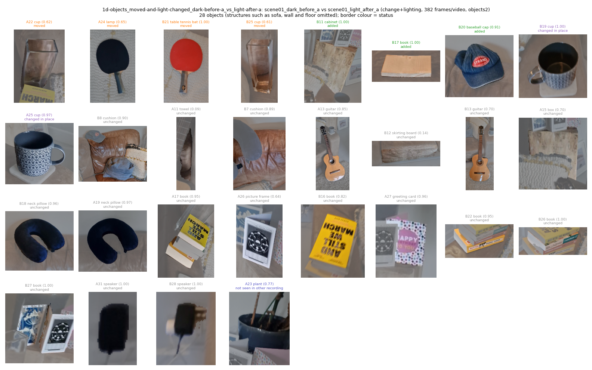
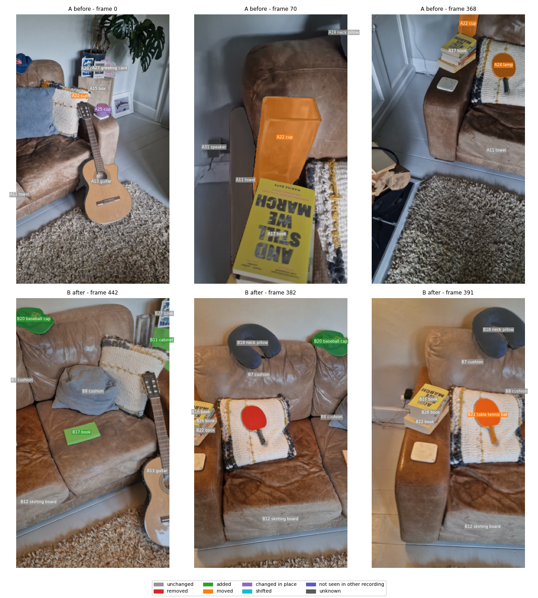
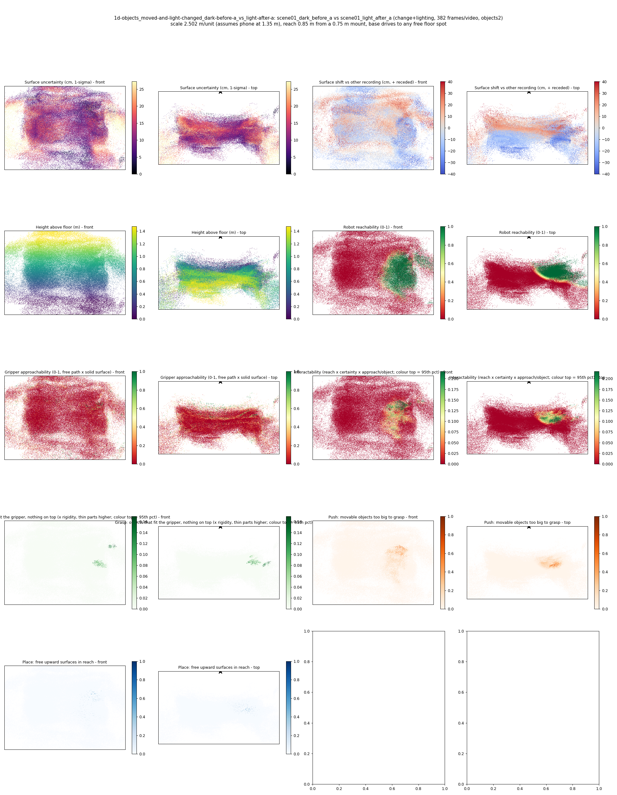
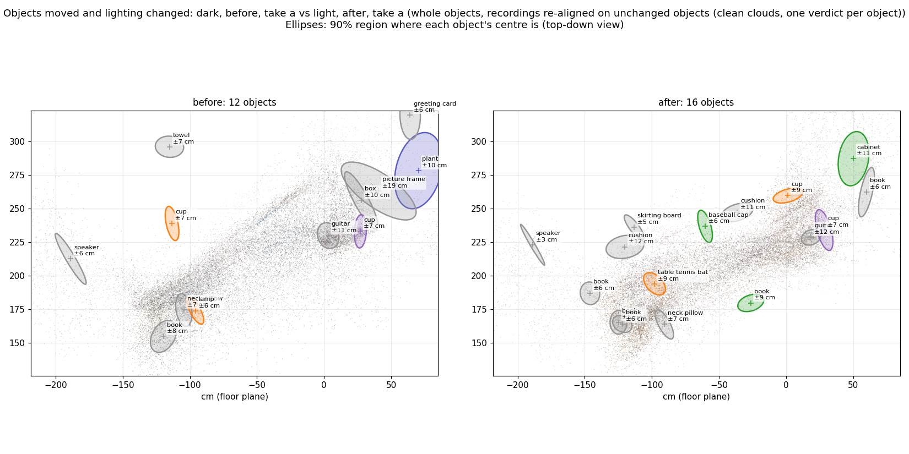
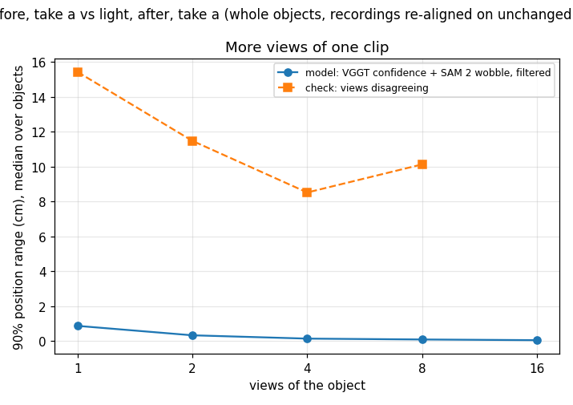
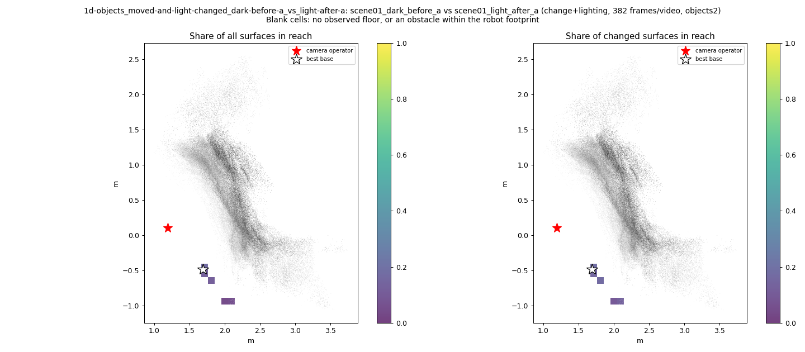
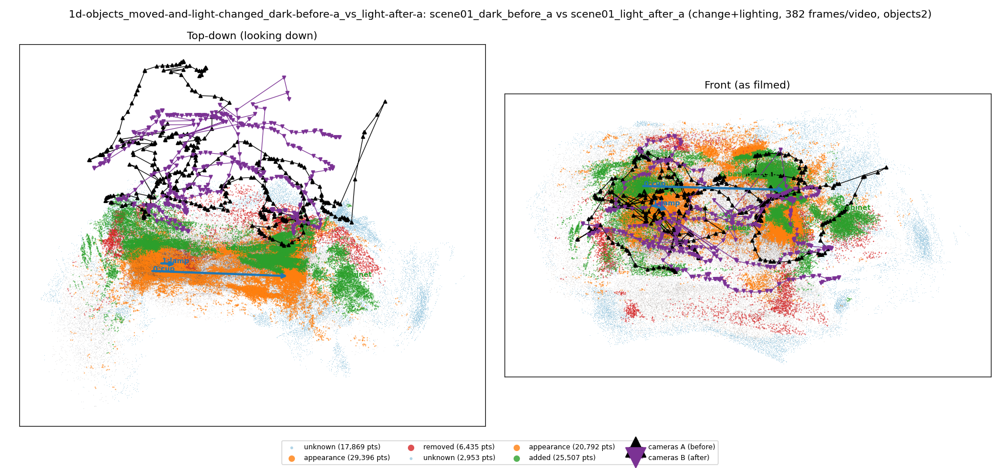

# Objects moved and lighting changed: dark, before, take a vs light, after, take a (whole objects, recordings re-aligned on unchanged objects (clean clouds, one verdict per object))

**What this run tests:** Does it still find the real changes when the lighting also changes?

Before: `scene01_dark_before_a`. After: `scene01_light_after_a`. 382 frames per recording, 44 SAM 2 views each. Step folder `1d-objects_moved-and-light-changed_dark-before-a_vs_light-after-a` (part of *Whole objects, recordings re-aligned*).

| Measure | Value |
|---|---|
| Objects found (A / B) | 12 / 16 |
| Objects compared / changed | 16 / 6 (38%) |
| Moved / added / removed / changed in place / shifted | 2 / 3 / 0 / 1 / 0 |
| Point-level changed share (old method) | 6.96% |
| Scale | 2.502 m/unit, 90% [2.2372, 2.7716] (most likely from metric depth cue 2.7631 and objects cue 0.904 from 11 objects) |
| Reconstruction | 753 frames in 19 chunks, 652.2 s, worst anchor residual 0.0083 |
| Where objects are (90% range, median over objects) | ±7.0 cm from VGGT confidence and SAM 2 mask wobble over 12 views (one view alone: ±1.46 cm); check from views disagreeing: ±5.75 cm |
| Consistency check (3 = honest, higher = overconfident) | 56977.88 |
| Do unchanged objects agree between the recordings? | 0% within their combined 90% ranges (5 objects; about 90% expected where nothing moved) |
| Camera poses (bundle adjustment from VGGT) | reprojection error 8.5 -> 0.73 px median (1.94 px p90; worst frame 2.64 px), 38 sparse frames resected, 17 interpolated, cameras turned 1.89 deg; pose uncertainty 0.40 px median, 9 unconstrained frames count for less in positions, motion, change votes and splats |
| How the recordings are tied together | 258 adjusted points seen in both (their error 1.23 px); per recording 0.76 / 0.70 px median; 16% of feature observations kept; one focal length for both recordings |

## Object assets (node graphs)

`assets/` holds 28 objects as node graphs (nodes with weights, edges with rest length, spring constant from the Rigidity Copilot and measured strain, convex hull also as `_hull.obj`) and `scene_graph.json` with contacts.

Rigidity Copilot (CLIP asked what each object is made of and how stiff it is; an expectation from appearance, checked against the measured strain where there is any):

| Object | Status | Material (CLIP) | Rigidity 0-1 | Young's modulus | Measured | Check |
|---|---|---|---|---|---|---|
| cup | moved | rubber | 0.82 | 9.2e+08 Pa | - | - |
| lamp | moved | rubber | 0.64 | 2e+08 Pa | - | - |
| cup | changed in place | metal | 0.89 | 3e+10 Pa | - | - |
| cabinet | added | wood | 0.86 | 4.1e+09 Pa | - | - |
| book | added | wood | 0.88 | 8.4e+09 Pa | - | - |
| cup | changed in place | metal | 0.90 | 1.8e+10 Pa | - | - |
| baseball cap | added | fabric or cloth | 0.65 | 3.9e+06 Pa | - | - |
| table tennis bat | moved | rubber | 0.74 | 6.3e+08 Pa | - | - |
| cup | moved | metal | 0.91 | 1.9e+10 Pa | - | - |
| plant | not seen in other recording | rubber | 0.85 | 3.4e+09 Pa | - | - |
| cushion | unchanged | fabric or cloth | 0.53 | 4.2e+06 Pa | - | - |
| guitar | unchanged | wood | 0.78 | 2.3e+09 Pa | - | - |
| guitar | unchanged | wood | 0.80 | 4.2e+09 Pa | - | - |
| cushion | unchanged | leather | 0.64 | 4.5e+07 Pa | - | - |
| towel | unchanged | leather | 0.76 | 1.2e+09 Pa | - | - |

Contacts: B027_book rests on B011_cabinet.

## Changes

- **A22 cup** (moved, 26 x 21 x 7 cm): The cup moved to the right by about 146 cm (90% interval 130 to 162). Its centre is known to within about 7 cm (90%, from 20 views; one view alone: 2 cm). It is on top of the guitar and next to the skirting board, the skirting board, the sofa.
- **A24 lamp** (moved, 28 x 18 x 8 cm): The lamp moved to the right by about 19 cm (90% interval 17 to 21). Its centre is known to within about 6 cm (90%, from 19 views; one view alone: 1 cm). It is on top of the sofa and next to the guitar, the book, the large surface.
- **A25 cup** (changed in place, 22 x 11 x 7 cm): The cup is in the same place but looks different (turned over, deformed or swapped). Its centre is known to within about 7 cm (90%, from 12 views; one view alone: 1 cm). It is on top of the sofa and next to the guitar, the sofa, the large surface.
- **B11 cabinet** (added, 74 x 47 x 29 cm): A cabinet is there now that was not there before. Its centre is known to within about 11 cm (90%, from 13 views; one view alone: 2 cm). It is next to the cup, the sofa, the cushion. Resting on it: the book.
- **B17 book** (added, 36 x 24 x 15 cm): A book is there now that was not there before. Its centre is known to within about 9 cm (90%, from 11 views; one view alone: 2 cm). It is on top of the sofa and next to the large surface, the cushion, the sofa.
- **B19 cup** (changed in place, 22 x 19 x 11 cm): The cup is in the same place but looks different (turned over, deformed or swapped). Its centre is known to within about 7 cm (90%, from 12 views; one view alone: 1 cm). It is on top of the sofa and next to the cushion, the large surface, the guitar.
- **B20 baseball cap** (added, 50 x 11 x 6 cm): A baseball cap is there now that was not there before. Its centre is known to within about 6 cm (90%, from 8 views; one view alone: 1 cm). It is on top of the sofa and next to the sofa, the cushion, the wall.
- **B21 table tennis bat** (moved, 35 x 21 x 18 cm): The table tennis bat moved to the right by about 19 cm (90% interval 17 to 21). Its centre is known to within about 9 cm (90%, from 11 views; one view alone: 1 cm). It is next to the large surface, the cushion, the sofa.
- **B25 cup** (moved, 27 x 24 x 13 cm): The cup moved to the right by about 146 cm (90% interval 130 to 162). Its centre is known to within about 9 cm (90%, from 8 views; one view alone: 1 cm). It is on top of the sofa and next to the cabinet, the cushion, the large surface.

Scene report with the full object inventory and simulator ranges: [scene_report.md](scene_report.md)

Interactive 3D: download `viewer.html` and open it in a browser (objects are labelled; heat maps are layers in the legend).
