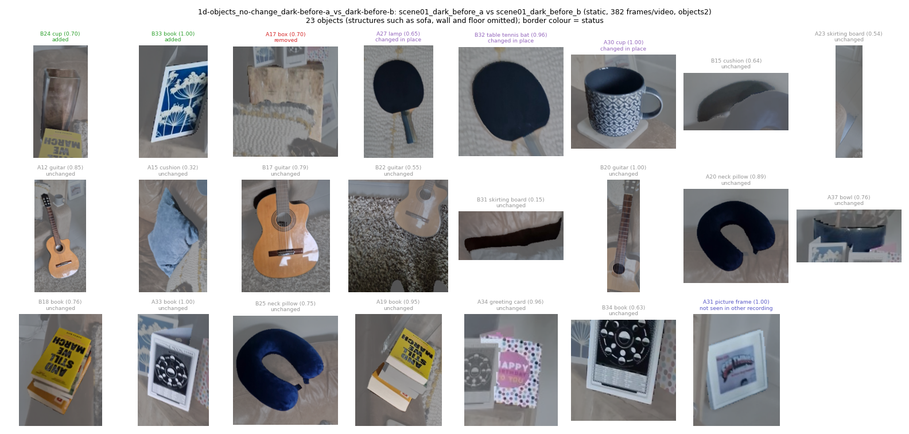
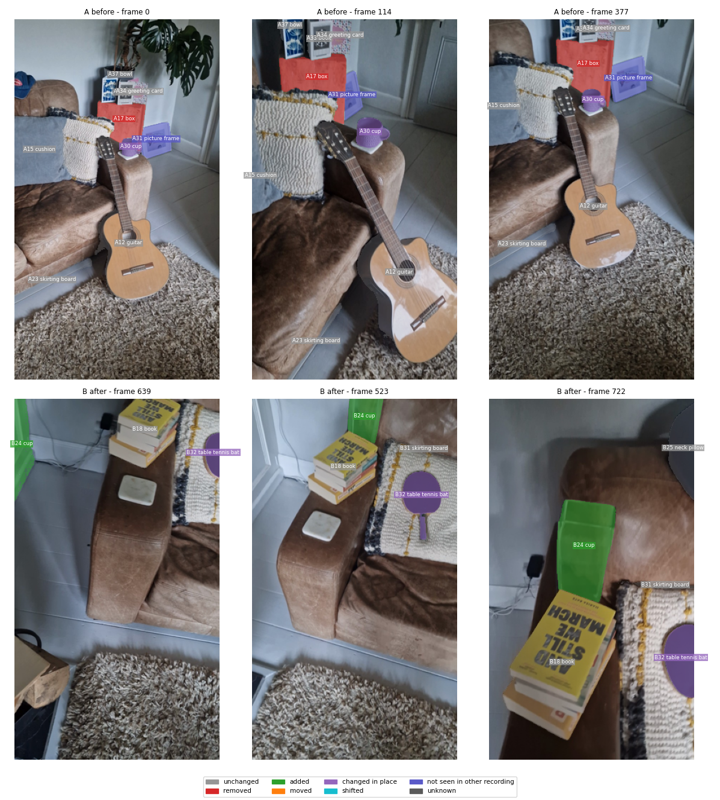
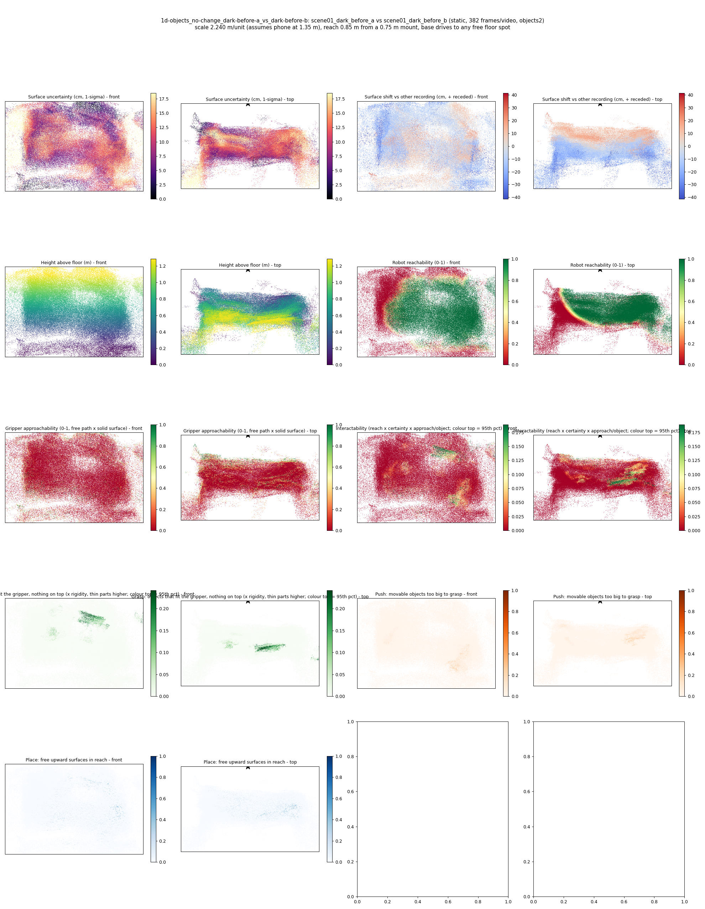
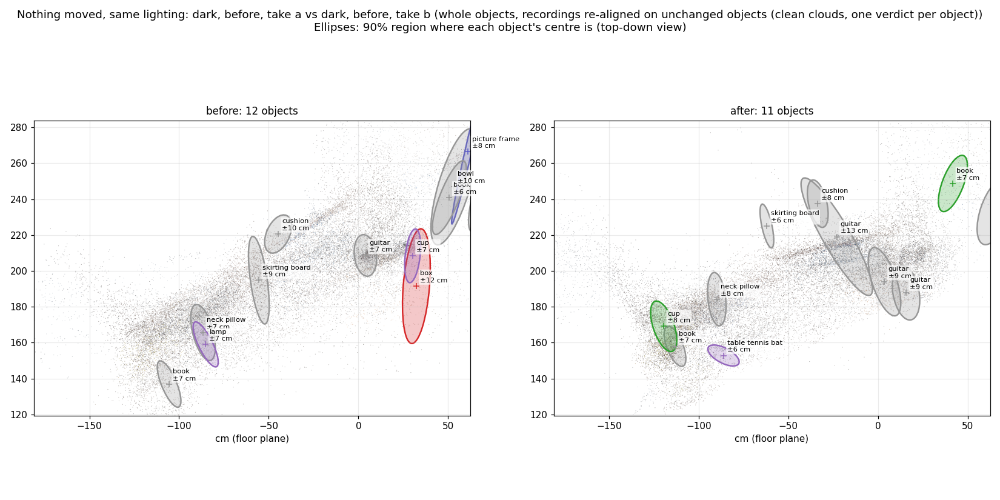
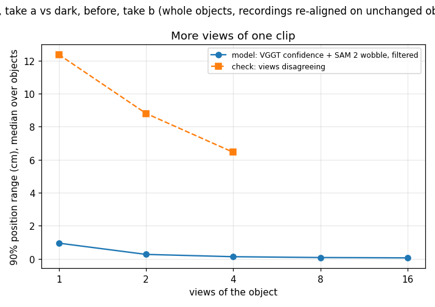
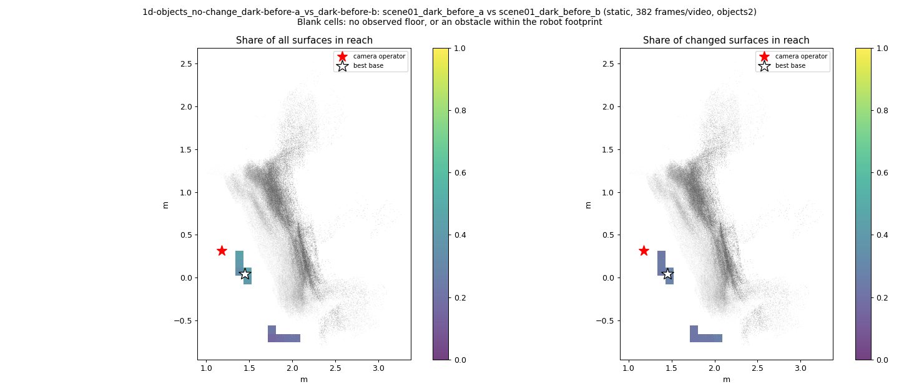
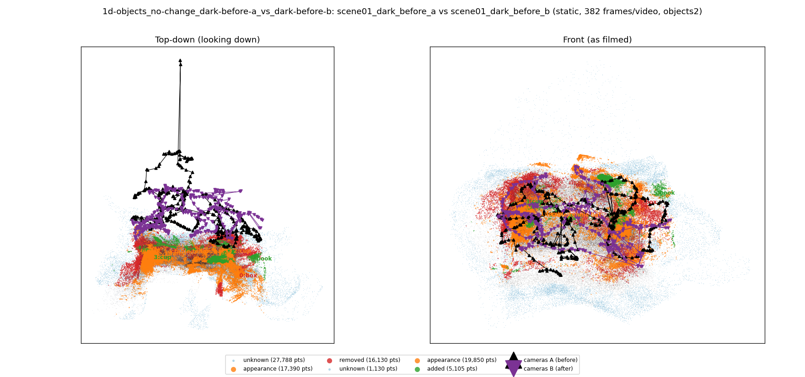

# Nothing moved, same lighting: dark, before, take a vs dark, before, take b (whole objects, recordings re-aligned on unchanged objects (clean clouds, one verdict per object))

**What this run tests:** How many false alarms does it raise when nothing changed?

Before: `scene01_dark_before_a`. After: `scene01_dark_before_b`. 382 frames per recording, 44 SAM 2 views each. Step folder `1d-objects_no-change_dark-before-a_vs_dark-before-b` (part of *Whole objects, recordings re-aligned*).

| Measure | Value |
|---|---|
| Objects found (A / B) | 12 / 11 |
| Objects compared / changed | 12 / 4 (33%) |
| Moved / added / removed / changed in place / shifted | 0 / 2 / 1 / 1 / 0 |
| Point-level changed share (old method) | 5.01% |
| Scale | 2.2399 m/unit, 90% [1.9995, 2.7318] (most likely from metric depth cue 2.7071 and objects cue 1.9086 from 12 objects) |
| Reconstruction | 744 frames in 19 chunks, 467.5 s, worst anchor residual 0.0098 |
| Where objects are (90% range, median over objects) | ±7.27 cm from VGGT confidence and SAM 2 mask wobble over 11 views (one view alone: ±1.32 cm); check from views disagreeing: ±4.45 cm |
| Consistency check (3 = honest, higher = overconfident) | 29640.51 |
| Do unchanged objects agree between the recordings? | 25% within their combined 90% ranges (4 objects; about 90% expected where nothing moved) |
| Camera poses (bundle adjustment from VGGT) | reprojection error 9.0 -> 0.92 px median (2.53 px p90; worst frame 2.98 px), 52 sparse frames resected, 25 interpolated, cameras turned 1.71 deg; pose uncertainty 0.59 px median, 19 unconstrained frames count for less in positions, motion, change votes and splats |
| How the recordings are tied together | 1714 adjusted points seen in both (their error 1.54 px); per recording 0.90 / 0.96 px median; 13% of feature observations kept; one focal length for both recordings |

## Object assets (node graphs)

`assets/` holds 23 objects as node graphs (nodes with weights, edges with rest length, spring constant from the Rigidity Copilot and measured strain, convex hull also as `_hull.obj`) and `scene_graph.json` with contacts.

Rigidity Copilot (CLIP asked what each object is made of and how stiff it is; an expectation from appearance, checked against the measured strain where there is any):

| Object | Status | Material (CLIP) | Rigidity 0-1 | Young's modulus | Measured | Check |
|---|---|---|---|---|---|---|
| box | removed | wood | 0.88 | 6.1e+09 Pa | - | - |
| lamp | changed in place | rubber | 0.64 | 2e+08 Pa | - | - |
| cup | changed in place | metal | 0.90 | 2.6e+10 Pa | - | - |
| cup | added | metal | 0.90 | 1.1e+10 Pa | - | - |
| table tennis bat | changed in place | rubber | 0.70 | 8.1e+08 Pa | - | - |
| book | added | ceramic or porcelain | 0.87 | 1.7e+10 Pa | - | - |
| picture frame | not seen in other recording | rubber | 0.80 | 1.6e+09 Pa | - | - |
| guitar | unchanged | wood | 0.72 | 1.1e+09 Pa | - | - |
| guitar | unchanged | wood | 0.80 | 4.2e+09 Pa | - | - |
| cushion | unchanged | fabric or cloth | 0.53 | 5e+06 Pa | - | - |
| book | unchanged | paper or cardboard | 0.82 | 7.5e+08 Pa | - | - |
| neck pillow | unchanged | soft foam or stuffing | 0.56 | 2.3e+06 Pa | - | - |
| cushion | unchanged | rubber | 0.53 | 1.3e+07 Pa | - | - |
| book | unchanged | paper or cardboard | 0.84 | 1.2e+09 Pa | - | - |
| guitar | unchanged | wood | 0.85 | 5.7e+09 Pa | - | - |

Contacts: B024_cup rests on B018_book; A037_bowl rests on A033_book; A037_bowl rests on A034_greeting_card.

Nothing was moved between these recordings, so every changed object is a false alarm (**4 of 12**).

## Changes

- **A17 box** (removed, 72 x 38 x 28 cm): A box that was there before is no longer there. Its centre is known to within about 12 cm (90%, from 11 views; one view alone: 2 cm). It is next to the shelf, the sofa, the large surface.
- **A27 lamp** (changed in place, 39 x 18 x 6 cm): The lamp is in the same place but looks different (turned over, deformed or swapped). Its centre is known to within about 7 cm (90%, from 20 views; one view alone: 1 cm). It is next to the book, the guitar, the large surface.
- **A30 cup** (changed in place, 24 x 11 x 7 cm): The cup is in the same place but looks different (turned over, deformed or swapped). Its centre is known to within about 7 cm (90%, from 11 views; one view alone: 1 cm). It is on top of the sofa and next to the hat, the guitar, the sofa.
- **B24 cup** (added, 29 x 20 x 10 cm): A cup is there now that was not there before. Its centre is known to within about 8 cm (90%, from 13 views; one view alone: 2 cm). It is on top of the book and next to the sofa, the pillow, the sofa.
- **B32 table tennis bat** (changed in place, 37 x 23 x 12 cm): The table tennis bat is in the same place but looks different (turned over, deformed or swapped). Its centre is known to within about 6 cm (90%, from 13 views; one view alone: 1 cm). It is on top of the blanket and next to the sofa, the pillow, the sofa.
- **B33 book** (added, 24 x 13 x 7 cm): A book is there now that was not there before. Its centre is known to within about 7 cm (90%, from 5 views; one view alone: 1 cm). It is next to the book.

Scene report with the full object inventory and simulator ranges: [scene_report.md](scene_report.md)

Interactive 3D: download `viewer.html` and open it in a browser (objects are labelled; heat maps are layers in the legend).
