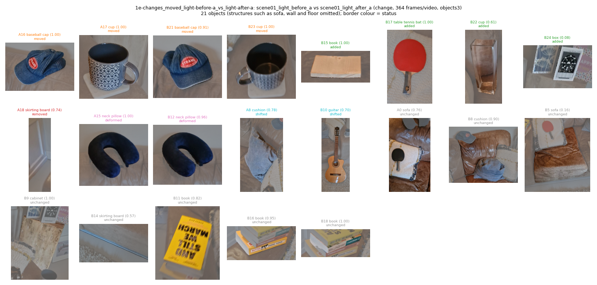
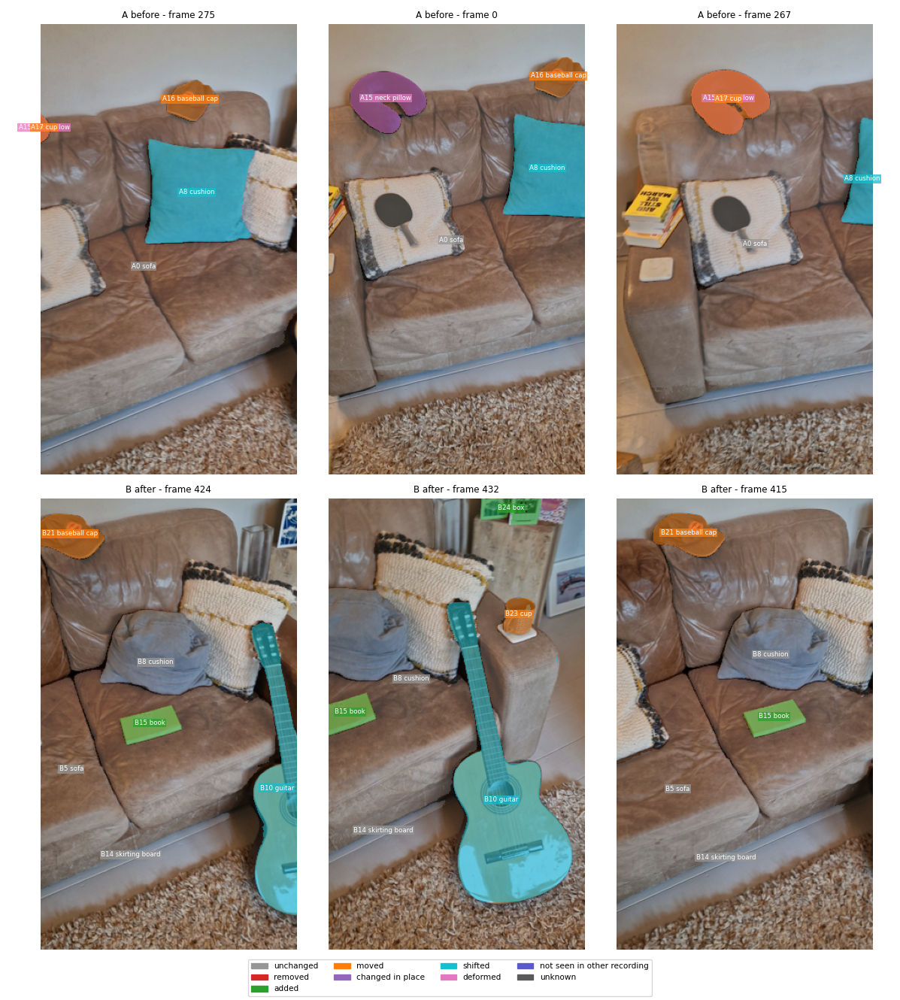
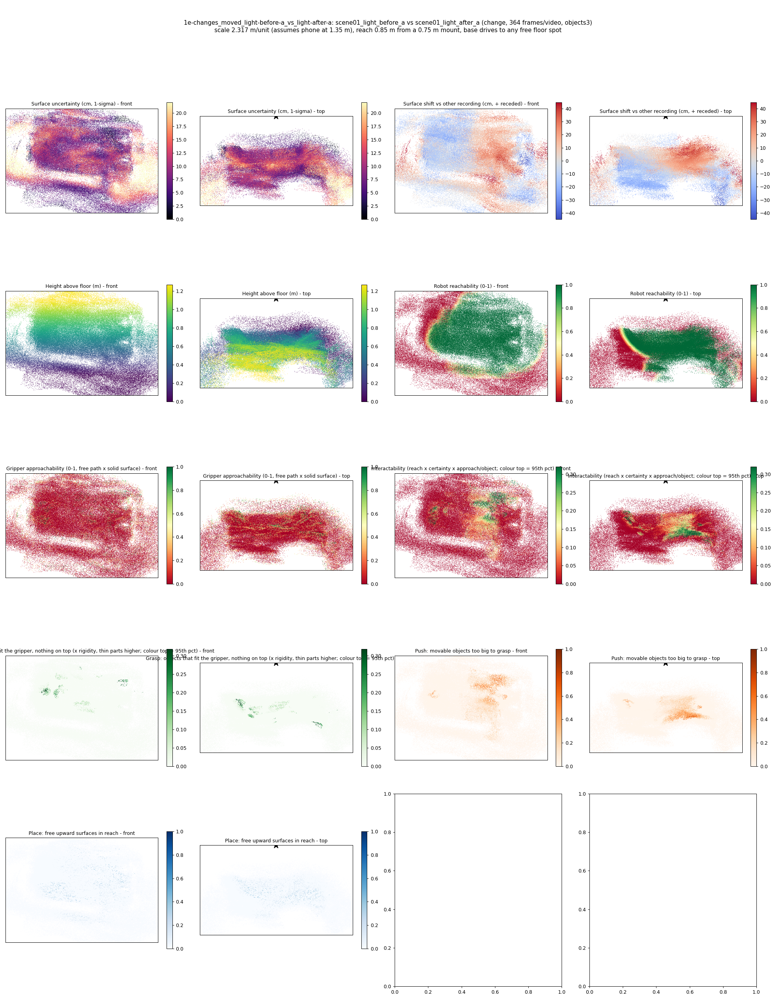
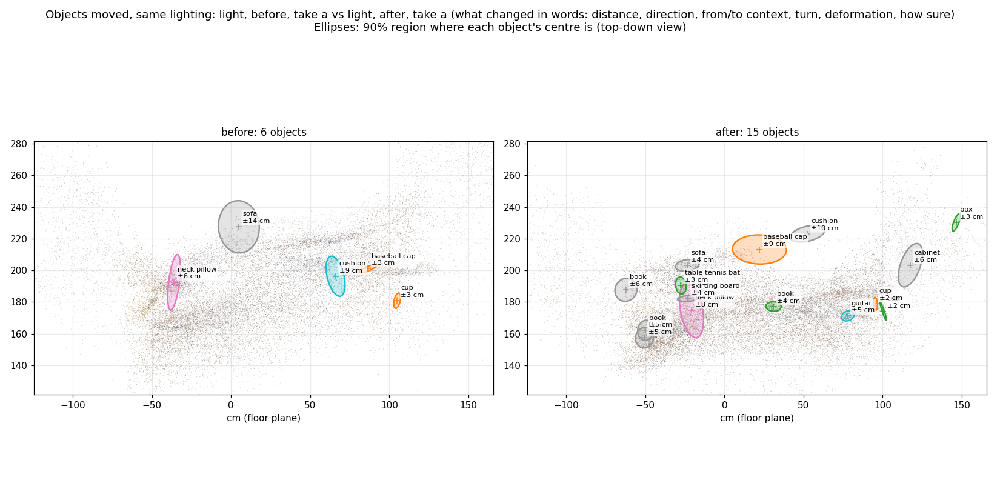
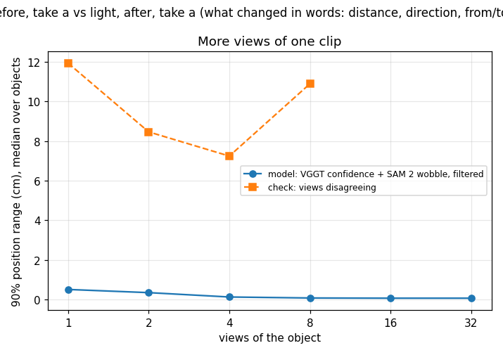
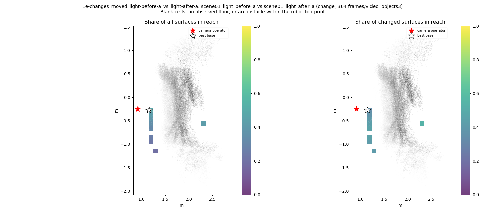
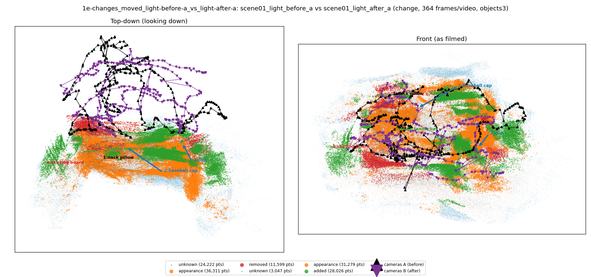

# Objects moved, same lighting: light, before, take a vs light, after, take a (what changed in words: distance, direction, from/to context, turn, deformation, how sure)

**What this run tests:** Does it find the objects that really moved, were added or removed?

Before: `scene01_light_before_a`. After: `scene01_light_after_a`. 364 frames per recording, 44 SAM 2 views each. Step folder `1e-changes_moved_light-before-a_vs_light-after-a` (part of *What changed, in words*).

| Measure | Value |
|---|---|
| Objects found (A / B) | 6 / 15 |
| Objects compared / changed | 16 / 9 (56%) |
| Moved / added / removed / deformed / changed in place / shifted | 2 / 4 / 1 / 1 / 0 / 1 |
| Point-level changed share (old method) | 9.13% |
| Scale | 2.3169 m/unit, 90% [2.0615, 2.6075] (most likely from metric depth cue 2.5985 and objects cue 2.0796 from 4 objects) |
| Reconstruction | 735 frames in 19 chunks, 426.8 s, worst anchor residual 0.0061 |
| Where objects are (90% range, median over objects) | ±4.98 cm from VGGT confidence and SAM 2 mask wobble over 12 views (one view alone: ±0.99 cm); check from views disagreeing: ±4.4 cm |
| Consistency check (3 = honest, higher = overconfident) | 37018.83 |
| Do unchanged objects agree between the recordings? | 0% within their combined 90% ranges (1 objects; about 90% expected where nothing moved) |
| Camera poses (bundle adjustment from VGGT) | reprojection error 8.3 -> 1.04 px median (2.72 px p90; worst frame 2.92 px), 53 sparse frames resected, 12 interpolated, cameras turned 1.23 deg; pose uncertainty 0.53 px median, 4 unconstrained frames count for less in positions, motion, change votes and splats |
| How the recordings are tied together | 2194 adjusted points seen in both (their error 1.64 px); per recording 1.07 / 1.02 px median; 15% of feature observations kept; one focal length for both recordings |

## Object assets (node graphs)

`assets/` holds 21 objects as node graphs (nodes with weights, edges with rest length, spring constant from the Rigidity Copilot and measured strain, convex hull also as `_hull.obj`) and `scene_graph.json` with contacts.

Rigidity Copilot (CLIP asked what each object is made of and how stiff it is; an expectation from appearance, checked against the measured strain where there is any):

| Object | Status | Material (CLIP) | Rigidity 0-1 | Young's modulus | Measured | Check |
|---|---|---|---|---|---|---|
| cushion | shifted | soft foam or stuffing | 0.42 | 4.9e+05 Pa | - | - |
| neck pillow | deformed | soft foam or stuffing | 0.27 | 2e+05 Pa | - | - |
| baseball cap | moved | fabric or cloth | 0.59 | 1.4e+06 Pa | - | - |
| cup | moved | metal | 0.92 | 4.1e+10 Pa | - | - |
| skirting board | removed | wood | 0.82 | 1.6e+09 Pa | - | - |
| guitar | shifted | wood | 0.77 | 1.4e+09 Pa | - | - |
| neck pillow | deformed | soft foam or stuffing | 0.41 | 6.1e+05 Pa | - | - |
| book | added | wood | 0.88 | 8.4e+09 Pa | - | - |
| table tennis bat | added | rubber | 0.72 | 2.3e+08 Pa | - | - |
| baseball cap | moved | fabric or cloth | 0.66 | 5.4e+06 Pa | - | - |
| cup | added | metal | 0.89 | 9.2e+09 Pa | - | - |
| cup | moved | metal | 0.90 | 1.8e+10 Pa | - | - |
| box | added | paper or cardboard | 0.84 | 2.5e+09 Pa | - | - |
| cushion | unchanged | fabric or cloth | 0.53 | 4.2e+06 Pa | - | - |
| sofa | unchanged | leather | 0.56 | 2.8e+07 Pa | - | - |

Contacts: B024_box rests on B009_cabinet; B011_book rests on B016_book.

## What changed, in words

- **A17 cup** — moved, 67% sure: The cup (98% sure of the name, detector) moved 36 cm (90%: 34 to 38 cm) towards the camera and down and to the left, from next to the chair and the side table to next to the guitar case and the sofa, turned about 40 deg (+/- 2) about the vertical, was tilted about 17 deg, now lying flat. 67% sure it moved (beyond position noise 100%, same object 99%, real object 79%). Measured on its SAM 2 masks in 11 views.
- **A15 neck pillow** — deformed, 66% sure: The neck pillow (100% sure of the name, clip) deformed but did not move away: same object in the same place (moved 14 cm, within its position noise), but its shape differs by 4.2 cm where unchanged objects in this pair differ by up to 3.0 cm. The Rigidity Copilot reads it as soft foam or stuffing, rubber (rigidity 0.27), so a change of shape is plausible. 66% sure it deformed. Also: tipped 31 deg; was tilted about 26 deg, now tilted about 35 deg. Measured on its SAM 2 masks in 12 views.
- **A16 baseball cap** — moved, 55% sure: The baseball cap (98% sure of the name, detector) moved 73 cm (90%: 67 to 79 cm) to the left and towards the camera and down, from next to the sofa and the cushion to on top of the sofa, next to the sofa and the skirting board, turned about 18 deg (+/- 3) about the vertical, was tilted about 15 deg, now tilted about 10 deg. 55% sure it moved (beyond position noise 100%, same object 99%, real object 70%). Measured on its SAM 2 masks in 9 views.
- **B24 box** — added, 50% sure: The box (8% sure of the name, size + names), on top of the cabinet was added: the before video looked at that spot in 115 frames and it was empty. 50% sure (real object 50%, spot covered 100%, see-through 100%). Measured on its SAM 2 masks in 4 views.
- **A18 skirting board** — removed, 30% sure: The skirting board (74% sure of the name, clip) was removed: the after video looked at that spot in 55 frames and saw straight through where it stood. 30% sure (real object 40%, spot covered 100%, see-through 73%). Measured on its SAM 2 masks in 3 views.
- **B15 book** — added, 1% sure: The book (98% sure of the name, detector), on top of the sofa, next to the cushion and the sofa was added: the before video looked at that spot in 109 frames and it was empty. 1% sure (real object 85%, spot covered 100%, see-through 2%). Measured on its SAM 2 masks in 11 views.
- **B17 table tennis bat** — added, 0% sure: The table tennis bat (100% sure of the name, clip), on top of the large surface, next to the sofa and the skirting board was added: the before video looked at that spot in 128 frames and it was empty. 0% sure (real object 88%, spot covered 100%, see-through 0%). Measured on its SAM 2 masks in 12 views.
- **B22 cup** — added, 0% sure: The cup (75% sure of the name, detector), next to the cushion and the sofa was added: the before video looked at that spot in 135 frames and it was empty. 0% sure (real object 58%, spot covered 100%, see-through 0%). Measured on its SAM 2 masks in 5 views.
- **A8 cushion** — shifted: The cushion's surface moved by about 22 cm (squashed, pushed or deformed). Its centre is known to within about 9 cm (90%, from 18 views; one view alone: 1 cm). It is next to the coffee table, the chair, the side table.
- **B10 guitar** — shifted: The guitar's surface moved by about 23 cm (squashed, pushed or deformed). Its centre is known to within about 5 cm (90%, from 12 views; one view alone: 1 cm). It is next to the guitar case, the rug, the large surface.

Noise levels of this pair, from its own unchanged objects (no answer key): shape differences up to 3.0 cm, turns up to 12.0 deg, tilts up to 31.1 deg (1 unchanged pairs). Only changes beyond these are reported. How sure: the product of named parts (object is real from its views; same object from appearance and name; moved beyond both clouds' position ranges plus the recordings' residual misalignment; the other video covered the spot; see-through evidence; shape evidence with the Rigidity Copilot's stiffness). Model probabilities, not calibrated on an answer key.

## Scale check: measured sizes against typical sizes

4 of 8 objects fit their typical size at 2.317 m/unit (median measured/typical 1.39); objects come out too big: scale may be too large.

| Object | Typical largest size | Measured | Ratio | Sds off | Fits |
|---|---|---|---|---|---|
| B17 table tennis bat | 26.0 cm | 16.4 cm | 0.63 | -2.66 | no |
| A15 neck pillow | 30.0 cm | 53.0 cm | 1.77 | 2.78 | no |
| B12 neck pillow | 30.0 cm | 57.8 cm | 1.93 | 3.2 | no |
| A8 cushion | 45.0 cm | 54.8 cm | 1.22 | 0.88 | yes |
| A16 baseball cap | 28.0 cm | 28.8 cm | 1.03 | 0.14 | yes |
| A17 cup | 10.0 cm | 15.6 cm | 1.56 | 1.72 | yes |
| B8 cushion | 45.0 cm | 77.3 cm | 1.72 | 2.41 | no |
| B10 guitar | 100.0 cm | 96.3 cm | 0.96 | -0.22 | yes |

Names changed because the measured size did not fit: B24 book -> box (49 cm).

Second copies of objects from a group of camera poses that sat off, removed: A0 sofa: 10 frames, 113 cm off; A1 sofa: 10 frames, 140 cm off; A2 coffee table: 6 frames, 172 cm off; A3 sofa: 7 frames, 144 cm off; A4 rug: 6 frames, 103 cm off; A5 sofa: 2 frames, 47 cm off; A6 skirting board: 9 frames, 141 cm off; A7 sofa: 16 frames, 124 cm off; A8 cushion: 8 frames, 118 cm off; A9 side table: 5 frames, 157 cm off; A11 skirting board: 2 frames, 60 cm off; A12 chair: 1 frames, 64 cm off; A13 skirting board: 3 frames, 42 cm off; B1 large surface: 10 frames, 153 cm off; B2 guitar case: 7 frames, 116 cm off; B3 rug: 4 frames, 63 cm off; B4 large surface: 2 frames, 78 cm off; B5 sofa: 6 frames, 82 cm off; B6 guitar case: 11 frames, 102 cm off; B7 sofa: 8 frames, 86 cm off; B8 cushion: 2 frames, 63 cm off; B9 cabinet: 4 frames, 49 cm off; B10 guitar: 5 frames, 46 cm off; B13 skirting board: 10 frames, 99 cm off; B14 skirting board: 5 frames, 120 cm off; B19 hat: 1 frames, 43 cm off; B20 skirting board: 1 frames, 42 cm off; B21 baseball cap: 2 frames, 35 cm off.

## Where the SAM 2 masks are used

| Stage | How |
|---|---|
| Object points | only depth points inside an object's SAM 2 mask, in the frames SAM 2 tracked it, become its cloud |
| Names | the detector votes and CLIP see masked crops (background greyed out), never the whole frame |
| Same object / moved | appearance is pooled over the masked pixels of each view; the clouds compared are the masked clouds |
| Position and its range | each view's measurement is the masked region's depth; SAM 2's mask wobble widens it |
| Deformation | the shape compared before vs after is the masked cloud of each recording |
| Scale check | measured object sizes are the masked clouds' core extents |
| Assets | each exported asset (points, hull, node graph) is the masked cloud |
| Not masked | the point-level change map, the heat maps and the camera poses use whole frames |

Scene report with the full object inventory and simulator ranges: [scene_report.md](scene_report.md)

Interactive 3D: download `viewer.html` and open it in a browser (objects are labelled; heat maps are layers in the legend).
