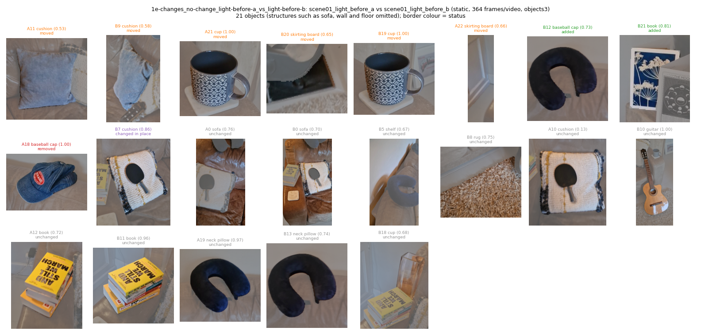
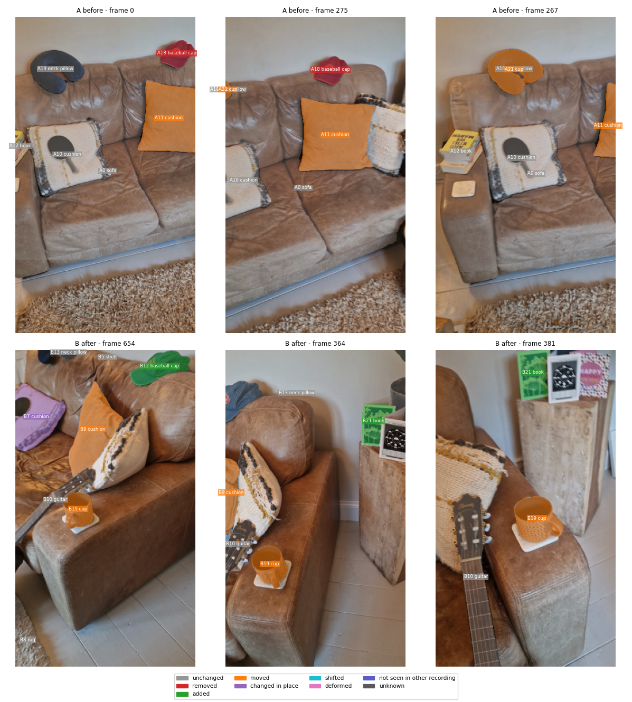
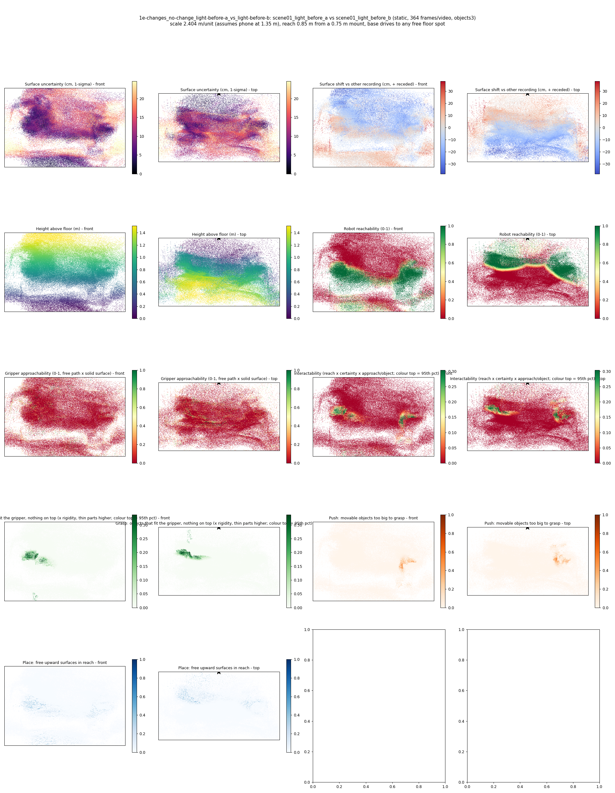
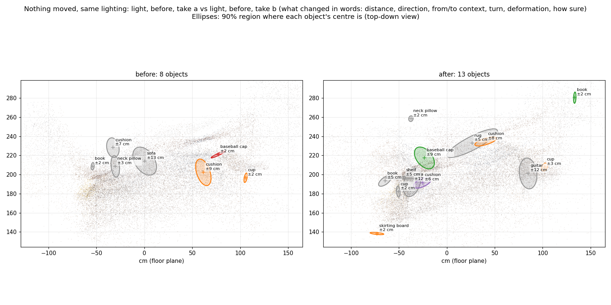
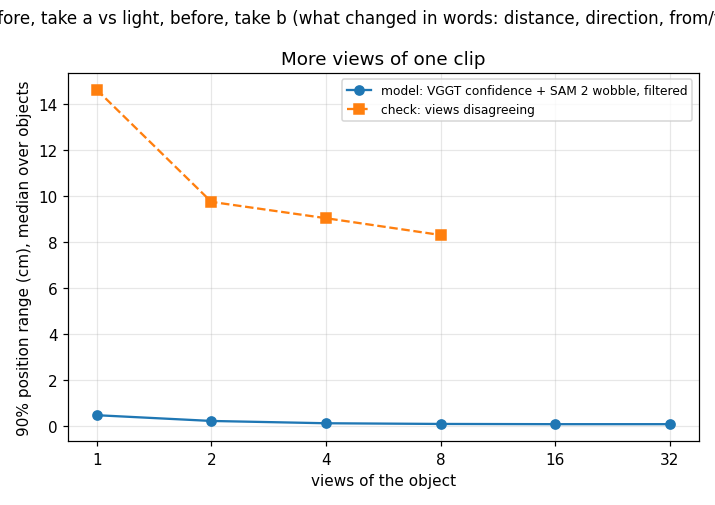
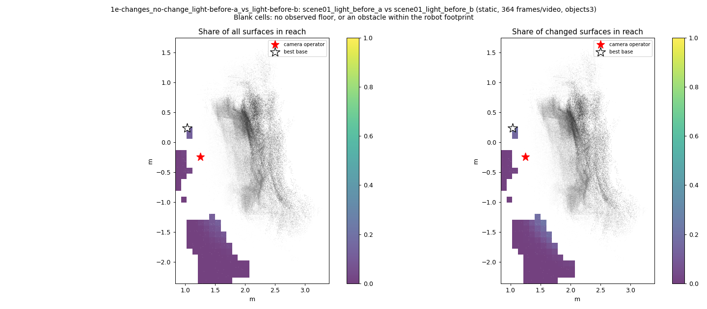
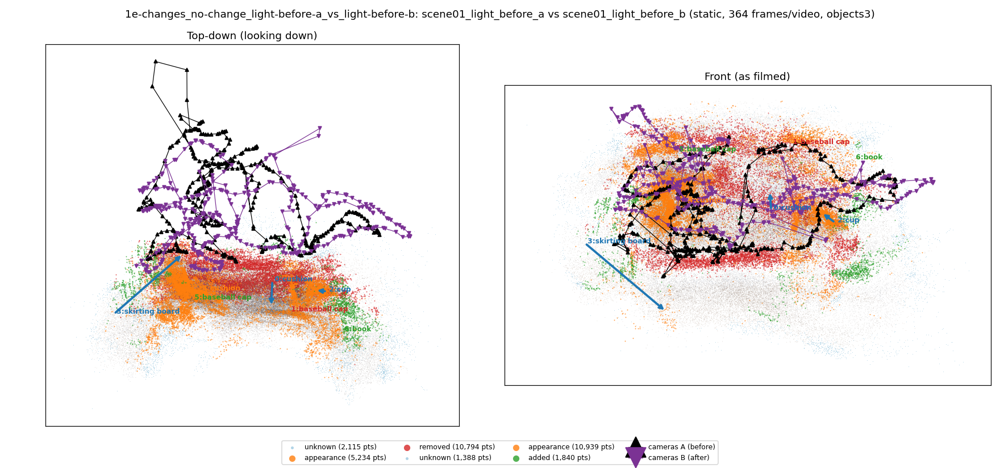

# Nothing moved, same lighting: light, before, take a vs light, before, take b (what changed in words: distance, direction, from/to context, turn, deformation, how sure)

**What this run tests:** How many false alarms does it raise when nothing changed?

Before: `scene01_light_before_a`. After: `scene01_light_before_b`. 364 frames per recording, 44 SAM 2 views each. Step folder `1e-changes_no-change_light-before-a_vs_light-before-b` (part of *What changed, in words*).

| Measure | Value |
|---|---|
| Objects found (A / B) | 8 / 13 |
| Objects compared / changed | 14 / 7 (50%) |
| Moved / added / removed / deformed / changed in place / shifted | 3 / 2 / 1 / 0 / 1 / 0 |
| Point-level changed share (old method) | 7.27% |
| Scale | 2.4037 m/unit, 90% [2.1445, 2.6949] (most likely from metric depth cue 2.6491 and objects cue 2.2158 from 5 objects) |
| Reconstruction | 736 frames in 19 chunks, 647.2 s, worst anchor residual 0.0058 |
| Where objects are (90% range, median over objects) | ±4.55 cm from VGGT confidence and SAM 2 mask wobble over 12 views (one view alone: ±1.12 cm); check from views disagreeing: ±4.35 cm |
| Consistency check (3 = honest, higher = overconfident) | 36551.03 |
| Do unchanged objects agree between the recordings? | 0% within their combined 90% ranges (3 objects; about 90% expected where nothing moved) |
| Camera poses (bundle adjustment from VGGT) | reprojection error 8.3 -> 1.01 px median (2.64 px p90; worst frame 2.83 px), 44 sparse frames resected, 22 interpolated, cameras turned 1.46 deg; pose uncertainty 0.51 px median, 10 unconstrained frames count for less in positions, motion, change votes and splats |
| How the recordings are tied together | 2920 adjusted points seen in both (their error 1.51 px); per recording 1.02 / 1.00 px median; 15% of feature observations kept; one focal length for both recordings |

## Object assets (node graphs)

`assets/` holds 21 objects as node graphs (nodes with weights, edges with rest length, spring constant from the Rigidity Copilot and measured strain, convex hull also as `_hull.obj`) and `scene_graph.json` with contacts.

Rigidity Copilot (CLIP asked what each object is made of and how stiff it is; an expectation from appearance, checked against the measured strain where there is any):

| Object | Status | Material (CLIP) | Rigidity 0-1 | Young's modulus | Measured | Check |
|---|---|---|---|---|---|---|
| cushion | moved | fabric or cloth | 0.58 | 4.4e+06 Pa | - | - |
| baseball cap | removed | fabric or cloth | 0.59 | 1.4e+06 Pa | - | - |
| cup | moved | metal | 0.93 | 5.8e+10 Pa | - | - |
| skirting board | moved | rubber | 0.81 | 1.2e+09 Pa | - | - |
| cushion | changed in place | fabric or cloth | 0.43 | 7.1e+06 Pa | - | - |
| cushion | moved | soft foam or stuffing | 0.44 | 4.7e+05 Pa | - | - |
| baseball cap | added | soft foam or stuffing | 0.44 | 1.7e+05 Pa | - | - |
| cup | moved | metal | 0.92 | 3.4e+10 Pa | - | - |
| skirting board | moved | rubber | 0.78 | 5.6e+08 Pa | - | - |
| book | added | ceramic or porcelain | 0.86 | 8.9e+09 Pa | - | - |
| sofa | unchanged | leather | 0.59 | 6.9e+07 Pa | - | - |
| guitar | unchanged | wood | 0.81 | 3e+09 Pa | - | - |
| sofa | unchanged | leather | 0.49 | 2.6e+07 Pa | - | - |
| cushion | unchanged | soft foam or stuffing | 0.45 | 2e+07 Pa | - | - |
| book | unchanged | paper or cardboard | 0.81 | 6.1e+08 Pa | - | - |

Contacts: B013_neck_pillow rests on B000_sofa.

Nothing was moved between these recordings, so every changed object is a false alarm (**7 of 14**).

## What changed, in words

- **A11 cushion** — moved, 79% sure: The cushion (53% sure of the name, clip) moved 32 cm (90%: 25 to 40 cm) further from the camera and up, from next to the magazine and the sofa to next to the guitar and the cushion, was tilted about 15 deg, now tilted about 11 deg. 79% sure it moved (beyond position noise 100%, same object 99%, real object 88%). Its two clouds differ in shape by 4.7 cm (noise 2.7 cm), but the Rigidity Copilot reads it as fabric or cloth, soft foam or stuffing (rigidity 0.58), too stiff to deform: most likely the reconstruction or a side one video never saw. Measured on its SAM 2 masks in 12 views.
- **B7 cushion** — changed in place, 75% sure: The cushion (13% sure of the name, clip): was tilted about 45 deg, now tilted about 29 deg. 75% sure it stayed where it was. Its two clouds differ in shape by 2.7 cm (noise 2.7 cm), but the Rigidity Copilot reads it as soft foam or stuffing, rubber (rigidity 0.45), too stiff to deform: most likely the reconstruction or a side one video never saw. Measured on its SAM 2 masks in 25 views.
- **A21 cup** — moved, 67% sure: The cup (98% sure of the name, detector) moved 15 cm (90%: 13 to 18 cm) to the left and up, from next to the magazine and the sofa to next to the guitar, was tilted about 12 deg, now tilted about 6 deg. 67% sure it moved (beyond position noise 100%, same object 99%, real object 82%). Measured on its SAM 2 masks in 10 views.
- **A22 skirting board** — moved, 16% sure: The skirting board (66% sure of the name, clip) moved 117 cm (90%: 116 to 119 cm) to the right and towards the camera and down, from next to the skirting board to next to the rug and the sofa, turned about 18 deg (+/- 2) about the vertical, tipped 106 deg, was tilted about 37 deg, now tilted about 30 deg. 16% sure it moved (beyond position noise 100%, same object 62%, real object 50%). Measured on its SAM 2 masks in 4 views.
- **B12 baseball cap** — added, 2% sure: The baseball cap (75% sure of the name, detector), next to the shelf and the sofa was added: the before video looked at that spot in 101 frames and it was empty. 2% sure (real object 79%, spot covered 100%, see-through 3%). Measured on its SAM 2 masks in 9 views.
- **A18 baseball cap** — removed, 1% sure: The baseball cap (98% sure of the name, detector), next to the sofa and the skirting board was removed: the after video looked at that spot in 74 frames and saw straight through where it stood. 1% sure (real object 79%, spot covered 100%, see-through 1%). Measured on its SAM 2 masks in 9 views.
- **B21 book** — added, 0% sure: The book (81% sure of the name, detector) was added: the before video looked at that spot in 55 frames and it was empty. 0% sure (real object 50%, spot covered 100%, see-through 0%). Measured on its SAM 2 masks in 4 views.

Noise levels of this pair, from its own unchanged objects (no answer key): shape differences up to 2.73 cm, turns up to 12.0 deg, tilts up to 31.9 deg (3 unchanged pairs). Only changes beyond these are reported. How sure: the product of named parts (object is real from its views; same object from appearance and name; moved beyond both clouds' position ranges plus the recordings' residual misalignment; the other video covered the spot; see-through evidence; shape evidence with the Rigidity Copilot's stiffness). Model probabilities, not calibrated on an answer key.

## Scale check: measured sizes against typical sizes

7 of 8 objects fit their typical size at 2.404 m/unit (median measured/typical 1.21); the scale looks right.

| Object | Typical largest size | Measured | Ratio | Sds off | Fits |
|---|---|---|---|---|---|
| A19 neck pillow | 30.0 cm | 39.8 cm | 1.33 | 1.38 | yes |
| A12 book | 23.0 cm | 20.9 cm | 0.91 | -0.37 | yes |
| A18 baseball cap | 28.0 cm | 32.3 cm | 1.15 | 0.7 | yes |
| A21 cup | 10.0 cm | 14.3 cm | 1.43 | 1.37 | yes |
| B7 cushion | 45.0 cm | 35.7 cm | 0.79 | -1.03 | yes |
| B10 guitar | 100.0 cm | 83.2 cm | 0.83 | -1.04 | yes |
| B11 book | 23.0 cm | 29.2 cm | 1.27 | 0.92 | yes |
| B12 baseball cap | 28.0 cm | 45.4 cm | 1.62 | 2.36 | no |

Second copies of objects from a group of camera poses that sat off, removed: A0 sofa: 11 frames, 113 cm off; A1 sofa: 10 frames, 142 cm off; A2 sofa: 16 frames, 154 cm off; A3 sofa: 7 frames, 141 cm off; A4 rug: 6 frames, 106 cm off; A6 skirting board: 9 frames, 137 cm off; A7 sofa: 14 frames, 140 cm off; A8 sofa: 13 frames, 127 cm off; A9 large surface: 11 frames, 127 cm off; A10 cushion: 1 frames, 89 cm off; A11 cushion: 14 frames, 118 cm off; A12 book: 7 frames, 176 cm off; A14 skirting board: 2 frames, 80 cm off; A15 magazine: 1 frames, 72 cm off; A16 skirting board: 3 frames, 51 cm off; A17 skirting board: 2 frames, 128 cm off; A19 neck pillow: 1 frames, 28 cm off; A20 sofa: 5 frames, 86 cm off; B0 sofa: 18 frames, 75 cm off; B1 skirting board: 2 frames, 54 cm off; B2 sofa: 1 frames, 146 cm off; B3 sofa: 8 frames, 158 cm off; B4 rug: 5 frames, 63 cm off; B5 shelf: 11 frames, 171 cm off; B6 skirting board: 7 frames, 244 cm off; B8 rug: 1 frames, 34 cm off; B9 cushion: 1 frames, 37 cm off; B10 guitar: 1 frames, 50 cm off; B12 baseball cap: 8 frames, 94 cm off; B18 cup: 1 frames, 66 cm off.

## Where the SAM 2 masks are used

| Stage | How |
|---|---|
| Object points | only depth points inside an object's SAM 2 mask, in the frames SAM 2 tracked it, become its cloud |
| Names | the detector votes and CLIP see masked crops (background greyed out), never the whole frame |
| Same object / moved | appearance is pooled over the masked pixels of each view; the clouds compared are the masked clouds |
| Position and its range | each view's measurement is the masked region's depth; SAM 2's mask wobble widens it |
| Deformation | the shape compared before vs after is the masked cloud of each recording |
| Scale check | measured object sizes are the masked clouds' core extents |
| Assets | each exported asset (points, hull, node graph) is the masked cloud |
| Not masked | the point-level change map, the heat maps and the camera poses use whole frames |

Scene report with the full object inventory and simulator ranges: [scene_report.md](scene_report.md)

Interactive 3D: download `viewer.html` and open it in a browser (objects are labelled; heat maps are layers in the legend).
