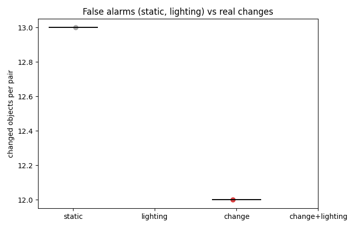
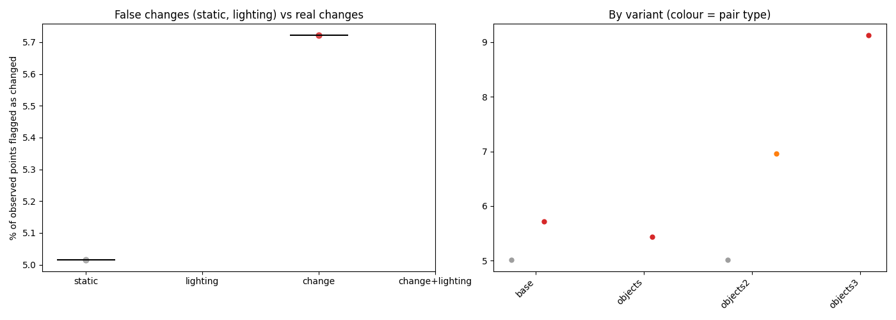

# Summary of 2026-10-11_scene01-objects-fixed

6 finished steps.
Lighting (dark vs light) comparison: [lighting.md](lighting.md)

## Headline: changed objects by pair type (SAM 2 objects, base settings)

| Pair type | Pairs | Changed objects, median (range) | Share of compared objects | Moved / added / removed / in place / shifted (total) |
|---|---|---|---|---|
| static | 1 | 13 (13-13) | 33% | 0 / 10 / 2 / 0 / 1 |
| change | 1 | 12 (12-12) | 39% | 1 / 8 / 2 / 0 / 1 |

**Separation: AUROC 0.00** (chance of a real-change pair having more changed objects than a no-change pair; 1.0 = perfect, 0.5 = no better than chance; 1 vs 1 pairs).

Most frequent changes on real-change pairs (label, status: pairs):

skirting board shifted: 2, baseball cap moved: 2, skirting board added: 2, wooden crate shifted: 1, neck pillow removed: 1, cup shifted: 1, ball removed: 1, wooden panel added: 1, table tennis bat added: 1, coaster added: 1, cup added: 1, guitar shifted: 1, sofa added: 1, poster added: 1

## Point-level changed fraction by pair type (base settings)

| Pair type | Steps | Median % changed | Range |
|---|---|---|---|
| static | 1 | 5.01 | 5.01 to 5.01 |
| change | 1 | 5.72 | 5.72 to 5.72 |

Static and lighting pairs have no real change, so their numbers are the false-change rate. A working detector shows change pairs clearly above both.

## All steps

| Step | Type | A vs B | Frames/video | Variant | % changed | Align resid (x/within) | Changes (mv/rm/add/app) | Recon s |
|---|---|---|---|---|---|---|---|---|
| [1-main_moved_light-before-a_vs_light-after-a](1-main_moved_light-before-a_vs_light-after-a/report.md) | change | scene01_light_before_a vs scene01_light_after_a | 364 | base | 5.72 | 0.0984/0.0785 | 0/2/8/5 | 607.2 |
| [1-main_no-change_light-before-a_vs_light-before-b](1-main_no-change_light-before-a_vs_light-before-b/report.md) | static | scene01_light_before_a vs scene01_light_before_b | 364 | base | 5.01 | 0.0864/0.0751 | 0/2/10/1 | 454.6 |
| [1c-objects_moved_light-before-a_vs_light-after-a](1c-objects_moved_light-before-a_vs_light-after-a/report.md) | change | scene01_light_before_a vs scene01_light_after_a | 364 | objects | 5.44 | 0.1038/0.0835 | 0/3/6/2 | 468.4 |
| [1d-objects_moved-and-light-changed_dark-before-a_vs_light-after-a](1d-objects_moved-and-light-changed_dark-before-a_vs_light-after-a/report.md) | change+lighting | scene01_dark_before_a vs scene01_light_after_a | 382 | objects2 | 6.96 | 0.1051/0.0785 | 1/0/3/2 | 652.2 |
| [1d-objects_no-change_dark-before-a_vs_dark-before-b](1d-objects_no-change_dark-before-a_vs_dark-before-b/report.md) | static | scene01_dark_before_a vs scene01_dark_before_b | 382 | objects2 | 5.01 | 0.0948/0.0814 | 0/1/2/3 | 467.5 |
| [1e-changes_moved_light-before-a_vs_light-after-a](1e-changes_moved_light-before-a_vs_light-after-a/report.md) | change | scene01_light_before_a vs scene01_light_after_a | 364 | objects3 | 9.13 | 0.1281/0.0896 | 1/1/4/2 | 426.8 |

## Detected changes (base settings)

**1-main_moved_light-before-a_vs_light-after-a** (change)
- The wooden crate's surface moved by about 24 cm (squashed, pushed or deformed). Its centre is known to within about 0 cm (90%, from 9 views; one view alone: 1 cm). Matched feature points: moved 26 cm (90%: 14-44 cm), turned 62 deg. Its shape changed: up to 61.9 cm beyond its rigid motion, towards one end (100% of it).
- The skirting board's surface moved by about 29 cm (squashed, pushed or deformed). Its centre is known to within about 0 cm (90%, from 5 views; one view alone: 2 cm).
- A neck pillow that was there before is no longer there. Its centre is known to within about 0 cm (90%, from 12 views; one view alone: 1 cm). Matched feature points: moved 8 cm (90%: 6-22 cm), turned 20 deg.
- The baseball cap moved to the left and towards the camera by about 42 cm (90% interval 37 to 47). Its centre is known to within about 0 cm (90%, from 9 views; one view alone: 1 cm).
- The skirting board's surface moved by about 25 cm (squashed, pushed or deformed). Its centre is known to within about 0 cm (90%, from 7 views; one view alone: 1 cm).
- The cup's surface moved by about 21 cm (squashed, pushed or deformed). Its centre is known to within about 0 cm (90%, from 11 views; one view alone: 1 cm).
- A ball that was there before is no longer there. Its centre is known to within about 0 cm (90%, from 10 views; one view alone: 1 cm).
- A skirting board is there now that was not there before. Its centre is known to within about 0 cm (90%, from 15 views; one view alone: 1 cm).

**1-main_no-change_light-before-a_vs_light-before-b** (static)
- A ball that was there before is no longer there. Its centre is known to within about 0 cm (90%, from 10 views; one view alone: 1 cm). It is on top of the cushion and next to the cushion, the cushion, the cushion.
- A table tennis bat that was there before is no longer there. Its centre is known to within about 0 cm (90%, from 1 views; one view alone: 0 cm). It is on top of the sofa and next to the baseball cap, the sofa, the skirting board.
- A table tennis bat is there now that was not there before. Its centre is known to within about 0 cm (90%, from 17 views; one view alone: 1 cm). It is on top of the cushion and next to the guitar, the neck pillow, the paper bag. Resting on it: the blanket, the cup.
- A glass vase is there now that was not there before. Its centre is known to within about 0 cm (90%, from 8 views; one view alone: 1 cm). It is on top of the book and next to the cup, the soft toy, the chair. Resting on it: the paper bag, the cup.
- A skirting board is there now that was not there before. Its centre is known to within about 0 cm (90%, from 4 views; one view alone: 1 cm). It is next to the rug, the rug, the sunglasses. Resting on it: the table tennis bat.
- A table tennis bat is there now that was not there before. Its centre is known to within about 1 cm (90%, from 2 views; one view alone: 1 cm). It is next to the shelf, the table tennis bat, the side table.
- A table tennis bat is there now that was not there before. Its centre is known to within about 0 cm (90%, from 3 views; one view alone: 1 cm). It is next to the shelf, the table tennis bat, the side table.
- A sock is there now that was not there before. Its centre is known to within about 0 cm (90%, from 1 views; one view alone: 0 cm). It is next to the book, the rug, the skirting board.

## Heat maps

Each step's `heatmaps.png` shows the maps; `viewer.html` has them as 3D layers.

| Step | Variant | Robot (reach m / mount m / base offset m) | Scale m/unit | Uncertainty cm (median / p90) | Shift cm p99 | Reachable | Approachable | Interactable |
|---|---|---|---|---|---|---|---|---|
| [1-main_moved_light-before-a_vs_light-after-a](1-main_moved_light-before-a_vs_light-after-a/heatmaps.png) | base | 1.0 / 0.75 / 0.0 | 2.0479 | 7.456 / 16.46 | 37.966 | 79% | 5% | 0% |
| [1-main_no-change_light-before-a_vs_light-before-b](1-main_no-change_light-before-a_vs_light-before-b/heatmaps.png) | base | 1.0 / 0.75 / 0.0 | 1.9 | 8.04 / 16.369 | 32.059 | 82% | 5% | 0% |
| [1c-objects_moved_light-before-a_vs_light-after-a](1c-objects_moved_light-before-a_vs_light-after-a/heatmaps.png) | objects | 1.0 / 0.75 / 0.0 | 1.9208 | 7.035 / 15.857 | 37.524 | 82% | 5% | 0% |
| [1d-objects_moved-and-light-changed_dark-before-a_vs_light-after-a](1d-objects_moved-and-light-changed_dark-before-a_vs_light-after-a/heatmaps.png) | objects2 | 0.85 / 0.75 / 0.0 | 2.502 | 9.743 / 20.608 | 40.044 | 17% | 2% | 0% |
| [1d-objects_no-change_dark-before-a_vs_dark-before-b](1d-objects_no-change_dark-before-a_vs_dark-before-b/heatmaps.png) | objects2 | 0.85 / 0.75 / 0.0 | 2.2399 | 8.73 / 15.737 | 41.41 | 57% | 3% | 0% |
| [1e-changes_moved_light-before-a_vs_light-after-a](1e-changes_moved_light-before-a_vs_light-after-a/heatmaps.png) | objects3 | 0.85 / 0.75 / 0.0 | 2.3169 | 8.039 / 17.134 | 44.885 | 61% | 4% | 0% |

