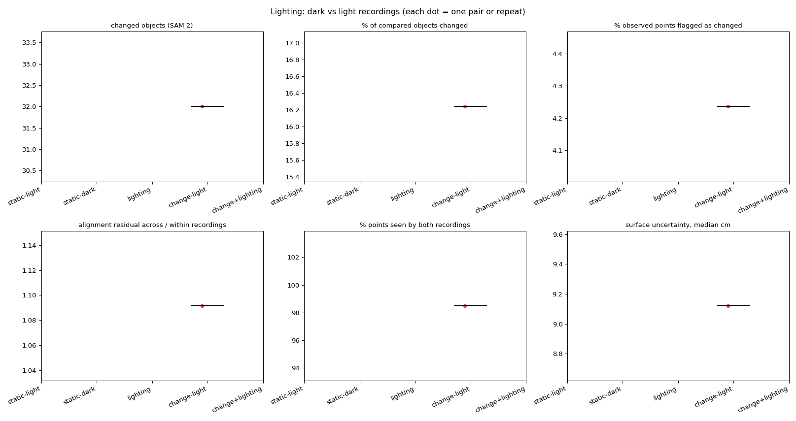

# Lighting comparison

| Group | Pairs | changed objects (SAM 2) | % of compared objects changed | % observed points flagged as changed | alignment residual across / within recordings | % points seen by both recordings | surface uncertainty, median cm |
|---|---|---|---|---|---|---|---|
| change-light | 1 | 32.00 (32.00-32.00) | 16.24 (16.24-16.24) | 4.24 (4.24-4.24) | 1.09 (1.09-1.09) | 98.50 (98.50-98.50) | 9.12 (9.12-9.12) |

Median (range). **lighting** vs **static-light/static-dark** isolates what the lighting change alone flags as change; **change+lighting** vs **change-light** shows how much the real changes survive it.

## Same changes found through a lighting change?

For each after recording: changes found from a light 'before' vs from a dark 'before' (base settings, first frame pick). Labels exclude background classes.

| After | Light-before pair: changes / labels | Dark-before pair: changes / labels | Shared labels | Label overlap (Jaccard) |
|---|---|---|---|---|

Ablation `no_appearance` (in the main summary) shows whether appearance features are what lighting trips; geometry-only detection should be nearly lighting-invariant.
