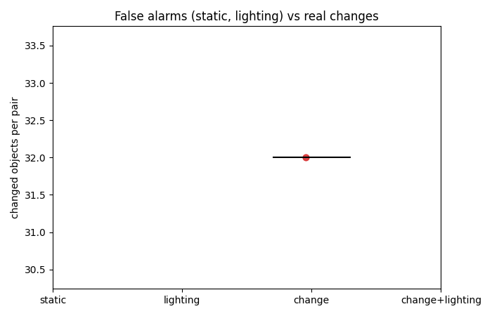
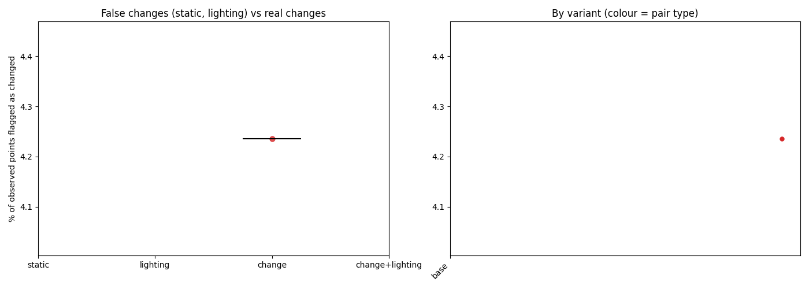

# Summary of 2026-10-11_scene01-objects-fixed

1 finished steps.
Lighting (dark vs light) comparison: [lighting.md](lighting.md)

## Headline: changed objects by pair type (SAM 2 objects, base settings)

| Pair type | Pairs | Changed objects, median (range) | Share of compared objects | Moved / added / removed / in place / shifted (total) |
|---|---|---|---|---|
| change | 1 | 32 (32-32) | 16% | 3 / 16 / 10 / 0 / 3 |

Most frequent changes on real-change pairs (label, status: pairs):

baseball cap moved: 6, guitar removed: 3, table tennis bat added: 3, skirting board shifted: 2, skirting board removed: 2, neck pillow added: 2, cushion added: 2, skirting board added: 2, jumper removed: 1, paper bag removed: 1, cup removed: 1, cushion removed: 1, phone removed: 1, coaster shifted: 1, wooden panel added: 1

## Point-level changed fraction by pair type (base settings)

| Pair type | Steps | Median % changed | Range |
|---|---|---|---|
| change | 1 | 4.24 | 4.24 to 4.24 |

Static and lighting pairs have no real change, so their numbers are the false-change rate. A working detector shows change pairs clearly above both.

## All steps

| Step | Type | A vs B | Frames/video | Variant | % changed | Align resid (x/within) | Changes (mv/rm/add/app) | Recon s |
|---|---|---|---|---|---|---|---|---|
| [1-main_moved_light-before-a_vs_light-after-a](1-main_moved_light-before-a_vs_light-after-a/report.md) | change | scene01_light_before_a vs scene01_light_after_a | 364 | base | 4.24 | 0.0322/0.0295 | 1/10/16/5 | 584.8 |

## Detected changes (base settings)

**1-main_moved_light-before-a_vs_light-after-a** (change)
- The baseball cap moved to the left by about 43 cm (90% interval 37 to 49). Its centre is known to within about 0 cm (90%, from 5 views; one view alone: 0 cm).
- A guitar that was there before is no longer there. Its centre is known to within about 1 cm (90%, from 3 views; one view alone: 3 cm).
- A guitar that was there before is no longer there. Its centre is known to within about 9 cm (90%, from 1 views; one view alone: 9 cm).
- The baseball cap moved to the left by about 48 cm (90% interval 42 to 56). Its centre is known to within about 0 cm (90%, from 1 views; one view alone: 0 cm).
- A jumper that was there before is no longer there. Its centre is known to within about 0 cm (90%, from 1 views; one view alone: 0 cm).
- A guitar that was there before is no longer there. Its centre is known to within about 0 cm (90%, from 2 views; one view alone: 1 cm).
- The baseball cap moved to the left by about 79 cm (90% interval 69 to 90). Its centre is known to within about 0 cm (90%, from 1 views; one view alone: 0 cm).
- A paper bag that was there before is no longer there. Its centre is known to within about 0 cm (90%, from 1 views; one view alone: 0 cm).

## Heat maps

Each step's `heatmaps.png` shows the maps; `viewer.html` has them as 3D layers.

| Step | Variant | Robot (reach m / mount m / base offset m) | Scale m/unit | Uncertainty cm (median / p90) | Shift cm p99 | Reachable | Approachable | Interactable |
|---|---|---|---|---|---|---|---|---|
| [1-main_moved_light-before-a_vs_light-after-a](1-main_moved_light-before-a_vs_light-after-a/heatmaps.png) | base | 1.0 / 0.75 / 0.0 | 3.0241 | 9.121 / 25.259 | 31.945 | 55% | 12% | 0% |

