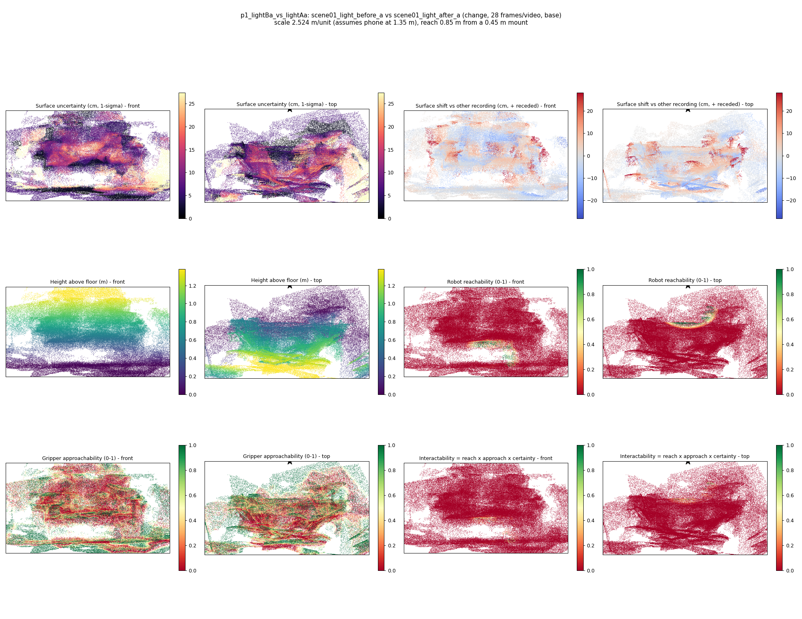
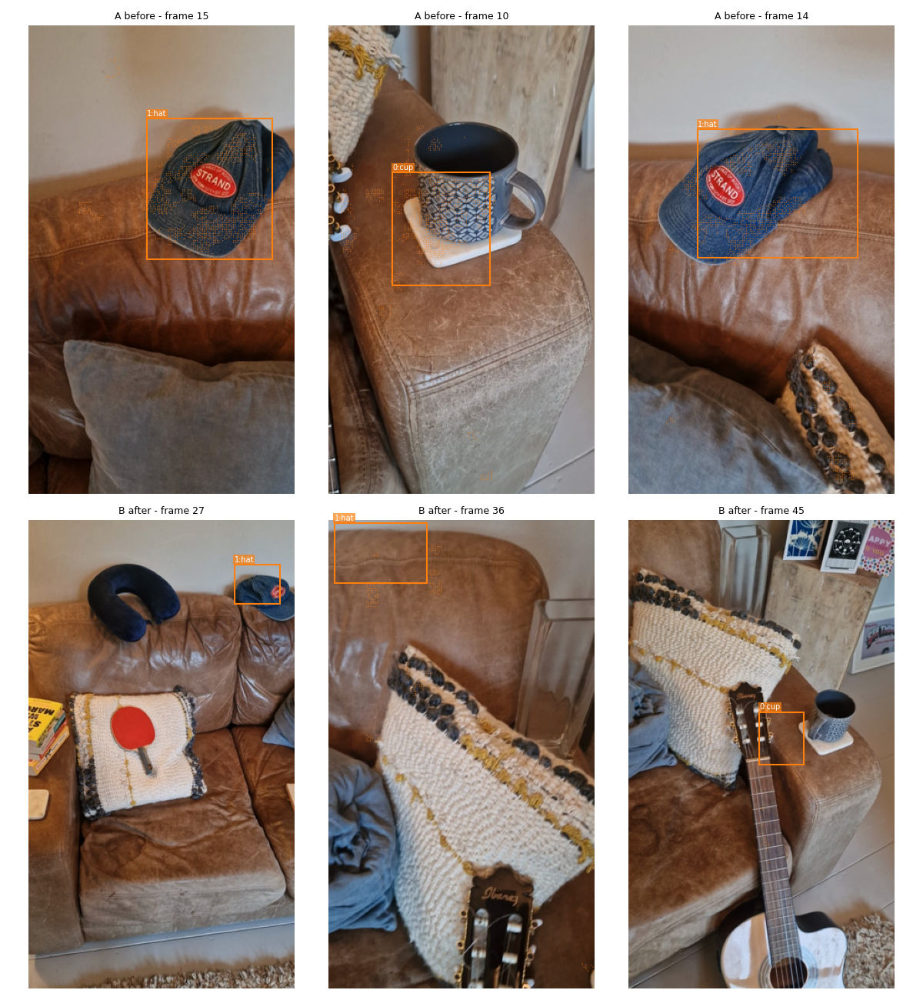

# UncertainScene results: scene01

One file for every run so far. The block under *Findings so far* is written by hand; everything below it is regenerated from the run folders (`python -m uncertainscene.eval.collate results/change`).

**Interactive viewer** (3D scene, heat maps, object boundaries, per-pair findings): https://claude.ai/artifact/7Ys2rRdQCHmw1cEJZeZjSy

<!-- notes -->
## Findings so far

Last updated 2026-10-10. No answer key yet, so nothing below is scored against ground truth; no-change pairs (static, lighting only) give the false-change rate.

**Version 1 (run `2026-10-10_scene01-heatmaps`, 28 frames per recording, point-level).**

1. It cannot tell change from noise yet. No-change pairs flag about as much of the scene (2.2%) as real-change pairs (2.3%).
2. Of the changes visible in the light pairs it finds the hat and cup (`a` takes) and the glass vase, table tennis bat and cap (`b` takes). It misses the guitar, neck pillow and book stack.
3. Labels are per changed cluster only (CLIP on a crop), so most objects in the scene have no label, and some clusters get nonsense labels (e.g. "sofa removed").
4. Dark recordings are about twice as noisy as light ones (median surface uncertainty 21 vs 10 cm). Lighting alone does not add false changes.
5. Floor and scale failed in the dark pairs (259 and 69 m per unit, uncertainty in metres), so heights, reachability and sizes there are meaningless. In light pairs scale is plausible (2.2-2.5 m per unit) but reachable share is 1-14%.
6. Cause: the change threshold comes from how much one recording disagrees with itself (about 13 cm at 28 frames), so thin objects fall under it, and the floor fit used too few points.

**Version 2 (run `2026-10-10_scene01-objects`, pushed, not run yet).** All ~185 frames per recording via chunked reconstruction, floor and scale from gravity plus phone height plus known object sizes, SAM 2 segmentation of every object with CLIP labels and an inventory per recording, object-level moved/added/removed tests. Results and object boundaries appear in this file and the viewer once it runs.
<!-- /notes -->

## Run `2026-10-10_scene01-heatmaps` (version 1: point-level, 28 frames per recording)

163 finished steps. Folder: [2026-10-10_scene01-heatmaps](2026-10-10_scene01-heatmaps/).

### Point-level changed share by pair type

| Pair type | Pairs | Median | Range |
|---|---|---|---|
| static | 5 | 2.17% | 1.82% to 2.44% |
| lighting | 6 | 2.24% | 1.81% to 3.13% |
| change | 4 | 2.29% | 1.16% to 3.07% |
| change+lighting | 6 | 2.87% | 1.59% to 3.90% |

### Main pairs

| Pair | Type | Changes found | Scale (m/unit) | Surface uncertainty (cm) | Reachable | Figures |
|---|---|---|---|---|---|---|
| p1_darkBa_vs_darkBb | static | blanket added, towel appearance, stack of books removed, blanket appearance | 259.440 | 534.1 | 0% | [heatmaps](2026-10-10_scene01-heatmaps/p1_darkBa_vs_darkBb/heatmaps.png) · [overlays](2026-10-10_scene01-heatmaps/p1_darkBa_vs_darkBb/overlays.png) · [scene_report](2026-10-10_scene01-heatmaps/p1_darkBa_vs_darkBb/scene_report.md) |
| p1_darkBa_vs_lightAa | change+lighting | keys added, coaster removed, towel removed, jacket appearance | 68.742 | 172.5 | 0% | [heatmaps](2026-10-10_scene01-heatmaps/p1_darkBa_vs_lightAa/heatmaps.png) · [overlays](2026-10-10_scene01-heatmaps/p1_darkBa_vs_lightAa/overlays.png) · [scene_report](2026-10-10_scene01-heatmaps/p1_darkBa_vs_lightAa/scene_report.md) |
| p1_darkBa_vs_lightBa | lighting | cushion added, towel removed, baseball cap appearance | 5.959 | 11.3 | 0% | [heatmaps](2026-10-10_scene01-heatmaps/p1_darkBa_vs_lightBa/heatmaps.png) · [overlays](2026-10-10_scene01-heatmaps/p1_darkBa_vs_lightBa/overlays.png) · [scene_report](2026-10-10_scene01-heatmaps/p1_darkBa_vs_lightBa/scene_report.md) |
| p1_lightBa_vs_lightAa | change | hat appearance, cup appearance | 2.524 | 6.2 | 1% | [heatmaps](2026-10-10_scene01-heatmaps/p1_lightBa_vs_lightAa/heatmaps.png) · [overlays](2026-10-10_scene01-heatmaps/p1_lightBa_vs_lightAa/overlays.png) · [scene_report](2026-10-10_scene01-heatmaps/p1_lightBa_vs_lightAa/scene_report.md) |
| p1_lightBa_vs_lightBb | static | hat appearance, guitar removed | 2.459 | 5.9 | 14% | [heatmaps](2026-10-10_scene01-heatmaps/p1_lightBa_vs_lightBb/heatmaps.png) · [overlays](2026-10-10_scene01-heatmaps/p1_lightBa_vs_lightBb/overlays.png) · [scene_report](2026-10-10_scene01-heatmaps/p1_lightBa_vs_lightBb/scene_report.md) |
| p1_lightBb_vs_lightAb | change | sofa removed, baseball cap removed, table tennis bat appearance, glass vase appearance, rug added | 2.152 | 7.2 | 12% | [heatmaps](2026-10-10_scene01-heatmaps/p1_lightBb_vs_lightAb/heatmaps.png) · [overlays](2026-10-10_scene01-heatmaps/p1_lightBb_vs_lightAb/overlays.png) · [scene_report](2026-10-10_scene01-heatmaps/p1_lightBb_vs_lightAb/scene_report.md) |

### Light vs dark

| Group | Pairs | % observed points flagged as changed | % flagged as appearance change | alignment residual across / within recordings | % points seen by both recordings | surface uncertainty, median cm | change objects found |
|---|---|---|---|---|---|---|---|
| static-light | 11 | 2.04 (0.73-2.49) | 1.17 (0.73-1.27) | 1.07 (0.99-1.09) | 86.69 (85.56-86.95) | 9.79 (5.92-11.44) | 2.00 (0.00-4.00) |
| static-dark | 19 | 2.44 (1.22-3.18) | 1.31 (0.61-2.24) | 1.04 (0.93-1.10) | 86.83 (84.97-90.00) | 21.41 (9.62-534.08) | 4.00 (0.00-6.00) |
| lighting | 36 | 1.84 (0.70-3.13) | 1.15 (0.70-1.52) | 1.02 (0.99-1.10) | 86.66 (81.53-90.64) | 14.67 (4.40-32.31) | 1.00 (0.00-7.00) |
| change-light | 29 | 2.44 (0.97-4.47) | 1.28 (0.92-2.35) | 1.07 (0.96-1.18) | 85.66 (82.70-88.63) | 7.39 (5.20-29.97) | 2.00 (0.00-6.00) |
| change+lighting | 36 | 2.47 (1.08-3.90) | 1.64 (0.79-3.06) | 1.04 (0.95-1.13) | 84.36 (80.29-88.53) | 16.68 (5.93-1154.60) | 3.00 (0.00-8.00) |

Full lighting report: [2026-10-10_scene01-heatmaps/summary_session_colab-dbb8/lighting.md](2026-10-10_scene01-heatmaps/summary_session_colab-dbb8/lighting.md)

### Example: p1_lightBa_vs_lightAa

